# **SQUAD GENERATION TABLES**

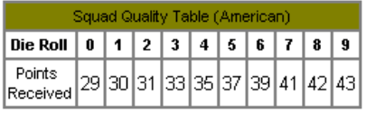

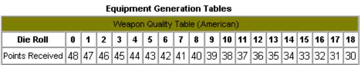

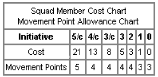

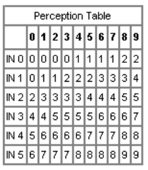

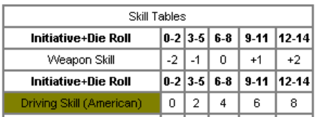

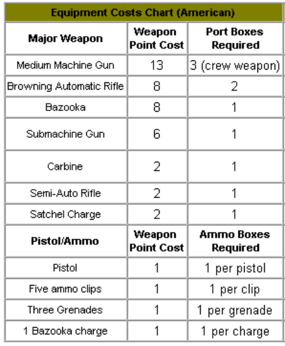

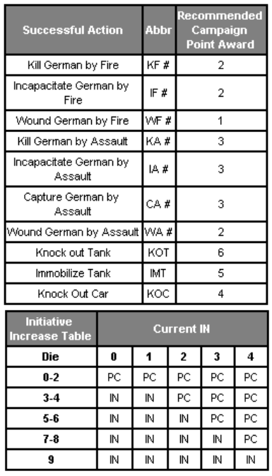

# **Weapon Type Chart**

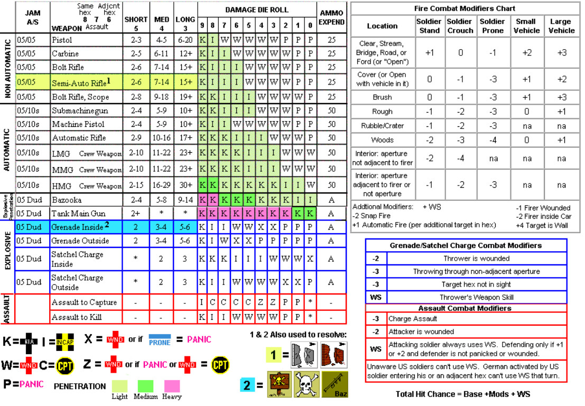

# **Grenade Scatter Diagrams**

Use A unless LOS from throwers hex to target hex _exactly_
bisects the two hexes adjacent to target hex then use B.

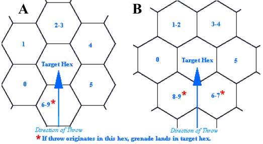

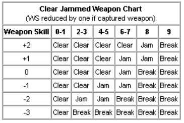

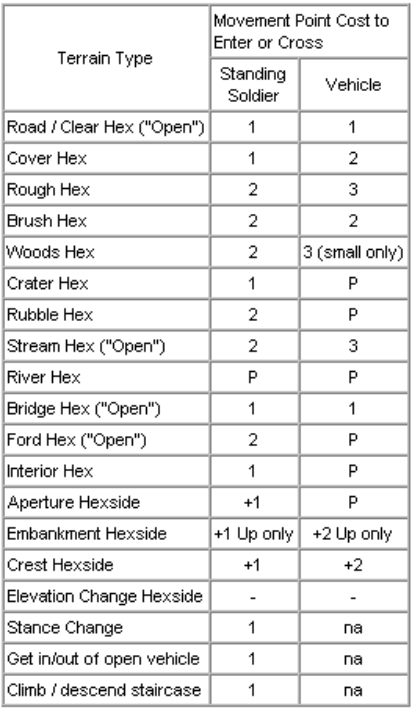

# **VEHICLE CHARTS**

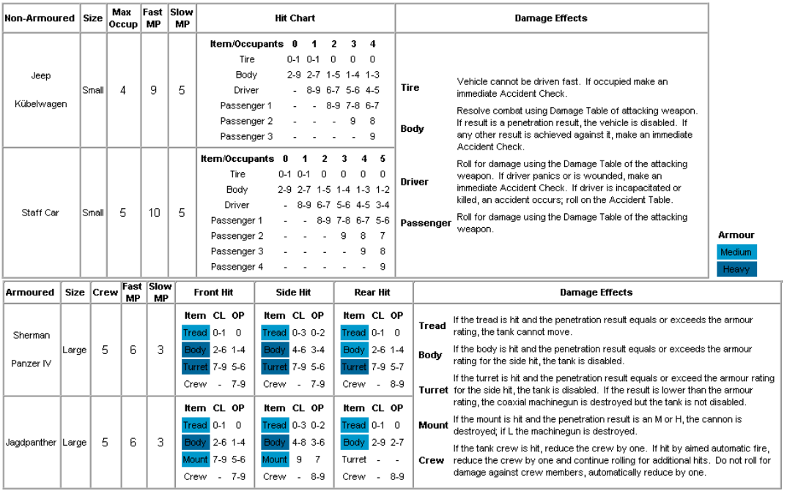

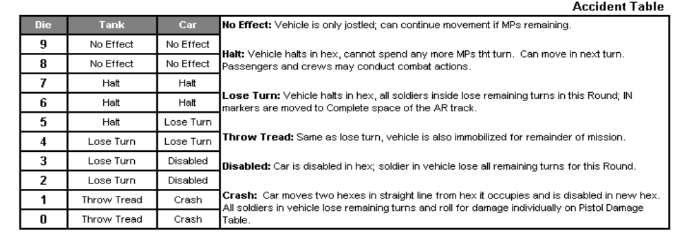

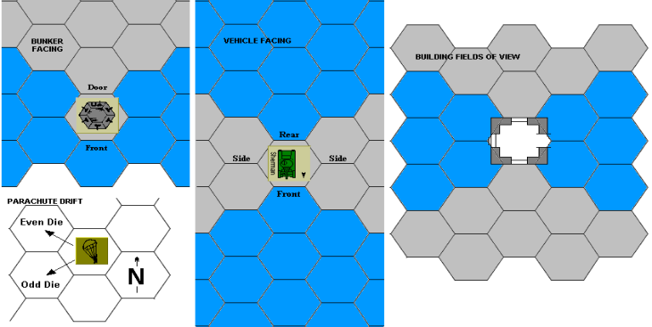
