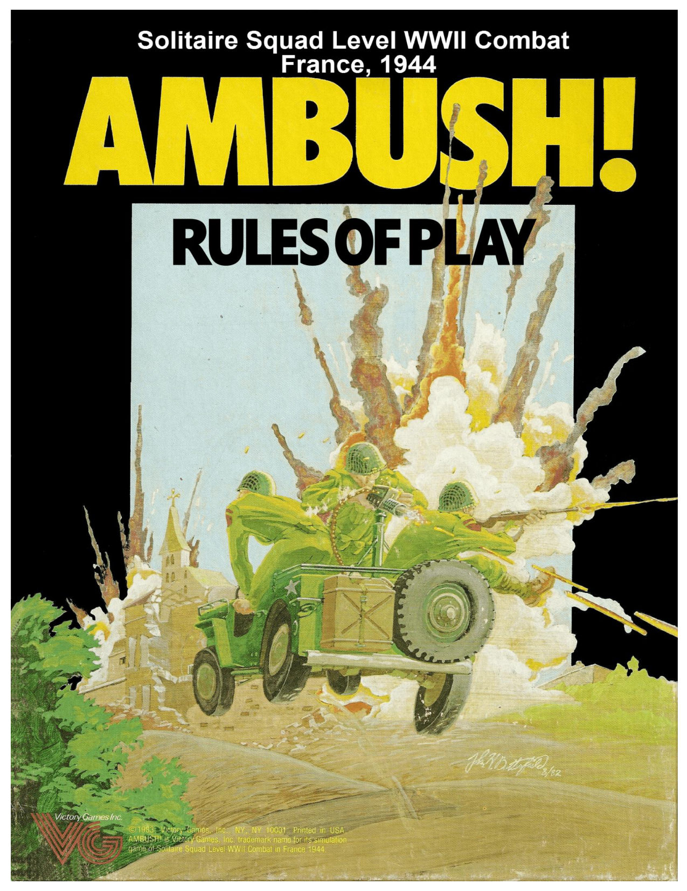

_**AMBUSH! RULES: PAGE 1**_

{COVER PHOTO HERE}

_**AMBUSH! RULES: PAGE 2**_

**1. Introduction ................................................... 3**

**2. Game Parts and Terms ................................. 3**

2/1 German Soldier Cards .............................................. 3
2/2 View Sleeve and Mission Cards .............................. 3
2/3 The Mission Maps ................................................... 4
2/4 The Playing Pieces ................................................... 4
2/5 The Squad Record .................................................... 5
2/6 US Soldier Cards ..................................................... 6
2/7 Paragraph Booklet.................................................... 6
2/8 Chart Reference Screen ........................................... 6
2/9 Two Ten-Sided Dice ................................................ 6
2/10 Soldier Characteristics ........................................... 6
2/11 Terms Used During Play ........................................ 6

**3. Course of Play ............................................... 8**

3/1 General Course of Play ............................................ 8
3/2 Play Outline ............................................................. 8

**4. Squad Generation ......................................... 8**

**5. Operations ..................................................... 9**

5/1 Paragraph Checks .................................................... 9
5/2 Soldier Stances ......................................................... 9
5/3 Actions During Operations ...................................... 9
5/4 Sightings ................................................................ 10
5/5 Conditions .............................................................. 10
5/6 Event Checks ......................................................... 10
5/7 Perception Checks.................................................. 10
5/8 Activation Checks .................................................. 11
5/9 Random Determination .......................................... 11

**6. Action Rounds ............................................. 11**

6/1 Action Sequence .................................................... 11
6/2 Activating German Soldiers ................................... 12
6/3 Command and Commanders .................................. 12
6/4 Panic ...................................................................... 13
6/5 US Soldier Awareness ........................................... 13
6/6 German Activation During Rounds ....................... 13
6/7 Performing Actions During Rounds ...................... 14
6/8 German Actions ..................................................... 14
6/9 German Action Paragraph Examples ..................... 15
6/10 German Activation When US Soldiers
Have Yet to Enter ........................................................ 16
6/11 Condition Changes During Rounds ..................... 16

**7. Movement .................................................... 16**

7/1 General Rules for Movement ................................. 16
7/2 Movement During Operations ............................... 16
7/3 Movement During Rounds ..................................... 16
7/4 German Evasive Movement ................................... 17

**8. Line of Sight ................................................ 17**

8/1 Tracing a Line of Sight .......................................... 17
8/2 Blocking Terrain .................................................... 17
8/3 LOS Problems ........................................................ 18

**9. Fire Combat ................................................. 20**

9/1 Fire Combat Procedure .......................................... 20
9/2 Multiple Fire Targets ............................................. 21
9/3 Fire Shifts............................................................... 21
9/4 Weapon Jamming and Clearing ............................. 21
9/5 Ammo Expenditure ................................................ 21
9/6 German Fire Combat Terms .................................. 22
9/7 Crew Weapons ....................................................... 22
9/8 Bazookas ................................................................ 22
9/9 German Attacks on Buildings (OPTIONAL) ........ 22

**10. Grenade/Satchel Charge Combat ............. 23**

10/1 Grenade/Satchel Charge Combat Procedure ........ 23
10/2 Grenade Strike PC Check .................................... 23
10/3 Grenade Scatter .................................................... 23
10/4 Satchel Charges .................................................... 24

**11. Assault Combat ......................................... 24**

11/1 Assault Combat Procedure ................................... 24
11/2 Capture ................................................................. 25
11/3 Charge Assault ..................................................... 25
11/4 Assault Modifiers ................................................. 25

**12. Minefields and Boobytraps ....................... 25**

12/1 Boobytrap Procedure ........................................... 25
12/2 Minefield Procedure ............................................. 25

**13. Damage ...................................................... 26**

13/1 Panic Results ........................................................ 26
13/2 Wound Results ..................................................... 26
13/3 Incapacitation Results .......................................... 26
13/4 Kill Results .......................................................... 26
13/5 Penetration Results ............................................... 26
13/6 Aimed Automatic Weapon Damage .................... 27

**14. Captured Equipment ................................. 27**

**15. Victory ....................................................... 27**

**Mission 1: Bloody St. Mick ............................. 28**

**16. Campaign ................................................... 28**

16/1 Campaign Procedure ............................................ 28
16/2 Combat Point Awards .......................................... 28
16/3 Improving Soldier Characteristics ........................ 29
16/4 Replacements ....................................................... 29

**17. Vehicles ..................................................... 29**

17/1 Vehicle Attributes ................................................ 30
17/2 Vehicle Facing ..................................................... 30
17/3 Vehicle Movement During Operations ................ 30
17/4 Vehicle Movement During Rounds ..................... 30
17/5 Drivers, Passengers, and Crew ............................. 31
17/6 Fire Combat Against Vehicles ............................. 31
17/7 Vehicle Fire Combat ............................................ 31
17/8 German Vehicle Paragraphs ................................. 32
17/9 Accident Checks .................................................. 32
17/10 Vehicles, Minefields, and Boobytraps ............... 32
17/11 Grenades and Satchel Charges ........................... 32
17/12 Running Over Soldiers ....................................... 33
17/13 Tanks .................................................................. 33

**Mission 2: Advance on Chasoul .................... 34**

**Mission 3: A Cold Morning in Belgium .......... 34**

**Mission 4: D-Day Night Drop to Destiny ........ 34**

**Mission 5: Operation Pickpocket ................... 36**

**Mission 6: Pleasure Boating to the**

**West Wall ...................................... 37**

**Mission 7: Bait for the Trap ............................ 38**

**Mission 8: Dash for the Sambre ..................... 39**

**VEHICLE SUMMARY ....................................... 40**

_**AMBUSH! RULES: PAGE 3**_

# **1. Introduction**

_**Ambush!**_ is a tactical level solitaire game of man-to-man
combat on the western front in World War II. It depicts small
unit actions in great detail and, for the most part, accurately.
However, it should be understood that more happens in a single _**Ambush!**_ mission than an average soldier encountered in
an entire battle historically. Thus, you and your squad are an
elite group that gets into an extraordinary amount of combat
and adventure during your missions.

Since _**Ambush!**_ is a solitaire game, the presence of the
Germans is hidden from you until you discover them. Furthermore, you never know what the Germans will do until their
intentions are revealed during play. We have attempted to encrypt the German moves and strategies as best we could. However, the German actions and hidden intelligence procedures
we use are simple and can be easily uncovered. We highly
recommend that you not break them, because one of the main
pleasures of this game is being surprised during play by the
things the Germans do. The reason for the game’s title will
become obvious in very short order.

It is possible to play _**Ambush!**_ with two players. In fact,
the game can be particularly fun when played this way. The
best two-player game is to divide your squad into two groups
of four soldiers each. Each player should receive at least one
commander. Equipment should be split evenly between the
two half-squads as best as you can. The game is then played as
usual with the two of you playing cooperatively, rather than
competitively. It is especially fun if you limit conversation
between yourselves. For instance, you can talk about strategy
and possible moves only when you each have a soldier – preferably the commander – within earshot (two hexes) of each

# **2. Game Parts and Terms**

Some of the terms and ideas mentioned in the following
rules will not make much sense until you have read the rest of
the rules. Simply refer back to this section later, once you have
finished reading the rules.

**2/1 German Soldier Cards**

Every German soldier or vehicle that might appear in any
of the missions has its own card listing its characteristics and
possible actions. When a German soldier is activated, pull his
card from the deck and place it in front of you for easy reference. Keep the card there until the German becomes inactive
due to being killed or incapacitated or because he has exited
the map.

**Number.** The number identifies each character and vehicle
card individually.
**Identity Letter.** A letter from L through Z (omitting O) that
matches a soldier or vehicle counter to show the German on
the map. Each letter appears on more than one card, but only
appears on one card used per mission.

other. You can play semi-competitively by keeping track of the
VPs each of your half squads earn separately and comparing
your totals at the end of the mission. You can also use these
same ideas to play the game with three or more players. Experiment, because _**Ambush!**_ is flexible enough to allow different
types of play.

Each _**Ambush!**_ mission can be played only once, because
after playing it you know its plot, characters, and mysteries.
However, we have found that if you return to a mission long
after you played it the first time, it has some replay value due
to the frailty of human memory. Do not depend on this, however, since you might just remember anyway. For these reasons, _**Ambush!**_ missions should be played carefully and savored for their flavor and uniqueness.

We hope you enjoy _**Ambush!**_ and that it provides you
with many evenings of enjoyment.

**GAMES QUESTIONS**

If you have questions about the rules, feel free to write to
us. When you do, please word your questions so that we can
respond with a simple one-word answer when possible, and
include a self-addressed, stamped envelope. This will ensure a
quick and precise answer to your questions. Mail them to:

_**Ambush!**_ Questions
Victory Games, Inc.
43 West 33rd Street, Suite 603
New York, NY 10001

**Type.** A word describing the German soldier’s primary role or
characteristic, such as officer, sniper, or driver.
**Activation Victory Point Award.** The number of Victory
Points you receive when the German is activated, regardless of
what happens later with that German.
**Conditional Victory Point Award.** The number of Victory
Points you receive if something specific happens to the German. Most Germans have no Conditional VP award.

**Weapons.** All the equipment the German is carrying. Each
German uses his equipment as directed in the paragraphs.

**Characteristics.** Each German is rated in four areas: Initiative,
Perception, Weapon Skill, and Movement Point Allowance.
Some Germans also have a Driving Skill rating. Some vehicles
have a range of ratings, depending on the current status of the
vehicle and crew. See paragraph **2/10** for explanations of each
characteristic.

**Action Table.** A matrix used to determine what actions a German soldier undertakes each time he gets a turn. Usually, the
result of a die roll is cross-referenced with the current Mission
Condition (a number from 1 to 6) to yield an Action Paragraph
describing the German’s maneuvers. Sometimes, however, a
Special Reaction or Self-Preservation (both indicated by letters) may be in effect for a German, in which case the die result is cross-reference with the appropriate letter column instead.

**Notes.** Many soldiers have instructions specifying what each
does when first activated or when other situations arise during
play. Read these notes carefully.

**2/2 View Sleeve and Mission Cards**

The Mission Cards represent, in a scrambled form, all the
paragraph references required to play each mission. The sleeve

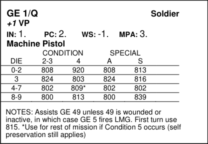
_**AMBUSH! RULES: PAGE 4**_

enables you to find those paragraphs you need without letting
you see what else the mission might have in store for you.
Each mission is played using two or three Mission Cards read
one at a time in the view sleeve. Each Mission Card is identified by Mission Number and Mission Condition Number. At
the start of a mission, place the Mission Condition 1 card for
that mission in the sleeve with the Condition 1 side facing the
slots. Refer to the sleeve/card each time a Paragraph Check is
triggered by a US soldier entering a hex, each time you conduct an Event Check, and each time you must move a German.

 When a US soldier enters a hex, look up the paragraph
number by aligning the hex number on the sleeve with the hex
letter on the card in the window. If a black paragraph number
appears in the slot above or below that number, look up the
paragraph in the Paragraph Booklet. If the number is preceded
by a Sighting Reference (sl, s2, etc.), and that sighting has occurred, do not look up the listed paragraph. In some slots, the
word Event appears instead of a paragraph number. This
means you must conduct an Event Check ( **5/6** ) if Operations
are underway. Event Checks are not triggered by Mission
Cards during Rounds.

 When an Event Check is rolled, line up the die result on the
sleeve with the RE (Random Event) column of the Mission
Card. If a paragraph number appears in the appropriate slot,
look it up in the Paragraph Booklet. However, if the number is
preceded by a Sighting Reference that has already occurred, do
not look up the listed paragraph.

 When you must move a German ( **6/8** ), locate the hex he
occupies by aligning the hex number on the sleeve with the
hex letter on the Mission Card. Read the red hex coordinate or
paragraph number that appears in the corresponding slot. If it
is a hex coordinate, move the German to that hex. If a paragraph number appears, look it up in the Paragraph Booklet to
determine how the German moves. In some cases, the word
Exit appears, which indicates that the German leaves the map.

As play of a mission proceeds, a paragraph may tell you to
put a new condition into effect. When this occurs, remove the
Mission Card from the sleeve and flip it over or replace it with
the Mission Card for the new condition.

**2/3 The Mission Maps**

Each mission is played on one of these two maps. Map A
shows farm country, with a raised road surrounded by hedges
and fields. Map B portrays a small village built around a crossroads and a railroad station nestled in a small valley. A hexagonal grid is superimposed over the terrain features to aid in the
placement of the playing pieces. Each hex has a letter-number
coordinate and represents an area 10 meters across. The terrain
symbology used on each map is identified in the Terrain Key.
More than one type of terrain is often depicted in a single hex
to give a more natural look. However, only one type is actually
used in game terms.

A hex containing any woods pattern is a woods hex
throughout (hex G-2, on Map B, for instance, is entirely a
woods hex). In the case of all other terrain types, a hex’s type
is determined by the terrain type filling the majority of the hex.

In addition to the playing area, each map has the following
tracks:

 The Action Round Track is used during Action Rounds to
show the status of each soldier in play. Each soldier has an
Action Round marker that is moved from space to space on the
track. An AR marker in the Inactive space indicates that the
soldier is killed, incapacitated, or captured. An AR marker in
the Unaware space indicates that the soldier is active, but does
not know what is going on around him. An AR marker in the
Complete space indicates that the soldier is active and aware,

but has no turns in the current Round. An AR marker in a Turn
space indicates that the soldier can take one or two Turns in
the current Round. AR markers are placed in Turn spaces in
either the Advantage or Disadvantage half of the Turn, depending on which side has the advantage for this Round.

 The German Action Track shows the current German Action die result during Action Rounds. Each time a new German
Action number is rolled, move the German Action marker to
the matching space on the track as a reminder.

**2/4 The Playing Pieces**

Many of the 218 playing pieces represent US and German
soldiers, vehicles, and special equipment, and special terrain
features. The rest of the pieces are markers, used to note the
status of your soldiers and the enemy.

US and German soldiers are placed on the map as each enters
play. The US soldiers are identified by a silhouette and by the
letters A through K (omitting I). Soldiers A through H make
up your squad; US soldiers J and K may be encountered during
a mission. German soldiers are identified by a silhouette and
by the letters L through X (omitting O). Each soldier is shown
in two stances: standing on the front, and crouching on the
back. The prone stance is indicated by placing a prone marker
atop the soldier.

**Action Round Markers.** Each US soldier
has several AR markers with his identity
number, showing different Initiative Ratings (one per side). At the start of a mission, the AR marker with an IN matching the soldier’s is
placed on the AR Track and is used to note the soldier’s status
during Action Rounds. The soldier’s other AR markers are not
used. Every German soldier has one AR marker that is placed
on the AR Track, with his IN showing, when that soldier is
activated.

**Heavy Weapons** are placed on the map
to show those weapons that are too large
to be carried by one soldier or that must
be prepared before use. These include
US medium machineguns, heavy machineguns, bazookas, and
German light, medium, and heavy machineguns. Each weapon
is shown prepared for fire on one side and unprepared on the
other.

**Personal Weapons** are not usually represented by markers on the map, but instead
are recorded on the Squad Record or
German Soldier Cards. Personal weapon
markers are placed on the map only when a weapon is dropped
in a hex or becomes jammed. Each weapon is shown in operating condition on one side, and jammed on the other.

**Radios** can be carried and used by certain US and
German soldiers.

**Satchel Charges** can be carried and
used by certain US soldiers. Each satchel
charge is shown prepared for throwing
on one side and unprepared on the other.

**Minefield/Boobytrap.** Placed in a
hex with the proper side up when the
presence of a minefield or boobytrap
is revealed by a paragraph.

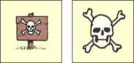
_**AMBUSH! RULES: PAGE 5**_

**German Action Number.** Placed and moved on the
German Action Track as a reminder of the current
German Action Number during Action Rounds.

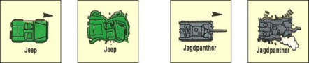

**Vehicles** are used in some of the missions by your squad or by
the Germans. The only US vehicles available are jeeps and
tanks. German vehicles include a scout car (Kubelwagen), an
armored staff car, a tank destroyer (Jagdpanther), and a tank
(Panzer IV). Each German vehicle has an identity letter (Y or
Z). Each vehicle is shown operational on the front and disabled
on the back. The operational side of each vehicle has an arrow
to show the direction that the vehicle is moving.

**Blast, Crater, Rubble,**
**Burning** **Building.**
Placed in a hex to show

the effects of an artillery
strike or other large ex
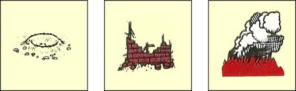
plosion. Any non-building hex hit by artillery becomes a blast
crater. A building hex hit by artillery becomes a rubble hex. A
building hex with combustibles in it that is hit by artillery becomes a burning building and may not be entered. Blast crater
counters have rubble or burning buildings on their backs.

**Fords** are placed in stream hexes to show that
the water may be crossed on foot at that point.

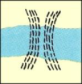

**Landmarks** represent a variety of special objects and structures not shown on the map that may be encountered during a
mission. When a landmark is mentioned in a paragraph, locate
the appropriate counter and place it on the map.

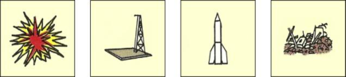

**Starshell** **Rocket Gantry** **Rocket** **Trash**

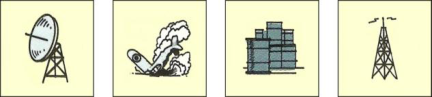

**Radar** **Crashed Plane** **Fuel Dump** **Antenna**

**Wounded/Incapacitated.** Placed atop
a soldier on the map to show that he
has been wounded or incapacitated.

**Killed/Captured.** Placed atop a soldier
on the map to show that he has been
killed or captured.

**Prone.** Placed atop a soldier on the map who has
fallen prone. Incapacitated or killed soldiers are
always prone and thus no prone marker is needed
for them.

**Event.** Placed in each hex on the map in which
an Event Check has occurred and in some hexes
where Perception Checks occur (as required by
the paragraph). When a hex that already has an
Event marker is entered, no Paragraph Check is

conducted. Each time the Mission Condition changes, all
Event markers are removed from the map ( **5/5** ).

**Second Floor.** Placed beneath a soldier who occupies the steeple in hex S-13 on Map B.

**2/5 The Squad Record**

At the start of each mission, record the attributes of your
soldiers and note the weapons and equipment they are carrying
on the Squad Record. During the mission, use the Squad Record to note gain or loss of equipment, Victory Points, and other
mission information. One Squad Record sheet is used per mission.

The filled-out Squad Record in this booklet can be used in
any of the scenarios. However, always use the entire squad as a
group, not separately to replace killed soldiers. If you play the
scenarios as a campaign, you can use this squad to start and
then replace any of its killed members with soldiers you generate. When you use the squad to play a scenario other than the
first one, use the soldiers’ characteristics, but not their equipment. Use the equipment purchase procedure in Squad Generation ( **4** ) and the limitations listed for the mission being played.

Each soldier in your squad has his own section on the
Record identified with his letter. Record the following ratings
for each soldier in his section: Initiative (IN), Perception (PC),
Weapon Skill (WS), Driving Skill (DS), and Movement Point
Allowance (MPA). Each soldier’s section also includes the
following:

 Port Boxes provide space to record the weapons and
equipment the soldier is carrying. Write the name of each item
the soldier is carrying in one or more of his Port Boxes, depending on the item’s size. A soldier cannot carry more items
than his Port Boxes allow. However, two soldiers can combine
their Port Boxes to carry a crew weapon.
 Ammo Boxes provide space to record the clips, grenades,
bazooka charges, and pistols the soldier is carrying. Write the
name of each separate clip, etc., the soldier is carrying in one
Ammo Box. A soldier whose Ammo boxes are full cannot carry any more clips, etc. Place an **X** through Ammo Boxes expended in play ( **9/5** ).
 Combat Boxes are used only if you are using your squad in
a continuing campaign ( **16** ). Each time a soldier earns a Combat Point during a mission, mark one of these boxes.
 Cost Boxes are used to record the cost in Squad Points you
spent for each soldier. This value is used when playing the
game as a campaign.

 Commander Boxes are checked off for each soldier who is

a commander. Leave them blank for those soldiers who are not
commanders.

The following general information is also noted on the
Squad Record:

 Your squad’s overall rating in Squad Points.
 Your squad’s Equipment rating in Weapon Points.
 The number of Victory Points your squad has earned and
lost during the mission. Keep track of Victory Points with hash
marks.

 The current Mission Condition and Activation Levels. Each
mission can have up to six Conditions. Each Condition has an
Activation Level, used to activate Germans, which is recorded
in the Activation space at the start of the mission ( **5/8** ). Each

_**AMBUSH! RULES: PAGE 6**_

time a new Condition comes into effect, fill in all the boxes up
to and including the new Condition number.
 Sightings. Each mission can have up to 10 sightings, numbered 0 through 9, which can occur during the mission. When
a sighting occurs, check the correspondingly numbered box.
Thereafter, ignore any paragraphs and paragraph references
preceded by that sighting reference, since it has already occurred. This saves time by cutting down the number of Paragraph Checks you have to make.

**2/6 US Soldier Cards**

Every US soldier that your squad might encounter during
a mission has his own card. Each US card is organized like a
soldier’s section on the Squad Record. In addition, each card
has an identity number, an identity letter and, in some cases,
special notes about the soldier when in play.

|PC: 2. WS: -1.|Col2|Col3|MPA: 3. DS: 2.|Col5|Col6|
|---|---|---|---|---|---|
|**Semi-Auto Rifle**|**Semi-Auto Rifle**|**Semi-Auto Rifle**||||
|**SAR**|**SAR**|||||

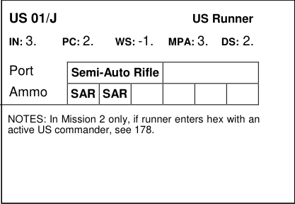

**2/7 Paragraph Booklet**

This indexed manual of paragraphs forms the brains of the
game. Do not read a paragraph unless specifically instructed to
do so during a mission. As your soldiers move around the map
and engage Germans in combat, you will be referred to these
paragraphs by number.

**2/8 Chart Reference Screen**

All the charts, tables, and summaries referred to in these
rules are printed on this screen. Stand the screen in front of you
on the table for easy reference.

**2/9 Two Ten-Sided Dice**

When a die roll is called for, one of three types of dice roll
will be indicated:

 Roll one die. Roll either die to obtain a result from 0
through 9. Note that a 0 is read as a zero; not as ten.

 Roll two dice. Roll both dice and add the two results together for a result from 0 (two zeroes) to 18 (two nines).
 Roll percentile dice. Declare one die as the “tens” die and
the other as the “ones” die, and then roll both together to obtain a result from 0 (two zeroes) to 99 (two nines).

**Example:** _If the tens-die shows a 4 and the ones-die an 8, the_
_result is 48; if the tens-die shows a 0 and the ones-die a 6, the_
_result is 6._

**2/10 Soldier Characteristics**

Every US and German soldier is defined by a series of
characteristics. Each characteristic has a numerical rating; the
higher the rating, the better the characteristic. These characteristics are used during play to determine what the soldier can do
and how well he can do it. Often in the rules and paragraphs
the characteristics are referred to by their abbreviations.

**Initiative (IN).** A number from 0 through 5, representing the
will to act and react. IN is used during each Action Round to
determine how many turns a soldier receives, when he can take
his turns, and whether or not he panics. For US soldiers, IN

determines whether the soldier is in or out of command and,
during squad generation, affects the quality of a soldier’s Perception.

**Perception (PC).** A number ranging from 0 through 9, representing awareness and attention to detail. PC is used to conduct
a Perception Check ( **5/7** ) whenever called for by a paragraph.
A PC Check is resolved by rolling one die. If the result is less
than or equal to the soldier’s PC, the check succeeds, and he
notices something that he would have missed had he failed the
check.

**Weapon Skill (WS).** A number ranging from -2 through +2,
representing marksmanship ability and general familiarity with
weapons. WS affects a soldier’s chance of hitting a target
when firing a weapon, throwing a grenade or satchel charge,
clearing a jammed weapon, and assaulting.

**Driving Skill (DS).** A number ranging from 0 through 8, representing the ability to handle vehicles. DS affects a soldier’s
chance of having an accident when driving.

**Movement Point Allowance (MPA).** A number ranging from 3
through 5, representing quickness and reaction time. The maximum number of Movement Points a soldier can spend in a
single movement action ( **7/3** ) equals his Movement Point Allowance.

**Command Radius.** US and German soldiers that are commanders have a Command Radius of two hexes, representing
the ability to lead and inspire others to act. A US soldier with
this characteristic is called a commander, and the Cmdr Box in
his section of the Squad Record is checked. German commanders are referred to as officers or NCO’s on their cards. A
soldier with a Command Radius can help other soldiers stay in
command, give other soldiers Turns, and make other soldiers
aware ( **6/3** ).

**2/11 Terms Used During Play**

The following terms are used constantly during the rules
and paragraphs:

**Active.** A soldier is active unless he is incapacitated, killed, or
captured. A vehicle is active unless it is disabled. Only active
soldiers can engage in combat and movement (although you
can move captives). Only active vehicles can move and fire,
although a tank can be immobilized without becoming inactive.

**Inactive.** A captured, killed, or incapacitated soldier is inactive. An inactive soldier cannot be fired upon or attacked by
assault; he is an ineligible target. Inactive soldiers cannot perform any actions for the duration of the mission (although a
captive can escape and become active again). An inactive soldier can be run over by a vehicle. A vehicle is active until it is
disabled. A disabled vehicle cannot move; additionally, a disabled tank cannot fire.

**Target.** A target is an active soldier or vehicle. An inactive
soldier or vehicle cannot be the target of fire or assault combat.
For example, if a hex contains an active and an inactive enemy
soldier, you can fire at the active soldier because he is a target,
but not at the inactive soldier. When using aimed automatic
weapon fire, only active targets in a hex can be hit and increase
the Hit Chance ( **13/6** ); inactive soldiers in the same hex have
no effect.

**Success/Failure.** An Activation Check, Perception Check, or
combat resolution can be either successful or a failure. Such a
check or resolution can be harmful to your soldiers and still be
termed a success. In most cases, a die roll of 0 is always successful, while a die roll of 9 is always a failure, regardless of
modifiers.

_**AMBUSH! RULES: PAGE 7**_

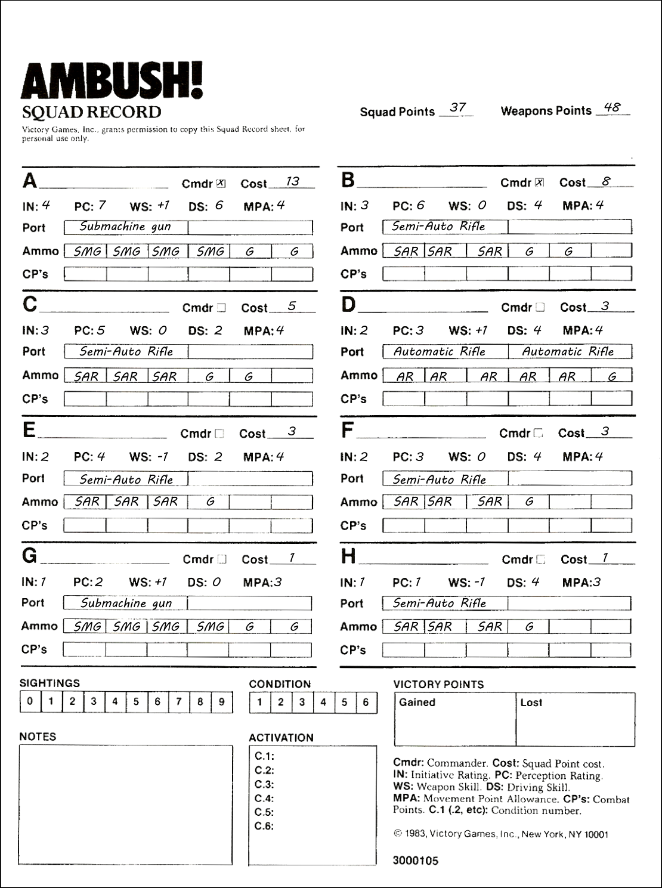

_**AMBUSH! RULES: PAGE 8**_

# **3. Course of Play**

**3/1 General Course of Play**

_**Ambush!**_ is an unusual game because it is played solitaire
and, unlike other wargames, has no Game-Turns or Sequence
of Play. Although not overly complex, _**Ambush!**_ uses a unique
game system that may throw you at first. The system is divided
into two parts called Operations and Action Rounds (or simply, Rounds), which toggle back and forth depending on whether or not there are active Germans on the map. When no Germans are present, you are in Operations. While in Operations,
you can perform any of the Actions listed in **5/3**, in any order
you choose, one after the other, without keeping track of
Turns, Movement Points, or anything else.

When the movement of one of your soldiers or a Random
Event triggers the Activation of a German soldier or vehicle,
then operations cease and you immediately begin Action
Rounds ( **6/1** ). Action Rounds are used to divide time into segments, so that movement and combat can be rendered in detail.
During Action Rounds, your soldiers and the Germans can
perform the Actions listed in **6/7.** If, at the conclusion of an
Action Round, there are no active Germans on the map, Operations resume. The game can switch back and forth between
Operations and Rounds any number of times during a mission.

**3/2 Play Outline**

The following outline is a brief summary of the steps involved in playing an entire game of _**Ambush!**_

**Starting a Mission.** Pick a mission and read the mission briefing. If this is your first mission, locate the Mission Cards
marked Mission 1. Otherwise, locate the Mission Cards for the
mission of your choice. We recommend that you play the missions in numerical order. Place the Mission Card marked Condition 1 in the view sleeve so that the Condition 1 side can be
read through the slots. Record the Activation Levels for each
Condition on the Condition section of the Squad Record using
the values assigned in the mission briefing. Then assemble
your squad using the procedure in Squad Generation ( **4** ), or use
the pre-generated squad in this booklet. Locate your soldier
counters and an Action Round marker for each that lists that
soldier’s Initiative Rating. Place each soldier’s AR marker on
the Unaware space of the Action Round Track in the column
corresponding to his Initiative. Find the German Action Number marker and place it on the German Action Number Track
(on any space). You are now ready to begin the mission.

**Commence Operations.** Enter your soldiers, one or more at a
time, onto the map as instructed in the mission briefing. Each

# **4. Squad Generation**

To generate your own squad, you will need a Squad Record and a piece of scrap paper to keep track of Squad and
Weapon Points as you spend them. The following procedure is
used only to generate an entire squad. If you are playing the
game as a campaign, use the procedure in Campaign ( **16** ) to
generate replacement soldiers.

**1. Read Mission Briefing**
Some missions list equipment you receive without cost and/or
limits on equipment purchases. Knowing your mission will
also help you to make decisions during Squad Generation.

**2. Roll Once on the Squad Quality Table**
Roll one die and record the Squad Points result in the Squad
Points space on your Squad Record.

**3. Roll Once on the Weapon Quality Table**
Roll one die and add to it your Squad Quality Table die roll.

time a soldier or group enters a hex that does not contain an
Event marker, make a paragraph Check ( **5/1** ) by looking up
that hex on the view sleeve. If there is a paragraph number
printed in black, look it up in the Paragraph Booklet and read
it. If the result is an Event, make an Event Check ( **5/6** ). If the
result is None, continue Operations. If the hex contains an
Event marker, no Paragraph Check is made. Continue moving
soldiers/groups in any order and direction you choose, making
Paragraph Checks for each hex that contains no Event marker.
In addition to moving, you can perform any of the other Actions listed in paragraph **5/3** . Note that no combat occurs during Operations, although random artillery strikes or German
sniper attacks can occur during some missions. At some point,
a German soldier or vehicle will be activated by a Paragraph
Check or Random Event, at which time Action Rounds commence ( **6/2** ).

**Commence Rounds.** When a German soldier or vehicle is
activated, Rounds begin. First the German soldier or vehicle
card is located and its counter placed on the map. Then its AR
marker is placed on the Action Round Track in the Complete
Space. Then the first Round is begun using the Action Sequence ( **6/1** ). During Rounds, your active soldiers can perform
any of the Actions listed in paragraph **6/7** as you see fit. This
includes combat, movement, and other more specialized Actions. The Germans also perform similar Actions as directed
by their paragraphs. Rounds continue until the last German
vehicle or soldier is killed, incapacitated, captured, or leaves
the map. Then Operations resume as above.

**Missions Ends.** Each mission ends in a different way, as described in the mission briefing. Victory is determined at the
end of the mission by totaling the number of Victory Points
you gained during the course of the game (as recorded on your
Squad Record) and subtracting from this total the number of
Victory Points you lost. If the resulting total is equal to or
greater than the number listed for Victory in the mission briefing, you have won. If it is less, you have lost.

**Campaign Update.** If you are not playing the game as a continuous campaign, skip this step. Otherwise, perform the following steps to prepare your squad for the next mission, as
described in Campaign ( **16** ). Each surviving squad member,
including incapacitated members, gains Combat Points. Then,
at your option, you can spend each soldier’s Combat Points to
increase his Ratings. Finally, generate replacement soldiers to
take the place of those killed during the mission.

Record your Weapon Points result in the Weapon Points space
on your Squad Record.

**4. Buy Your Soldiers Using the Squad Member Cost**

**Chart**
Spend your Squad Points to buy soldiers for your squad. The
cost of each soldier depends on his Initiative Rating and
whether or not he is a commander. Record each soldier’s cost
on the Squad Record. Any Squad Points you do not spend are
lost. When you have made your purchases, record the Initiative
Ratings of each soldier in his IN space. If a soldier is a commander, check his Cmdr Box. Record the ratings in descending
order; soldier A should be the commander with the highest IN,
while soldier H should be the soldier with the lowest IN. Give
each soldier a name and record it in the space next to his identification letter.

_**AMBUSH! RULES: PAGE 9**_

**5. Roll on the Perception Table Once per Soldier**
Roll one die and cross-reference the result with the soldier’s
Initiative Rating to determine his Perception. Record the Rating in that soldier’s PC space on the Squad Record. Roll separately for each soldier.

**6. Roll on the Weapon Skill Table Once per Soldier**
Roll one die and add the soldier’s Initiative Rating to the result. Locate the result on the Weapon Skill Table. Record the
Rating result in that soldier’s WS space on the Squad Record.
Roll separately for each soldier.

**7. Roll on the Driving Skill Table Once per Soldier**
Roll one die and add the soldier’s Initiative Rating to the result. Locate the result on the Driving Skill Table. Record the
Rating result in that soldier’s DS space on the Squad Record.
Roll separately for each soldier.

**8. Use Movement Point Allowance Chart Once**

**per Soldier**
Use the soldier’s Initiative Rating to determine his Movement
Point Allowance. Record the result in that soldier’s Movement
Point Allowance space on the Squad Record.

**9. Buy Your Weapons Using the Equipment Cost Chart**
Spend your Weapon Points to buy weapons for your squad,
subject to the restrictions of your mission. Each weapon has a
cost in Weapon Points and comes with one free ammo clip
when bought.

# **5. Operations**

As long as there are no active Germans on the map, you
are in Operations, and the passage of time does not affect the
mission. During Operations, you can move your soldiers individually or as groups in any directions that you choose one hex
at a time. There are no Movement Point costs involved, since
movement is always one hex at a time. Soldiers can also conduct any of the actions listed in **5/3** any number of times and in
any order you choose while in Operations.

**5/1 Paragraph Checks**

When a soldier/stack enters a hex, make a Paragraph
Check by cross-referencing the letter and number codes for
that hex on the view sleeve. If the slot reveals the word
“None,” there is no effect; continue Operations. If there is a
three-digit paragraph number printed in black, look it up in the
Paragraph Book and do as it instructs. If a black paragraph
reference is preceded by a sighting reference (sl, s2, etc.), it
indicates that the paragraph is looked up only if the sighting of
that number has not occurred ( **5/4** ). If it has occurred, ignore
the paragraph and return to Operations. Ignore paragraph and
hex numbers printed in red (these are used only during
Rounds).

Each paragraph you are directed to read includes a statement or series of statements that you then carry out. Some paragraphs describe an occurrence in a straightforward manner.

**EXAMPLE:** _**One paragraph says “Soldier notices fresh tire tracks**_
_**on dirt road, heading toward hex J-14.” If you were directed to this**_
_**paragraph, you would simply make a mental note of the information**_
_**therein and carry on.**_

Most paragraphs, however, are a series of conditional
statements in which you must roll a die, make a choice, or refer to the map in order to determine which part of the statement
actually applies to your situation. Many paragraphs include
more than one option. If these are separated by bullets (•),
choose the one statement that applies. If the options are numbered (1, 2, etc.), choose the first one that applies.

Each weapon, except a pistol, takes up 1, 2, or 3 Port Boxes for the soldier who carries it. A weapon is carried by writing
its name in one of the soldier’s Port Boxes. If a weapon requires more than one box, write its name in each box. A soldier can never carry more than two Port Boxes worth of weapons. In the case of a three-Port Box weapon, such as a medium
machinegun, one soldier must carry two of the three boxes and
another soldier must carry one.

Each ammo clip, bazooka round, grenade, and pistol takes
up one Ammo Box. Record each clip or round with an abbreviation of your choice in the Ammo Boxes. For example, “P”
may indicate pistol ammo, while “G” may indicate a grenade.
A soldier can never carry more than six Ammo Boxes worth of
pistols and ammo. You can buy additional ammo for the costs
listed. For one Weapon Point, you get three grenades, which
may be divided among up to three soldiers. You receive five
ammo clips for one weapon Point. These clips can be for any
types of weapon except bazookas. Ammunition types are not
compatible/interchangeable with each other; you must buy
ammo specifically for each weapon type. For example, you
could spend one Weapon Point and receive two pistol clips, a
sub machinegun clip, and two semiautomatic rifle clips to divide among your soldiers as you see fit. Bazooka rounds cost
one Weapon Point each.

After you have bought your equipment and ammo, record
your purchases on the Squad Record along with the weapons
you receive in the mission briefing, if any.

If a group of soldiers enters the same hex, only one Paragraph Check is made. Any Perception Checks required by the
paragraph are made by the soldier with the highest PC only.
This is true whenever more than one US soldier occupies a hex
and a Paragraph or PC Check is required.

Paragraph Checks are made during Rounds in this same
manner. The only difference is that Event Checks are not performed during Rounds; another procedure is used to generate
Events during Rounds.

**5/2 Soldier Stances**

Regardless of whether you are in Operations or Action
Rounds, a soldier can be in only one of three stances: standing,
crouching, or prone. When in Operations, you can change a
soldier’s stance at any time you choose after conducting any
necessary Paragraph Check for the soldier. Place-a Prone
marker on a prone solider; otherwise, use the standing or
crouching side of the’ soldier’s counter to indicate his current
stance.

Stance is very important to movement ( **7** ), combat ( **9**, **10**,
**11** ), and line of sight ( **8** ).

**5/3 Actions During Operations**

Any of your active soldiers can perform any of the following actions any number of times in any order you wish during
Operations.

**Movement.** A soldier can move from one hex to an adjacent
hex if he is crouching or standing. Crouching soldiers are considered crawling when they move, while standing soldiers are
considered running as fast as the terrain allows. Prone soldiers
cannot move at all. Each time a soldier enters a hex, a Paragraph Check is conducted unless the hex contains an Event
marker. A Paragraph Check is made even if the hex contains
other soldiers or has already been entered by a US soldier. If
you have already read the paragraph and know what it says, it
may be possible to forego looking it up a second time. Any
number of soldiers in the same hex in the same stance can

_**AMBUSH! RULES: PAGE 10**_

move into an adjacent hex together. Each time a group move is
performed, only one Paragraph Check is conducted. Any number of soldiers and any amount of equipment can occupy a hex
simultaneously (however, vehicles are an exception).

**Stance Change.** A soldier can change his stance. If a soldier
moves into a hex, he cannot change his stance until after any
required Paragraph Check is completed.

**Pick Up/Exchange Equipment.** A soldier that is crouching or
standing can pick up or put down any portable items in his hex.
If two or more soldiers are in the same hex, they can exchange
any portable items in this manner. A soldier that is taking
equipment from an inactive soldier must be crouching.

**Drag Inactive Soldier.** A standing soldier that has an empty
Port Box and is in the same hex with an inactive soldier can
drag him to an adjacent hex. If the inactive soldier is incapacitated, roll a die for each hex he is dragged; on a result of zero,
he dies. A soldier can cease dragging an inactive soldier instantly at any time. Only inactive soldiers may be dragged, not
unaware or wounded ones.

**Prepare Weapon.** A standing or crouching soldier can prepare
a weapon that requires preparation before it can be fired. A
machinegun that is prepared remains prepared until it is
moved. A prepared bazooka or satchel charge remains prepared until fired or thrown, respectively. Personal weapons
need not be prepared to fire.

**Clear Jammed Weapon.** A standing or crouching soldier can
attempt to clear a jammed weapon by rolling one die and referring to the Clear Jammed Weapon Table. On a result of **B**, the
weapon breaks; on any other result, the weapon is cleared.

**Move Captured German.** A captured German can be moved
during Operations but only by a US soldier occupying the
same hex ( **11/2** ).

**5/4 Sightings**

During Operations, a Paragraph Check may yield a black
three-digit paragraph number preceded by a sighting reference
(sl, s2, etc.). Generally, each German soldier and vehicle in a
mission is assigned a sighting number. In addition, some missions have other types of sightings, such as buildings, lost
equipment, German soldiers in a group, and so forth. A mission can have up to 10 sightings, which you keep track of on
the Sighting Boxes of the Squad Record. When you read a
paragraph with a sighting number and the sighting occurs, record its occurrence by checking off its sighting number on the
Squad Record. Thereafter, when a Paragraph Check reveals a
sighting reference to that sighting, do not look it up in the Paragraph Booklet, since it has already occurred.

A sighting reference on a Mission Card only indicates that
the sighting **may** occur. Do not mark the sighting off on your
Squad Record until it does occur. A sighting occurs only when
you read a paragraph preceded by a Sighting Reference.

**SIGHTING OCCURRENCE EXAMPLE**

**019. [s2] A flare explodes overhead.**

_The exploding flare is Sighting Number 2. Check off the “2” space on_
_the Sighting Track of the Squad Record. Any subsequent paragraph_
_references preceded by s2 are disregarded and not read. This in-_
_cludes s2 references on the Event Check section of the Mission Cards._

**5/5 Conditions**

The “narrative” of the mission is directed by changing the
Mission Cards in the view sleeve; these changes are called
Condition changes. The events that may occur and the reactions of the Germans depend on the Condition in progress. All
missions begin in Condition 1 – that is, with the Condition 1
side of the first Mission Card visible through the view sleeve.

During the course of play, paragraphs and/or events may instruct you to change the Condition. When the change occurs,
change the Mission Card to display the new Condition, and
check off the Condition in progress on the Condition Track of
the Squad Record. Finally, remove all Event markers from the
map. Conditions always change from a lower number to a
higher number, and may sometimes skip numbers. Conditions
that are skipped never occur (ignore any reference to them).

When the Condition changes, pause and make Paragraph
Checks for each hex occupied by active US soldiers. Make the
check in hex number order, lowest number first. Ignore any
Event Checks, and simply place Event markers in hexes that
required the Event Checks. Make any Paragraph Checks required and follow their instructions. If a check causes a German to be activated, immediately commence Rounds (do not
check other hexes occupied by US soldiers). If you check all
hexes occupied by US soldiers and no Germans are activated,
return to Operations. If a Condition change occurs during
Rounds, use the procedure in **6/11**, rather than the preceding.

**CONDITION CHANGE EXAMPLE**

**323. Overhead, a P-51 fighter engages an Me-109 in a dogfight**
**and shoots the German plane down. Go to Condition 6.**

_After completing the instructions called for in the paragraph (in_
_this case, none), replace the current Mission Card with the Condi-_
_tion 6 side of the Mission Card. Then check off the 6 Box on the_
_Condition Track on your Squad Record as a reminder of which_
_Condition is in progress and which ones, if any, have been skipped._
_Make a mental note of the Activation Level for the Condition. Then_
_make Paragraph Checks for each hex occupied by an active US_
_soldier (in hex number order), ignoring Event Checks and placing_
_Event markers instead. Complete any instructions called for in the_
_paragraphs, then resume Operations or Rounds, whichever is in_

_progress._

Some paragraphs require a previous sighting in order to be
read. If the listed sighting has not occurred, then the paragraph
reference is ignored. If the sighting has occurred, then the paragraph is read and its instructions are followed.

**PREVIOUS SIGHTING REQUIRED EXAMPLE**

**252. s2 required. See 121. Otherwise, no event.**

_If Sighting Number2 has occurred, read paragraph 121. If it has not_
_occurred, nothing happens; return to Operations (or Rounds, if_
_Rounds are in progress). In some paragraphs, you are told to do one_
_thing if a specific sighting has occurred, and another thing if that_
_sighting has not occurred. In other paragraphs, a previous sighting_
_requirement is combined with a sighting occurrence so that a sighting_
_occurs only if another sighting has already occurred._

**5/6 Event Checks**

Unique occurrences are triggered at random during play
by making Event Checks. When a Paragraph Check yields an
Event result, roll two dice and check the Mission Card again
by lining up the RE (Random Event) column with the dice
result. The corresponding slot will show “None” (indicating
that no Event occurs), or a paragraph number, sometimes preceded by a sighting reference. After reading the paragraph and
completing the instructions, place an Event marker in the hex
where the Check was triggered. This marker indicates that no
additional paragraph or Event Checks are made when a soldier
enters that hex. All Event markers are removed from the map
when the Condition changes. Some Events will have a sighting
reference preceding them. If the listed sighting has occurred,
do not look up the paragraph.

**5/7 Perception Checks**

A Paragraph Check may require a soldier to make a Perception (PC) Check, which represents a chance for that soldier
to notice something, usually important to the mission or to his
own health. To make a Perception Check, roll one die; if the
result is equal to or less than the soldier’s Perception, the PC

_**AMBUSH! RULES: PAGE 11**_

Check succeeds; if the result is greater, it fails. Depending on
the paragraph, success or failure of a PC Check may direct you
to another paragraph. The soldier’s PC may be modified if the
paragraph triggering the check has a modifier listed. A positive
modifier increases the soldier’s PC Rating, thus making the PC
Check easier to conduct successfully. A negative modifier reduces the soldier’s PC Rating, thus making the PC Check more
difficult to conduct successfully. Regardless of modifiers, a die
roll of 0 is always successful, and a roll of 9 is always a fail
ure.

Certain paragraphs allow soldiers that can see a specific
hex to conduct a PC Check, regardless of which soldier triggers the paragraph. Unless a paragraph specifically allows all
eligible soldiers to conduct PC Checks, only one soldier occupying the hex can make the check. If the hex contains more
than one soldier, use the soldier with the highest PC Rating.

Some PC Checks occur only once and will require that
you place an Event marker in the hex if your soldier fails the
check. No Paragraph Checks are made for that hex for the duration of the Condition; thus, no more PC Checks can be made
from that hex.

Besides PC Checks triggered by paragraphs, PC Checks
can also be triggered by boobytraps ( **12/1** ), minefields ( **12/2** ), a
grenade toss ( **10/2** ), and US Awareness Checks during Action
Rounds ( **6/5** ).

**PERCEPTION CHECK EXAMPLE**

**288. Conduct PC Check (-2):**

- **If successful, see 325.**

- **If fails, see 180.**

_The soldier who entered the hex conducts a PC Check. His PC is_
_reduced by two for purposes of this check (only). Roll one die; if the_
_result is equal to or less than his modified PC then the PC Check is_
_successful and paragraph 325 is read. If greater than his PC, read_
_paragraph 180._

**5/8 Activation Checks**

Germans enter play in one of two ways, as a result of either an Event or Activation Check. Activation Checks are

# **6. Action Rounds**

As you conduct Operations and consult paragraphs, you
will at some point read a paragraph that instructs you to activate Germans and “commence Rounds.” Play immediately
switches to Action Rounds upon reading any such paragraph.
If such a paragraph is read when Rounds are already underway, see the procedure in **6/6** to activate the new German. You
then conduct Action Rounds until there are no active German
soldiers or vehicles on the map, at which point Operations resume. As US soldiers move during Rounds, make Paragraph
Checks for each hex entered. If a paragraph check calls for an
Event Check, ignore it, but still place an Event Marker in the
hex, since Event Checks occur in a different way during
rounds.

**6/1 Action Sequence**

An Action Round is conducted in accordance with the Action Sequence. However, when Action Rounds are initiated,
special procedures must be conducted to activate the Germans.
The activation paragraph will call for a specific German; find
his card and place the activated German on the map and his
AR marker on the Action Round Track ( **6/2** ). Furthermore,
during the first two Rounds following initiation of Rounds,
special checks must be made to see how quickly each of your
soldiers becomes aware of the situation at hand.

The following sequence is conducted once per Round. At
its conclusion, the Round is over. If there are still active Ger

made when called for by a paragraph by rolling a die and comparing it with the Activation Level for the Condition in progress (recorded on the Condition section of the Squad Record).
If the result is equal to or less than the current Activation Level, the German is activated and Action Rounds begin; if greater
than the Activation Level, the German is not activated.

Some Activation Checks include a modifier that is applied
to the Activation Level. A positive modifier makes the Activation Check easier to conduct successfully, while a negative
modifier makes it more difficult. A roll of 0 is always a successful activation, and a roll of 9 is always a failure, regardless
of modifiers. If the check is triggered by a group of US soldiers, only one check is made. When a German is activated,
place the German and commence Rounds ( **6/2** ).

**ACTIVATION CHECK EXAMPLE**

**136. Conduct Activation Check (-1):**

- **If successful, see 154.**

- **If fails, conduct PC Check. If successful, see 165.**

_An Activation Check is made using the current Activation Level re-_
_duced by 1. If the die roll result is equal to or less than the Activation_
_Level, then the check succeeds and you read paragraph 154: if the_
_result is higher the check fails. If the check fails the soldier then_
_makes a PC Check, which, if successful, leads to the reading of para-_
_graph 165. If the PC Check fails there is no effect; return to Opera-_
_tions._

**5/9 Random Determination**

Many paragraphs and game procedures will require you to
make a choice “at random.” To do so, assign each of the possible choices an equal die roll range and roll a die.

**RANDOM DETERMINATION EXAMPLE**

**018. One German weapon fired in the previous Round is out of**
**ammo. If more than one German weapon was fired last Round,**
**determine which one is out of ammo at random.**

_If three Germans had fired in the previous Round, German A could be_
_assigned 0, 1, and 2; German B 3, 4, and 5; and German C 6, 7, and_
_8. One die roll would then determine which German is out of ammo. If_
_a 9 were rolled in this case, roll again._

mans on the map, another Round begins. If a German is activated in the course of performing any of the following steps,
immediately perform the procedures described in **6/6** .

**1. US AWARENESS PHASE (Rounds 1 and 2 only)**

During this step of the first and second Rounds, each active US soldier, on or off the map, must make a PC Check to
determine whether he becomes aware ( **6/5** ). During the first
Round, only those soldiers that can see the activated German
make PC Checks. During the second Round, all unaware US
soldiers, regardless of location, make a PC Check. The AR
markers for aware soldiers are placed in the Aware space on
the Action Round Track. All active US soldiers become automatically aware at the start of Round three.

**2. EVENT PHASE (Not conducted in Round 1)**

Conduct one Event Check by rolling two dice and adding
the two results together. Locate the sum on the Event column
of the Mission Card. This Event Check is resolved in the same
way as an Event Check during Operations ( **5/6** ); read the paragraph indicated on the Mission Card unless it is preceded by a
sighting reference for a sighting that has already occurred. _**Ex-**_
_**ception**_ : No Event Check is made during the first Round.

**3. ACTION PHASE**
**Initiative Determination.** Determine which side has the advantage by rolling two dice and reading one as the German
result and one as the US result. The side with the higher result

_**AMBUSH! RULES: PAGE 12**_

has the advantage for this Round. If the results are equal, advantage goes to the Germans. _**Exception**_ : The paragraph that
activates the Germans and initiates Rounds may state that one
side or the other has the advantage in the first Round. Advantage is thus predetermined by the paragraph, although you
still roll for initiative in order to place your AR markers on the
correct Turns.

**AR Marker Placement.** Use the initiative die results to determine which space each AR marker will occupy on the AR
Track. Locate each side’s die roll result on the AR Track in
each AR marker’s column. Move the AR markers to the spaces
containing their side’s die roll result. In the one and two Turn
spaces, place the markers in the advantage and disadvantage
halves according to which side has the advantage for the
Round. The location of the initiative die roll result has the following effects:

_**2 Turns.**_ If the initiative die result is in the 2-Turn space,
the soldier receives two turns in this Round. Place his marker
in the advantage or disadvantage half, as appropriate. _**Excep-**_
_**tion**_ : A wounded soldier can receive only one turn; if a wounded soldier receives two turns, place his marker in the 1-Turn
space instead.

_**1 Turn.**_ The soldier receives one turn this Round. Place
his AR marker in the advantage or disadvantage half, as appropriate.

_**Panic.**_ The soldier panics this Round, regardless of
whether he is in or out of command ( **6/4** ). A German soldier
can panic in this way (and also as a result of combat), and certain German action paragraphs also simulate panic effects.

_**Red Number**_ (applies only to US soldiers). If a die result
is printed in red and the soldier is out of command ( **6/3** ), he
panics instead of receiving turns this Round. Place his AR
marker in the Panic space. If he is in command, place his AR
marker in the space containing the red number. Panic caused
by a red number on the action table is unconditional. It applies
even if there is no real “reason” for panic, e.g. the soldier is far
out of sight of any enemy.

AR markers for soldiers on opposing sides can never occupy the same advantage or disadvantage space. Opposing
markers can occupy the same Turn space, however. Certain
paragraphs that activate Germans and initiate Rounds indicate
that all aware soldiers on one side or the other automatically
receive two turns in the first Round. If the number of turns is
specified, then the procedure above is not conducted in the first
Round. For example, one paragraph indicates that the Germans
receive advantage and two turns; thus, you need not roll for
German AR marker placement, since they will be placed in the
2-Turn advantage space.

**Important:** If a soldier is wounded or panics during a
Round, his AR marker is immediately moved to the Complete
space, if not already there. If a soldier becomes panicked as a
result of combat, move his AR marker to the Panic space (unless it already occupies the Panic or Complete space). If a soldier becomes incapacitated, killed, or captured during a Round,
his AR marker is immediately moved to the Inactive space.

**Perform All Soldier Actions.** The position of the AR markers
on the AR Track indicate the order in which US and German
soldiers perform actions. Soldiers in the 2-Turn advantage
space go first; then those in the 2-Turn disadvantage space;
and so forth. If more than one US soldier occupies a space, you
can have them go in any order you wish. At the beginning of
each turn in which one or more Germans can act, roll one die
to obtain a new German Action Number ( **6/8** ). Germans able to
act in the same turn go in the order of the letters on their AR
markers. _**Exception**_ : Firing a crew weapon, **9/7** .

**4. BEGIN A NEW ROUND (if there is an active Ger-**

**man on the map)**

If there are still one or more active Germans on the map,
begin a new Round. If there are no active Germans on the map,
return to Operations.

**6/2 Activating German Soldiers**

Action Rounds begin when, during Operations, a paragraph states that a German is activated (see also **5/8** ). Each
activated German will be identified by a number. Locate the
German soldier cards with the same identity number and place
them in front of you. Next to the identity number on each card
is an identity letter for the soldier. This letter is used to identify
the soldier when actually on the map. Locate the soldier marker with the matching letter and place it in the hex on the map
listed in the paragraph. Locate the Action Round marker with
the matching letter that shows the Initiative matching that
listed on the soldier card and place it in the complete space on
the Action Round Track.

Should a German activation occur during a Round that is
already in progress, use the procedure in **6/6** . Should activation
occur when there are US soldiers who have not yet entered the
map, use the procedure in **6/10** .

**GERMAN** **ACTIVATION** **PARAGRAPH EXAMPLE**

**164. [s3] Light machinegun opens fire. Activate Germans 5 and 49**
**in hex N12, crouching. Commence Rounds. German advantage.**
**Germans 5 and 49 receive two turns this Round.**

_Upon reading this paragraph, check off sighting s3 on the Squad_
_Record and locate German soldier cards 5 and 49. Cards 5 and 49_
_indicate that Germans M and T will be placed on the map, respective-_
_ly. These two markers are placed in hex N12, crouching side up. Since_
_German 49 has a light machinegun, place a light machinegun marker_
_in the hex, prepared side up. Locate the AR marker showing an IN of_
_3 for soldier M, and the AR marker showing an IN of 2 for soldier T,_
_and place both markers in the Complete space of the AR Track in the_
_initiative 2 and 3 columns._

**6/3 Command and Commanders**
**Command.** When a US soldier’s initiative die result is printed
in red, it means that the soldier has a chance of panicking, if he
is out of command. To determine if a soldier is in command,
add his IN to the IN ratings of all other active US soldiers in
his hex. If this sum is five or more, the soldier is in command.
If the total is less than five, he is out of command and liable to
panic. Being in or out of command only affects the chance of a
soldier panicking during AR marker placement. It has no effect
on a soldier panicking as a result of combat. German soldiers
panic only when their initiative die roll result is actually printed in the Panic space (initiative columns 0 and 1 only), never
as a result of their roll being printed in red.

**US Commanders and Panic.** A US soldier can be either a
commander or a private. A commander has a Command Radius consisting of the hex he occupies and all the hexes within
two hexes of the hex he occupies. A commander exerts his IN
rating into all these hexes, as long as he is active, and it is added to the IN’s of US soldiers occupying those hexes. For example, a commander with an IN of 4 exerts four Initiative
Points into all hexes within two hexes of the hex he occupies.
Any US soldiers (including another commander) in any of
those hexes can use those four points toward keeping himself
in command. The effects of Command Radii are reciprocal;
that is, a commander can use the Initiative Ratings of soldiers
within his command radius to contribute toward keeping himself in command. A commander who is panicked or inactive
has no Command Radius.

**Commanders Giving Turns.** While performing Actions during Action Rounds, a commander, both US and German, can
give a Turn to another friendly soldier in his Command Radius
(even to another commander). When it is the commander’s

_**AMBUSH! RULES: PAGE 13**_

turn to perform actions, he can give his Turn to another soldier
instead of performing an action himself. The commander’s AR
marker is moved down to the 1-Turn or Complete Box as if he
had performed an action, and the AR marker for the soldier to
whom he gave the Turn is moved up one Turn. This will alter
the Turn order, thus giving the soldier to whom the turn was
given an opportunity to perform an action earlier than he
would have if the commander had not given him an extra turn.
Only soldiers occupying the 1-Turn or Complete space can be
given a Turn; those in the 2-Turn, Panic, Unaware, or Inactive
spaces cannot be given a turn. A German commander will only
give a turn to another German when one of his action paragraphs explicitly states he is to do so. A wounded soldier can
never be given a turn in this way.

**Commanders and US Awareness.** A commander can spend a
turn to make an unaware US soldier within his Command Radius aware. The newly aware soldier’s AR marker is then
placed in the complete space. A wounded soldier can never be
made aware in this manner.

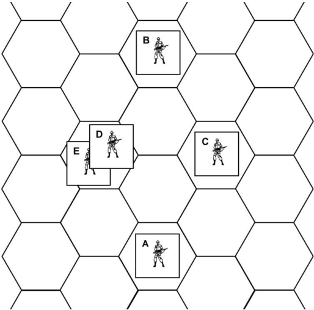

**COMMANDER FUNCTIONS**

_A is a commander with an IN of 3. The other soldiers in the dia-_
_gram are privates with IN’S of 1 (B), 2 (C), 1 (D), and 2_
_(E).Soldiers D and E are in command, because they are within two_
_hexes of commander A. A, D, and E combine their IN’S for a total_
_of 6, which is sufficient to keep each of them in command. C is also_
_in command, because his IN is combined with A’s for a total of 5. B_
_is out of command, because he is three hexes from A, and his IN is_
_less than 5. During Rounds, commander A can give turns to C, D,_
_and E,but not to B. If C and E were in B’s hex, all three would be_
_in command, because their combined IN would be 5._

**6/4 Panic**

During the Action Sequence, a German or US soldier is
subject to panic if his initiative die roll is printed in the Panic
space in his column of the AR Track. For example, a soldier
with an IN of 1 panics on a die roll of 1.

If a US soldier is out of command, and the die roll yields a
result that is printed in red, the soldier panics. Place his AR
marker in the Panic space. If the soldier is in command, he
does not panic and receives the indicated number of turns. For
example, a US soldier with an IN of 3 who is out of command
panics on a roll of 6, 7, or 9.

A panicked soldier remains immobile until the end of the
Round, at which time he must fall prone (if not already prone)
and his AR marker is placed in the Complete space. A pan

icked soldier can be attacked and, if hit, is subject to all the
effects of damage. For the additional effects of panic, see **13/1** .

**6/5 US Soldier Awareness**

When Action Rounds are initiated you must determine
which of your soldiers are immediately aware of the just activated Germans and which are unaware. An aware US soldier
can perform Actions during Rounds. An unaware US soldier
cannot perform any actions during Rounds; he remains immobile until he becomes aware. Once a soldier becomes aware, he
remains aware throughout Rounds until Rounds are initiated
again, following a return to Operations. German soldiers do
not check for awareness; once activated, they are automatically

aware.

During the US Awareness Phase of the first Round, after
the activated German is placed on the map, each active US
soldier that can see the German just activated conducts a PC
Check. Those that succeed at this check are aware during the
first Round. Those soldiers that fail the check are not aware
during the first Round. Place the AR marker of each aware
soldier in the Complete space on the AR Track. Place the AR
marker of each unaware soldier in the Unaware space of the
AR Track.

During the US Awareness Phase of Round 2, each active
US soldier on the map that is not yet aware conducts a PC
Check. Those that succeed at this check are aware during the
second Round. Those that fail are not aware during the second
Round.

During Round 3 and after, all active US soldiers are automatically aware, regardless of their location. When Rounds
end and you return to Operations, all US soldiers are again
considered unaware and the preceding procedure is used when
Rounds commence again.

If Rounds are in progress and a second German is activated, he has no effect on the awareness of the US soldiers. You
make no additional Awareness Checks due to the activation of
an additional German.

An unaware soldier who is attacked is automatically aware
after the combat is resolved. Place his marker in the Complete
space, unless he is killed or incapacitated. Even an attempted
attack (fire, grenade, assault) makes all US soldiers in the target hex aware. A scattered grenade/ SC makes both the soldiers in the original target hex and those in the scatter hex

aware.

An aware commander can spend one of his Turns to make
an unaware soldier within his Command Radius aware ( **6/3** ).

**6/6 German Activation During Rounds**

During Action Rounds, there is the possibility that additional Germans may become activated. If activation occurs
during a Round, use the following procedure. Interrupt whatever is happening and place the newly activated German on the
map in the stance indicated in the activation paragraph. Ignore
those parts of the paragraph dealing with advantage and US
awareness. If the paragraph states that the German receives
two turns, place his AR marker in the 2-Turn space of the AR
Track using the current German advantage/disadvantage result.
If the activation paragraph did not specify that the German
receives two turns, then roll a new German Action number and
place the newly activated German’s AR marker in the indicated space (again, using the current advantage/disadvantage).

The newly activated German has no effect on US awareness ( **6/5** ). If all US soldiers are currently aware, they remain
aware. If some are unaware, only the German that originally
caused Rounds to commence affects their awareness.

_**AMBUSH! RULES: PAGE 14**_

If German activation occurs during the action of a US soldier (typically movement) that soldier may end his action before any German takes an action.

**6/7 Performing Actions During Rounds**

During the Action Phase of the Action Sequence, US and
German soldiers perform Actions. The order in which soldiers
perform Actions is determined by the location of their AR
markers on the Action Round Track ( **6/1** ). When one of your
soldiers gets a turn, you can have him perform one Action or
pass. When a soldier passes, simply move his AR marker as if
he had performed an Action. All the different kinds of Actions
a soldier can perform during Rounds are listed below.

**Free Stance Change.** An unwounded soldier can, at any point
during his turn, make one free stance change; from prone to
crouching or standing, from crouching to prone or standing, or
from standing to prone or crouching. Wounded soldiers never
receive a free stance change. A soldier without a free stance
change must spend one Movement Point to change stance, and
thus must perform a Movement Action. However, a free stance
change can be combined with a movement action (in which
case a Movement Point to change stance is only spent when
you perform the second stance change). When a soldier enters
a hex, a Paragraph Check is made _**before**_ he can make the
stance change (free or otherwise). In addition, there is a special
free stance change associated with grenade PC Checks ( **10/2** ).

**COMBAT RELATED ACTIONS**

**Aimed Fire Once with Personal Weapon.** Soldier must be
standing or crouching with a personal weapon or a prepared
bazooka.

**Snap Fire Twice with Personal Weapon.** Soldier must be
standing or crouching with a personal weapon. The target for
each fire can be the same or different, and can occupy the same
or different hexes. You cannot snap fire a bazooka.

**Aimed Fire with Crew Weapon.** Aimed fire with a crew
weapon can only be made if the hex contains at least two
crouching, active soldiers. Both soldiers simultaneously spend
one turn performing this action. ( **9/7** ).

**Snap Fire with Crew Weapon.** Snap fire with a crew weapon
can only be made if the hex contains at least one crouching,
active soldier. If the hex contains two or more active soldiers,
the weapon can be snap fired twice at a cost of one action for
each of two soldiers. Thus, a crew weapon with two operators
could make one aimed fire (see above) or two snap fires at a
cost of two actions, one each per soldier. A crew weapon always uses snap fire whenever it is fired by a single soldier.
Snap fire greatly increases the chances of a crew weapon jamming ( **9/4** ).

**Assault.** Soldier must be standing in the hex with the enemy
soldier ( **11** ).

**Prepare Satchel Charge.** Soldier must be crouching or standing to prepare the satchel charge ( **10/4** ).

**Throw Satchel Charge.** Soldier must be standing to throw the
satchel charge. It can be thrown one, two, or three hexes
( **10/1** ).

**Prepare and Throw Grenade.** Soldier must be standing or
crouching with a grenade. If he is crouching, his range is reduced ( **10/1** ). A soldier can never move and throw a grenade in
the same Turn.

**Prepare Bazooka.** Soldier must be standing or crouching in
hex with an unloaded bazooka and a charge ( **9/8** ).

**Clear Jammed Weapon.** Soldier must be standing or crouching with a jammed weapon ( **9/4** ).

**Remove Live Grenade from Hex.** This special action is performed out of turn and only if the soldier is standing or crouching and makes a PC Check ( **10/2** ). It may also involve a special
free stance change.

**Prepare Crew Weapon.** One soldier in the same hex with all
parts of the weapon must spend one action to prepare it for
fire. It remains prepared until moved ( **9/7** ).

**MOVEMENT RELATED ACTIONS**

**Move** (expend some or all of soldier’s Movement Point Allowance). A crouching soldier can move only one hex (by crawling), which costs all his Movement Points. A standing soldier
can move one or more hexes, depending on his Movement
Point Allowance and the type of terrain in the hexes he enters.

**Move Crew Weapon** (expend some or all of two soldiers’
Movement Point Allowances). Crew weapons require three
Port Boxes. To be moved, two soldiers in the same hex with
the weapon must divide its Port Box cost between themselves.
They can then move the item separately; however, they must
both occupy the same hex to prepare the weapon.

**Move/Snap Fire** (expend up to half of soldier’s Movement
Point Allowance and snap fire personal weapon). A soldier can
combine movement and fire combat by spending up to half his
Movement Point Allowance (round fractions down) and snap
firing his personal weapon ( **7/3** ). You can choose to move then
fire, or to fire then move. You can split movement so that it
occurs both before and after fire, if sufficient MPs are available.

**Move/Charge Assault** (expend up to half of soldier’s Movement Point Allowance and charge assault). A soldier can combine movement and assault combat by spending up to half his
Movement Point Allowance (round fractions down) and charge
assaulting a soldier. Movement occurs before assault ( **11/3** ).

**Drag Inactive Soldier One Hex** (expend entire Movement
Point Allowance). The soldier must be standing in the same
hex as the inactive soldier to be moved, and must have one
Port Box empty. The soldier then spends his entire Movement
Point Allowance to drag the inactive soldier one hex. The
dragging soldier must remain standing. If the inactive soldier is
incapacitated, there is a chance he will be killed by the movement; roll a die; on a result of 0 he dies. Moving an incapacitated soldier by vehicle does not cause this die roll. Only inactive soldiers may be dragged, not unaware or wounded ones.

**MISCELLANEOUS ACTIONS**

**Pick Up/Exchange Equipment.** A soldier that is standing or
crouching can pick up or put down any portable items in his
hex. Two soldiers in the same hex can exchange equipment
even though only one soldier performs the action. A soldier
that is taking equipment from an inactive soldier must be
crouching. Record equipment changes on the Squad Record in
the appropriate Port Boxes for the soldiers involved. You can
pick up and use most German equipment ( **14** ).

**Load/Unload Inactive Soldier from Vehicle.** Active soldier
must be standing in same hex as inactive soldier and vehicle. If
the inactive soldier is incapacitated, there is a chance he will be
killed by the action (on a roll of 0).

**Give Turn** (Commanders only). A commander must be within
two hexes of the soldier he wishes to give a turn to. The soldier
that receives the turn must use it this Round ( **6/3** ). A US commander can also expend a turn to make an unaware US soldier
within two hexes aware ( **6/5** ).

**6/8 German Actions**

When a German soldier receives a turn during the Action
Sequence ( **6/1** ), you must have him perform an action. Howev

_**AMBUSH! RULES: PAGE 15**_

er, the soldier’s actions are not up to you; you must use the
soldier’s card, the paragraph booklet, and in some cases the
Mission Card to determine what the soldier does.

**German Action Number.** At the beginning of each turn in
which one or more German soldiers may act, roll one die and
note the result on the German Action Track with the German
Action marker. Use this Action Number when referring to the
card for each German that is acting this turn. This Action
Number remains in effect until the beginning of the next turn
in which Germans may act. _**Exception**_ : If a German Special
Reaction comes into effect during a German turn, immediately
roll a new Action Number. This new number applies to all
Germans that have yet to act in the current turn. For example,
three Germans occupy the 2-Turn advantage space. Roll one
German Action number for the group, and then perform actions for each in alphabetical order. If a Special Reaction is
triggered for one of them, reroll the Action number. When a
German is eligible to act, conduct the following steps:

1. Refer to the soldier’s card. Cross-reference the current Ac
tion Number with the current Condition to obtain a German
Action Paragraph number.
2. Read the indicated paragraph carefully. Many paragraphs
include different options. If these options are separated by bullets (•), consider the soldier’s current situation and choose the
one option that applies. If these options are numbered sequentially (1, 2, etc.), choose the first one that applies, even if later
options also apply.
3. Carry out the applicable instructions of the paragraph. The
soldier performs one Action from those listed in **6/7** (just like a
US soldier). He also receives a free stance change if the paragraph so indicates, within the same restrictions applicable to
US soldiers. In some cases, the instruction to make the free
stance change is explicitly stated; in other cases it is implied.
In some instances, the soldier may not be able to carry out all
the instructions of a paragraph. If this is the case, have the soldier do as much as he can toward completion of the instructions, in the order in which they are given. If unable to complete the first instruction, go to the second, and so forth.

Usually the paragraphs are to be taken literally; if a paragraph instructs a soldier to “crouch and fire...” he will crouch,
even if that makes fire impossible because has no longer has an
LOS to an enemy. Also, if a tank is not instructed to turn at the
end of a move it will not do so even if it would be “logical”
(e.g. to present better armor to the enemy) to do so. On the
other hand, if instructed to fire it will do as much as it can even
if actual fire is impossible (jammed gun or so) – for example it
will turn into a firing position if necessary.

Some paragraphs state that a German soldier shall move
and “...if active enemy in sight, lie prone”. If not specifically
told to lie prone “at the end of movement”, he lies prone at end
of movement or in the hex in which he gets LOS to a US soldier, whichever comes first.

A direction on a soldier card “On first turn, use...” applies
to his first turn after activation only.

**German Movement.** When a German soldier is instructed to
move, refer to the Mission Card to determine where he moves.
Look up the hex the soldier currently occupies on the card and
read the German Movement Reference listed in red in the window. This reference will usually be the identity number of an
adjacent hex into which you move the German. When moving,
the German expends Movement Points in the same manner as
a US soldier ( **7/3** ). If the German soldier has Movement Points
remaining after entering this first hex, look up the hex he now
occupies for another Movement Reference and continue moving the German. Keep checking for Movement References in
this manner until the German has expended his Movement

Point Allowance, at which time his turn ends. Certain German
Movement References are paragraph numbers instead of hex
numbers; look up the indicated paragraph to find how the
German moves. A movement reference paragraph does not
replace the German Action Paragraph that instructed the German to move. It simply defines a special move or situation
within the overall move. An “Exit” German movement reference indicates that the German leaves the map.

**Special Reactions.** Certain German action paragraphs and
Movement Reference paragraphs call for a Special Reaction
(identified by a letter) to be put into effect for the German you
are moving. When a Special Reaction is in effect for a German, use the indicated Special Reaction column on his card
instead of the current condition column. For example, if you
read paragraph 254 when moving German 92, you would immediately begin using the “T” column of his card to determine
his Action Paragraphs.

A Special Reaction is used only for the German that triggered it and remains in effect until another paragraph rescinds
the Special Reaction. You may wish to note the Special Reactions currently in progress on the Notes section of the Squad
Record as a reminder. As noted in German Action Number,
above, whenever a Special Reaction comes into effect, a new
German Action Number is rolled. If the German that triggered
the Special Reaction has not finished his turn, use the Action
paragraph indicated by the new Action number and the Special
Reaction column to determine what he does for the rest of the
turn. The self-preservation column often takes precedence over
the Special Reaction column.

**Self Preservation.** Every German soldier card includes a self
preservation column (marked “S”) of Action Paragraph numbers. This column is used instead of the current condition column whenever the German is in a hex occupied or adjacent to
an active US soldier, regardless of LOS. Use of the self preservation column may begin and stop any number of times for a
given German soldier, depending on his proximity to US soldiers. The self preservation column takes precedence over the
normal condition column and over a Special Reaction column,
unless specifically noted otherwise on the soldier’s card or in a
paragraph.

Use the following procedure to handle behavior of transported
soldiers under self-preservation conditions:
 Always stay on board a vehicle that is not immobilized.
 The driver of a still-mobile vehicle never fires, but may
possibly try to run enemies over
 The passengers fire, if any part of their self-preservation
instructions tell them to fire.

**Surrender.** Some paragraphs will indicate that a German immediately surrenders. If the paragraph is read when there is an
active US soldier in the hex, then the German immediately
falls prone and is captured ( **11/2** ). If not in the hex with a US
soldier, the German becomes inactive; place his AR marker in
the Inactive space. He remains in his current stance. When a
US soldier enters his hex, he is captured.

**6/9 German Action Paragraph Examples**
**800. Lie Prone.**

_The soldier falls prone, if not already prone. He does nothing else_
_this turn._

**802. Crouch, then conduct best fire at closest target. Fall prone**
**after fire if free stance change available.**

_If not yet crouching, the soldier uses his free stance change to_
_crouch. If, in a crouching position, the soldier can see no active US_
_soldiers, his turn ends. Otherwise, he then conducts fire combat. He_
_would normally conduct aimed fire, since this is the best fire possi-_
_ble. If wounded he would conduct snap fire if required to make a_
_stance change to crouching (the stance change for a wounded sol-_

_**AMBUSH! RULES: PAGE 16**_

_dier costs one Movement Point and the action required is_
_Move/Snap Fire). If wounded, but already crouching, he would_
_conduct aimed fire as normal. The target of his fire is the US sol-_
_dier that is closest to him (in hexes). If two or more targets are_
_equally close, he fires at the easiest target. The easiest target is the_
_US soldier that the German soldier has the best chance to hit. If_
_there is still a tie, determine the target at random. After resolving_
_the fire, the German falls prone, if he has a free stance change_
_available (this would happen only if the soldier was not wounded_
_and was already crouching at the beginning of his turn)._

**807. •If active target in sight, crouch and conduct best fire at easiest**
**target. Fall prone after fire if free stance change available.**

**•If no target in sight, run into clear, road, or interior hex, or crawl**
**into any other type of hex. If not in an open hex after movement**
**and free stance change is available, fall prone.**
_The German soldier follows one of these sets of instructions, de-_
_pending on whether or not he can see an active US soldier. The first_
_instruction is identical to 802, with the exception that the soldier_
_fires at the easiest target rather than the closest one. The second_
_instruction requires reference to the Mission Card to find the hexes_
_that the soldier moves into. Although not explicitly stated, the sol-_
_dier may have to make a stance change before he begins his move_
_so that he will be in the proper stance for the move. Have the sol-_
_dier crawl one hex or run into hexes until he is directed to enter a_
_hex that he has insufficient Movement Points to enter. His move-_
_ment then ends. If he has any Movement Points left or has not used_
_his free stance change, he falls prone (unless in an open hex)._

**833. 1. If active US soldier in hex, assault to kill.**
**2. If adjacent to active US soldier through traversable hexside and**
**a grenade is available, crouch and throw grenade.** _Exception_ **: If an**
**active German is in the US hex, charge assault to kill.**
**3. If active US soldier in sight, crouch and conduct best fire at**
**closest target.**
**4. Lie prone.**

_This paragraph presents four sequential options. Consider the_
_German’s situation and choose the first option that applies. If Op-_
_tion 1 applies, the German assaults (_ _**11**_ _) with intent to kill. He will_
_have to stand first, if not already standing. He will have to make a_

# **7. Movement**

**7/1 General Rules for Movement**

Movement occurs during both Operations and Rounds for
US soldiers and vehicles, but only during Rounds for the Germans. The movement procedure for Operations is radically
different from that used in Rounds. Both types of movement,
however, use some common rules.

 Each soldier or vehicle can move in any combination of
directions that you choose or that the German Movement References require.

 There is no limit to the number of soldiers, friendly and/or
enemy, that can occupy the same hex during movement, or at
the conclusion of movement. Only two vehicles, active and/or
disabled, can occupy a hex at any time, regardless of the number of soldiers in a hex.

 A soldier/vehicle cannot enter a hex containing terrain prohibited by the mission briefing and/or by the Movement Point
Cost Chart.

 Both German and US forces can exit the map, as described
in the Mission Briefing or called for by German Movement
References. Germans exit the map when they enter a hex and
the Movement Reference is “Exit.” Once exited, US forces can
never return; German forces may return, however, if so directed by a paragraph.

**7/2 Movement During Operations**

During Operations, only active US forces are on the map;
thus, there is no movement procedure for the Germans during
Operations _**Exception:**_ captured Germans ( **11/2** ). US sol

_charge assault if he is wounded and a stance change is required,_
_since the stance change will cost a Movement Point. If Option 2_
_applies he makes a grenade attack (_ _**10**_ _) or a charge assault (_ _**11/3**_ _)._
_Again, the appropriate stance change may have to be made first to_
_allow these actions. If Option 3 applies, it is carried out like 802. If_
_none of the first three options applies, Option 4 is conducted._

**6/10 German Activation When US Soldiers**
**Have Yet to Enter**
It is possible that German activation may occur before all US
soldiers enter the map. In this case, Rounds begin normally for
those US soldiers on the map. Soldiers off-map cannot enter;
they remain off-map for the duration of Round 1 (they are considered out of sight of the Germans). During Round 2, off-map
US soldiers make Awareness Checks; those that succeed receive turns during the Action Phase of Round 2 (unless they
panic) and can enter the map using one of the Movement Related Actions ( **6/7** ). Each soldier must spend Movement Points
when entering the first hex on the map edge (see Movement
Point Cost Chart). While off-map, all soldiers are considered to
occupy the same hex for command ( **6/3** ) and panic ( **6/4** ) purposes. Off-map soldiers are never subject to attack (even by
artillery rounds that land off-map).

**6/11 Condition Changes During Rounds**

Condition changes often occur during Rounds as well as
during Operations ( **5/5** ). When the condition changes, replace
the Mission Card as usual and interrupt the Round for a moment. Conduct Paragraph Checks for all US occupied hexes
beginning with the lowest numbered hex. Ignore all Event
Checks (but still place Event Markers in affected hexes), but
read all other paragraphs. All indicated German activations (if
any) occur using the procedure in **6/6** . Other paragraph types
are dealt with as usual. Once all Paragraph Checks and activations are dealt with, return to the Round in progress.

diers/vehicles move one at a time or one stack at a time, hexby-hex, until a German is activated. While moving, make Paragraph Checks for each hex entered by a US force. You can
move US soldiers in any order you choose. You could, for instance, move Soldier A six hexes, then move Soldier F a hex,
then move Soldier A again, or any other combination you desire. See Operations ( **5** ) for more details.

**7/3 Movement During Rounds**

Each soldier has a Movement Point Allowance (MPA)
printed on his card or recorded on the Squad Record, which is
the basic number of hexes the soldier can move in a single turn
during the Action Phase ( **6/1** ).

A soldier/vehicle spends Movement Points to move from
the hex it occupies into an adjacent hex. A crouching soldier
can crawl one hex by expending all his MPA, regardless of the
terrain in the hex entered. A standing soldier can enter more
than one hex, subject to the MP costs of the hexes entered and
the soldier’s MPA. One or more Movement Points are spent to
enter the hex, depending on the terrain in the hex or along its
hexsides (see Movement Point Cost Chart). The MP cost to
cross terrain hexsides is added to the cost of the hex entered.
Thus, it costs two Movement Points for a standing soldier to
enter a clear hex by crossing an embankment hexside from a
lower elevation to a higher one (there is no additional cost to
cross an embankment going downhill).

You can continue to move a US soldier/vehicle up to the
limit of its Movement Points or until you decide to stop moving. Germans move up to their MPA, as directed by paragraphs

_**AMBUSH! RULES: PAGE 17**_

and German Movement References. You can never move a
soldier/vehicle more hexes than its MPA allows. A hex cannot
be entered if the soldier/vehicle has insufficient MPs. A soldier
must stop movement immediately upon entering a hex occupied by an enemy active soldier. If a soldier begins his turn in
a hex occupied by an active enemy soldier, he can leave the
hex. He must then stop in the first enemy occupied hex entered.

Unused Movement Points are lost, not accumulated.
Movement Points cannot be lent by one soldier or vehicle to
another.

Unwounded soldiers receive a free stance change each
turn. A stance change can also be made by spending a Movement Point. A soldier can make as many stance changes in a
single turn as he has Movement Points, in addition to the free
stance change.

A soldier can combine movement and combat by using a
Move/Snap Fire or Move/Charge Assault action. In such cases,
the soldier must be standing to move and can spend only half
of his Movement Point Allowance (round fractions down). A
crouching or prone soldier must change stance using a free
stance change, if he has one, or by spending a Movement
Point, in order to stand and then move ( **6/7** ). A soldier can
snap fire and then move, or vice versa. However, movement
always comes first when performing a Charge Assault.

When a soldier drags another soldier, during Rounds or
Operations, the dragging soldier must remain standing. The
move is only one hex.

Make Paragraph Checks during movement in Rounds just
as you do in Operations ignoring, however, any hexes calling
for Event Checks, but still placing Event Markers.

# **8. Line of Sight**

In order to engage in fire combat or make certain PC
Checks, a soldier must be able to see the target hex or the hex
required by the PC Check paragraph. He can see the hex if he
has a clear Line of Sight (LOS) from his hex to the hex in
question. Lines of sight are reciprocal: if soldier A can see
soldier B, then B can also see A. In some cases a soldier may
be able to see his target’s hex, but not the target itself. In such
cases, the target cannot be attacked directly. However, a penetration result against a building can injure soldiers inside,
whether they are seen or not ( **13/5** ). A grenade or satchel
charge can be thrown into a hex at a target that is not in sight
( **10** ).

**8/1 Tracing a Line of Sight**

A line of sight is a straight line traced from the center dot
of the sighter’s hex to the center dot of the target itself. If the
LOS crosses any part of a blocking hex or hexside, the LOS is
blocked. If the LOS exactly bisects two hexes, one of which is
blocking terrain, the LOS is not blocked.

The terrain on the map is presented in a naturalistic way to
give the map a realistic look. For game purposes, however, the
terrain in each hex is considered to completely fill the hex.
When more than one terrain type appears in a hex, the type of
terrain that fills the majority of the hex is the only terrain type
that is considered to fill the hex. Many woods hexes also contain some brush; these hexes are nonetheless considered
woods. Note that, for example in the case of woods, a LOS can
be blocked by any part of the hex – not just by the woods symbol itself. For buildings, as for all other terrain features, the
hex sides are relevant for LOS, not the artwork.

**HEXES AT THE SAME ELEVATION**

An LOS between two hexes at the same elevation is
blocked by any intervening blocking terrain at the same or
higher elevation.

**7/4 German Evasive Movement**

Some German paragraphs require a German to move until
he leaves the sight of all US soldiers. When out of sight, remove him from the map. This is termed evasive movement. He
may reappear later in the mission or not at all. If the soldier
never leaves US sight, continue to move him normally until he
either exits the map or another movement paragraph changes
his action. See **6/8** for more detail on German movement.

You do not earn VPs for activated soldiers twice unless
specifically instructed. A German who left the map and reenters does not give activation VPs again.

**GERMAN EVASIVE MOVEMENT EXAMPLE**
**806. Run into open hex, crawl into any other type of hex. Stop**
**moving and fall prone if free stance change available and out of**
**sight of active US soldier. If out of US sight at end of Round, re-**
**move the German from the map.**

_If the German movement reference requires the German soldier to_
_enter an open hex, he does so standing. If the hex called for con-_
_tains another terrain type, he enters the hex in a crouching stance_
_by crawling. Both may require the soldier to change his current_
_stance by using his free stance change. If he is already wounded,_
_then the stance change, if any, will cost a Movement Point. If he_
_crawled, his movement is over; if he ran, then he continues moving:_
_read the German movement reference in the newly entered hex._
_When out of MPs or lacking sufficient MPs to enter another hex, the_
_German falls prone if not in sight of an active US target and a free_
_stance change is available. The German is removed from the map if_
_he is out of US sight at the end of the current Round._

**HEXES AT DIFFERENT ELEVATIONS**

An LOS between two hexes at different elevation levels
may be blocked by intervening blocking terrain, depending on
its position and elevation. If the intervening terrain is at a lower elevation than both sighting hexes, the LOS is always clear.
If the terrain is at the same elevation as either hex or is higher
than one of the hexes, it may block the LOS, depending on the
type of the terrain and its location. ( **See LOS Nr. 1** )

**8/2 Blocking Terrain**

**ELEVATIONS**

There are three color-coded elevation levels on each map,
from 1 (the lowest) to 3 (the highest). If the LOS enters a hex
that is a higher elevation than both sighting hexes, the LOS is
blocked.

Elevation changes themselves _**do not**_ block LOS (except
in the case of embankments). An LOS can be traced across and
elevation change without effect, since the change represents a
smooth slope rather than a drastic falloff. ( **See LOS Nr. 5** )

**EMBANKMENT HEXSIDES**

Embankment hexsides represent steep changes in elevation, and they may block LOS. An embankment hexside is
considered to be at the higher of the two elevations it borders,
thus, an embankment adjacent to a Level 2 hex is considered a
Level 2 hexside. If both sighting hexes are on the same elevation, then an embankment hexside has no effect on LOS. If at
different elevations, the embankment blocks the LOS if it is
higher than the lower of the two hexes and not adjacent to the
higher hex. If higher than the low hex but adjacent to the high
hex, the LOS is not blocked. If at the same elevation as the
lower hex, the embankment does not block LOS. ( **See LOS**
**Nr. 2** )

**CREST HEXSIDES**

_**AMBUSH! RULES: PAGE 18**_

view from hex S9 .

Crest hexsides always block LOS, regardless of the location and elevation of the two sighting hexes.

**FOREST, BRUSH, RUBBLE, AND ROUGH HEXES**

If both sighting hexes are at the same elevation, intervening forest, brush, rubble, and rough hexes always block LOS.
An LOS can be traced into a forest, brush, rubble, or rough
hex, but not through it.

If the sighting hexes are at different elevations, the LOS is
blocked if the LOS enters a hex adjacent to either the sighting
or target hex containing forest, brush, rubble, or rough at the
same elevation. A hex that is adjacent to the sighting or target
hex but at a lower elevation, does not block LOS (that is, the
LOS passes over the top of the blocking terrain). ( **See LOS**
**Nr. 4** )

**BUILDING HEXES**

A soldier occupying a building hex can trace an LOS into
the hexes within the fields of vision for the apertures of that
building. Likewise, a soldier tracing an LOS into a building
can trace only across an aperture hexside. There are two types
of apertures: doors and windows. A prone soldier inside a
building can never see out of or be seen through a window
hexside. A crouching soldier looking out a window cannot see
another crouching or prone soldier in the hex immediately adjacent to that window hexside (and vice versa). A standing
soldier inside a building can see all hexes in the field of view
from the window. A soldier, regardless of stance, can see all
hexes in the field of view of a door. A prone soldier in a building can only see a target in an adjacent hex through a door.

An LOS can be traced only
one hex across an aperture hexside
that is not adjacent to the sighting
soldier’s hex.

An LOS can never be traced
into a building hex across a nonaperture hexside. Fire combat can
occur, however, across such a
hexside within the restrictions of
**13/5** .

Within these aperture restrictions, an LOS cannot be traced
through a building hex at the same
elevation as both sighting hexes. If
the two hexes are at different elevations, the LOS is blocked if the
building hex in question is closer
to the soldier at the lower elevation than to the soldier at the higher elevation. If exactly equal, the
LOS is blocked. Note: The church
steeple in hex S13 on Map B is
two levels tall. It blocks the LOS
between hexes at Level 2 – hexes
Q14 and in hex U12, for example.
( **See LOS Nr. 3** )

**LOS INTO/OUT OF**
**VEHICLES**

LOS from vehicles is not influenced by open/ buttoned
up status. Soldiers in a building may be seen from an adjacent
vehicle if in a doorway hex (any stance), but only from a large
vehicle if crouching behind a window. A prone soldier behind
a window cannot be seen from a vehicle. LOS from nonadjacent vehicles is the same as for foot soldiers.

**OTHER BLOCKING TERRAIN**

The preceding are the only types of blocking terrain in
the game, with the exception of certain landmarks that may be
specific to a given mission. These are explained in the Mission Briefings or a paragraph. Soldiers, vehicles, and all types
of terrain not mentioned in the preceding rules do not block
LOS.

**8/3 LOS Problems**

The preceding rules and examples may not cover all the
LOS questions that may arise during play. Should you have a
problem, apply common sense or a die roll to solve the difficulty.

An LOS exists between soldiers in two separate buildings
only if both are in each other’s
field of view. It is very possible
for one soldier to be able to see the

other soldier’s hex, but not the
soldier himself. For example, a
soldier on Map B in hex R7 would
not be able to see a soldier in hex
S9, because the hex R7 is out of

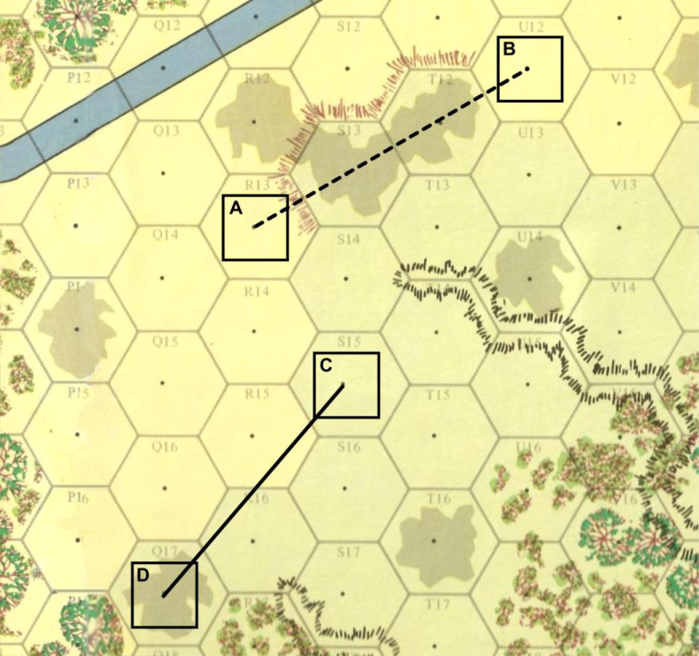

**LINE OF SIGHT: Nr. 1**

The LOS between A and B is blocked, because the terrain in S13 and T12 is higher than the hexes
occupied by A and 0. The LOS between C and D is clear, because the terrain between them is
lower, or at the same height, without blocking terrain.

_**AMBUSH! RULES: PAGE 19**_

**LINE OF SIGHT: Nr. 2**

The LOS between A and B is blocked,
because the embankment at Q16 / Q17 is
higher than B, but not adjacent to A. The
LOS between D and B is clear, because the
embankment between the two is adjacent
to D. The LOS between C and D is clear,
because both are at the same elevation, and
the embankments have no effect.

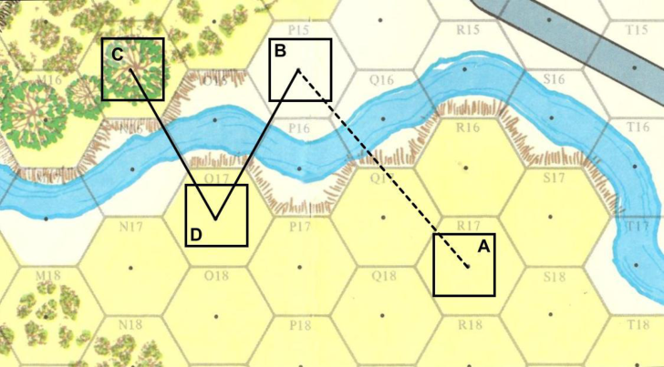

**LINE OF SIGHT: Nr. 3**

The LOS between A and B is blocked by
the wall hexside ( S9 / R8 ). The LOS between
A and C is clear, because each can see the
other in the field of view from the apertures
facing one another. The LOS between C and
B is blocked, because their aperture fields of
view do not coincide. The LOS between B
and G is blocked by building hex Q10, although B can see into Q10 . The LOS between B and D is clear, because the LOS
exactly bisects the brush in U11, and is thus
not blocked, and D is in sight of one of B’s
apertures ( S9 / T9 ). The LOS between D and
F is blocked by the two-story church steeple
in S13 . The LOS between E and F is
blocked, because the building hex S14 is not
closer to F than it is to E (the nonadjacent
apertures, in this case, are irrelevant). If E
were one hex further away, the LOS would
be clear. The LOS between C and D is
blocked, because an LOS can be traced only
one hex across a non-adjacent aperture
hexside. In this case, D can see Q10, but not
P9, and C can see R10, but no further.

BUILDING FIELDS OF VIEW

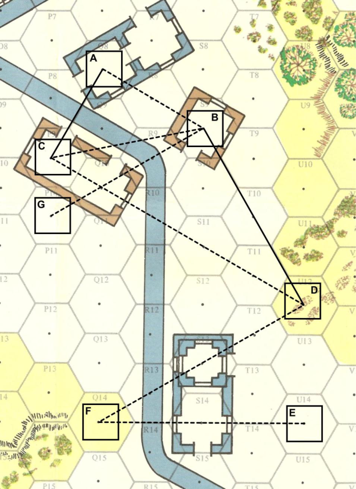

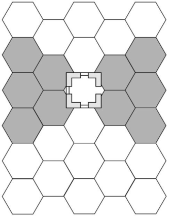
_**AMBUSH! RULES: PAGE 20**_

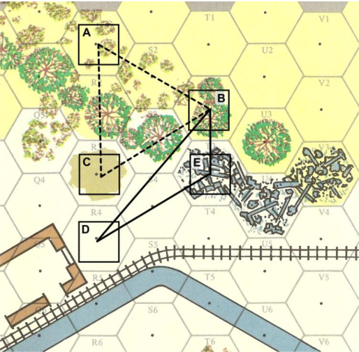

**LINE OF SIGHT: Nr. 4**

The LOS between A and B is blocked by the brush in hex S2, because it is at the same elevation. The LOS between A and C is
blocked by the woods in R2, because it is adjacent to and higher
than C. The LOS between B and C is blocked by the woods in S3,
because C is adjacent to the woods. However, D is not adjacent to a
woods hex, so the LOS from B to D passes over the woods in S3
and is clear. The Lines of Sight between B and E, and D and E, are
clear, because an LOS can be traced into a blocking terrain hex such as T3 - but not through it.

# **9. Fire Combat**

During Action Rounds, a crouching or standing soldier
can fire any weapon he possesses if he has at least one clip of
ammo for the weapon and if he can see the intended target of
his fire (see **8** ). A target can be attacked through an adjacent
building hexside, even if out of sight, if the hexside is penetrated ( **13/5** ). A crew weapon or bazooka must be prepared
before it can be fired (see **6/7** ). Fire combats are resolved one
at a time, in any order for the US and in alphabetical order as
indicated by the letter on each German’s AR marker (unless
two soldiers are firing a crew weapon together). The results of
a successful fire are applied immediately upon resolution. The
combat resolution may cause the weapon fired to break, become jammed, or use an ammo clip. Neither US nor German
soldiers can ever fire into a hex that contains a friendly active
soldier unless the shooter and the target are in the same hex.
The hex can be fired into if the friendly soldier is incapacitated
or dead, or if the friendly soldier is captured, however, you
cannot fire at the enemy soldier who is guarding the prisoner,
but you can fire at all other enemy soldiers in the hex.

**9/1 Fire Combat Procedure**

The following procedure is used to resolve all types of fire
combat, regardless of the weapon being used:
**1. Choose the Target and Fire Type**
Decide which weapon the soldier is firing (if he has more than
one) and whether he is conducting an aimed or snap fire Action ( **6/7** ). If there is more than one target in the target hex,
choose the actual target of the fire (see **9/2** ).

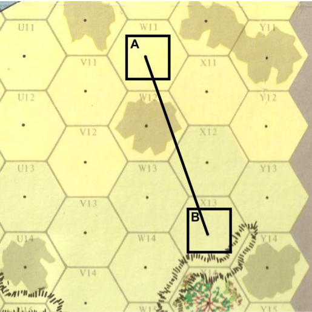

**LINE OF SIGHT: Nr. 5**

The LOS between A and B is clear, even though neither is adjacent
to the elevation change at W12 / X12 . If W12 / X12 were an embankment hexside, the LOS would be blocked.

**2. Consult the Jam or Dud Column of the Weapon Chart**
**and Roll Percentile Dice**
If the dice result is equal to or less than the number listed in
this column for the weapon type used, the weapon has jammed
or has fired a dud and the fire is resolved no farther. A jammed
weapon cannot be used again until the jam is cleared. When
snap firing a personal weapon twice, remember to roll for jam
use once for each fire.

**3. Determine the Fire Range**
If the target is in the same hex as the firing soldier or adjacent
to the firing soldier, range is not determined. Otherwise, count
the number of hexes that lie between the firing soldier and the
target (excluding the firing soldier’s hex but including the target’s hex). Locate the resulting number on the Weapon Chart
under the range column for the weapon being fired to determine the range of the fire: short, medium, or long.
**4. Determine the Basic Hit Chance According to Range**
Use the Adjacent or Same Hex range column if the target is in
an adjacent or the same hex; otherwise use the range determined in Step 3. Consult the Fire Combat Modifiers Chart and
add all the modifiers that apply to this fire ( **9/3** ). Combine these modifiers with the firing soldier’s Weapon Skill to yield a
final modifier. Subtract the final modifier from the Basic Hit
Chance to determine the final Hit Chance. If the final Hit
Chance is greater than 8 or less than 0, treat it as 8 or 0, respectively.

**5. Roll One Die**
If the result is equal to or less than the final Hit Chance, the
target is hit; proceed to Step 6. If the result is greater than the

_**AMBUSH! RULES: PAGE 21**_

final Hit Chance, the fire has missed; go directly to step 7. A
die roll of 0 is always a hit, while a roll of 9 is always a miss.
**6. Determine the Target Damage**
If the target is hit, roll one die and cross-reference the result
with the weapon being fired on the Damage Table section of
the Weapon Chart to determine what type of damage the target
takes (panicked, wounded, incapacitated, or killed), and
whether any penetration occurs (see **13** ).

**7. Roll Percentile Dice and Refer to the Out of Ammo**
**Column of the Weapon Chart**
If the dice roll is equal to or less than the number listed, the
fire has expended a clip of ammunition ( **9/5** ). When snap firing
a personal weapon twice, remember to roll for ammo use once
for each fire.

**FIRE COMBAT EXAMPLE:** _Soldier C is crouching in hex_ T3 _on Map_
_A and snap firing his semi-automatic rifle at soldier Q, standing in_
_hex_ P9 _. Determine if C’s weapon jams by looking up the jamming_
_chance for a semi-automatic rifle, then roll percentile dice; if the dice_
_result is 5 or less, the rifle jams. In this case, however, the result is_
_12, so no jam occurs. Range is determined by counting the hexes from_
T3 _to_ P9 _, excluding_ T3 _but including_ P9 _; the range is found to be 8_
_hexes, which is medium range for a semi-automatic rifle. The Base_
_Hit Chance for medium range is 4, which is then modified. Soldier_
_C’s Weapon Skill is -1, reducing the Base Hit Chance by one; Soldier_
_Q is standing in a clear terrain hex, applying a +1 modifier to the_
_Base Hit Chance (see Fire Combat Modifiers Chart). Finally, the_
_Base Chance is reduced by 2 because the fire is a snap fire. All modi-_
_fiers are combined (-1, +1, -2) to yield a total modifier of -2. This_
_modifier is then applied to the Base Hit Chance of 4, yielding a final_
_Hit Chance of 2. Roll one die; on a result of 0, 1, or 2, Soldier C hits_
_Soldier Q; any other result is a miss. A roll of 0 is always a hit, and 9_
_is always a miss regardless of modifiers. The roll in this example is 1,_
_thus scoring a hit. Roll one die and locate the result under the Per-_
_sonnel section of the Semi-Automatic Rifle row on the Weapons Chart_
_to determine the damage inflicted on Soldier Q. The roll in this exam-_
_ple is a 4, and soldier Q is wounded. Finally, determine whether or_
_not a clip of ammo is used by rolling percentile dice. A semi-_
_automatic rifle uses a clip on a roll of 25 or less. The result is 17;_
_thus, Soldier C uses a clip and marks off one of his semi-automatic_
_rifle Ammo Boxes._

**9/2 Multiple Fire Targets**

A target hex that contains more than a single enemy soldier or vehicle is a multiple target. A US soldier who is firing
at a multiple target can choose any one German soldier in the
hex that he can see as his target. A German soldier who is firing at a multiple target must fire at the one US soldier in the
hex in the most exposed stance (standing is the most exposed,
then crouching, then prone). If there is still a tie, determine the
target at random.

A soldier conducting aimed fire with an automatic weapon
against a multiple target receives an additional +1 to his Base
Hit Chance for each target in the hex beyond one. In addition,
his declared target is regarded as his primary target and, if he
hits his primary target, he may also be able to damage other
soldiers in the hex with the same fire (see **13/6** ).

Vehicles in a hex count towards the multiple target modifier for automatic fire even if they may be immune to damage
from this fire.

**9/3 Fire Shifts**

A number of modifiers based on the target’s stance, the
terrain the target occupies, the type of fire being conducted
(aimed or snap), the Weapon Skill of the firing soldier, and
other variables, affect the chance of a fire hitting its target.
Each modifier is expressed as a positive or negative number.
Add all modifiers that apply to the fire together to obtain a
single modifier result. Then add or subtract the final modifier
from the Base Hit Chance to determine the final Hit Chance. If
the final Hit Chance is greater than 8 or less than 0, treat it as 8
or 0, respectively.

The Fire Combat Modifiers Chart is used to determine a
fire modifier based on the target’s stance and terrain. Cross
reference the target’s stance with the terrain he occupies to
derive a positive or negative modifier. The stance and terrain
of the firing soldier does not affect the fire ( _**Exception**_ : Vehicles **17** ). The Fire Combat Modifiers Chart also lists all other
modifiers that affect fire combat.

**9/4 Weapon Jamming and Clearing**

When a weapon is fired or thrown, and you roll a percentile dice total that is equal to or less than the number in the Jam
column of the Weapon Chart, the weapon has jammed and no
fire occurs.

A German with a jammed weapon will use his second
weapon, if he has one; otherwise, he will attempt to unjam his
weapon. When a German Action Paragraph requires him to
fire, he attempts to unjam his weapon instead. If a German
becomes weaponless due to breakage or ammo depletion, he
will attempt to acquire a weapon from another German or inactive US soldier in his hex, using the Pick Up/Exchange
Equipment action ( **5/3**, **6/7** ). Use this action instead of the action indicated on his card as soon as he is in a hex with a suitable weapon.

**CLEARING A JAMMED WEAPON**

A jammed weapon (but not an explosive or penetration
round) may be cleared by successfully performing a Clear
Jammed Weapon action during Operations ( **5/3** ) or Rounds
( **6/7** ). Regardless of when it is done, the procedure is the same.
Roll one die and cross-reference the result with the soldier’s
Weapon Skill on the Clear Jammed Weapon Chart. A cleared
weapon can be used normally. A broken weapon cannot be
used for the remainder of the game. A soldier’s Weapon Skill
is reduced by 1 when attempting to clear a captured weapon
( **14** ).

**9/5 Ammo Expenditure**

**US AMMO EXPENDITURE**

A US soldier can carry up to six Ammo Boxes worth of
clips, grenades, or bazooka rounds. Each satchel charge takes
one Port Box to carry. When he throws a grenade, satchel
charge, or fires a bazooka, mark an **X** through the appropriate
box. When firing a weapon, there is a chance that a clip may
be expended. Roll percentile dice on the Out of Ammo column. If the dice roll is equal to or less than the number for the
weapon used, a clip is spent. The weapon type for the clip
spent must match the weapon fired. Ammo acquired by a soldier during a mission (from another soldier) can be marked in
any empty Ammo Box, including a box indicating spent ammo. Be sure to mark the removal of the clip from the soldier
that gave up the ammo.

If a soldier has a clip for a personal or crew weapon, reloading is automatic. A bazooka must be reloaded using the
prepare Bazooka action.

**GERMAN AMMO EXPENDITURE**

German soldiers do not have Ammo Boxes and do not expend ammo clips when firing. Germans can run out of ammunition as a result of a paragraph. When ordered to fire, a German soldier out of ammo will instead try to perform one of the
following actions, in order of precedence: fire secondary
weapon, exchange ammo with other German in same hex, take
the first other action from his list that does not require him to
fire, lie prone. He will never leave his movement path to get to
a possible “ammo source”.

If a US soldier acquires a German weapon that has not run
out of ammo, that weapon is assumed to have one ammo clip
or round, which is noted in one of the US soldier’s Ammo
Boxes.

_**AMBUSH! RULES: PAGE 22**_

**9/6 German Fire Combat Terms**

When a German fires, he uses his primary weapon, unless
it is out of ammo. If he has more than one weapon, the primary
weapon is the one with the greatest chance to hit (usually a
machine pistol or rifle). Grenades are never primary weapons.
Grenade use is always specifically called for by a paragraph.
When a paragraph instructs a German to fire, it will use one or
more of the following terms:

**Best Fire.** Aimed fire is the best fire possible, then snap fire. If
a soldier is unable to fire aimed fire, he fires snap fire instead.
Some paragraphs instruct a soldier to snap fire specifically.

**Closest Target.** The closest visible target is determined by
counting hexes from the German’s hex (exclusive) to the US
hex (inclusive). If there are two or more targets equally close,
fire at the easiest. If there is still a tie, determine the target at
random.

**Easiest Target.** The easiest target is the one the German has
the highest chance to hit. If there are two or more targets
equally easy, fire at the closest. If there is still a tie, determine
the target at random.

**9/7 Crew Weapons**

Light, medium, and heavy machineguns are crew weapons and
are represented with their own markers, showing the weapon
prepared on the front and unprepared on the back. A crew
weapon must be prepared before it can be fired.

**CARRYING A CREW WEAPON**

A crew weapon must be carried by two soldiers, in pieces.
Write the name of the weapon being carried in the Port Boxes
of the two soldiers. A light or medium machinegun takes up
three Port Boxes while a heavy machinegun requires four Port
Boxes. A machinegun can be carried only by two soldiers,

never more.

When a crew weapon is being moved, its marker should
have its unprepared side up. The marker can move with any
soldier who has a piece of the weapon. Soldiers carrying parts
of a crew weapon need not stay in the same hex, but the weapon cannot be prepared for fire unless both soldiers with a piece
of the weapon are in the same hex. Once this requirement is
met during Operations, the weapon is prepared; flip its marker
over. If Rounds are underway, one soldier in the hex must
spend an action to prepare the weapon. Once a crew weapon is
prepared, it remains prepared until a part of it is moved from
the hex. There is no cost to “unprepare” a crew weapon; simply move a soldier with a piece of the weapon and flip the
marker over.

**FIRING A CREW WEAPON**

A prepared crew weapon can be fired by one soldier or by
two soldiers working together. A soldier must be crouching to
fire a crew weapon.

A crew weapon fired by a single soldier is always a single
snap fire. If there are two soldiers in the hex, then each can
snap fire the weapon once, at a cost of one action each. A maximum of two soldiers can fire a single crew weapon in one
Round, regardless of the number of soldiers in the hex.

Two soldiers can combine their actions to make a single
aimed fire. In this case, both soldiers spend one action each,
simultaneously, and the fire is resolved as an aimed fire. The
two soldiers’ AR markers need not occupy the same Turn
space. For example, if a soldier has two turns and his partner
has only one turn, they can fire the crew weapon together when

the first soldier gets his turn. When two soldiers fire a crew
weapon together, declare one soldier as the firer and use his
Weapon Skill when resolving the fire. The other soldier is considered feeding to machinegun its ammo. However, when two
Germans are firing a crew weapon, the German with the higher
WS is the firer, unless instructed otherwise by a paragraph or
one of the soldier’s cards. For the second turn, only the first
soldier can fire the weapon, since the second soldier is out of
turns. The fire is a snap fire, since only one soldier is using the

weapon.

**CREW WEAPON EXAMPLE:** _Germans S and Tare manning a medi-_
_um machinegun. German T has two turns, while German S has only_
_one. Neither is wounded, and the German cards reveal that S fires the_
_machinegun while T assists. German T’s turn comes first, and T and S_
_fire the machinegun together as an aimed fire. T’s AR marker is_
_moved to the 1-Turn space and S’s AR Marker is moved to the Com-_
_plete space. The fire is then resolved using soldier S’s Weapon Skill._
_When T uses his second turn, the fire must be a snap fire using T’s_
_Weapon Skill, because only T is firing the weapon._

**9/8 Bazookas**

A bazooka is a personal weapon, but unlike other
personal weapons it cannot be snap fired. A bazooka counter is placed on the map with the soldier
carrying it. The counter shows the bazooka prepared on one side, and unprepared on the other. It must be prepared before it can be fired. Preparation is an action to load the
weapon. The loading soldier must be standing or crouching.
Once loaded it remains loaded until fired. Each fire uses up
one bazooka round; mark the round off the soldier’s ammo
boxes. A soldier carrying the loaded weapon can move with it
with no effect. A bazooka can be prepared by a soldier other
than the soldier carrying the weapon if both occupy the same
hex. To do so, the other soldier spends one action and the
weapon is prepared. It can then be fired if the holder has an
action.

A bazooka is both an explosive and a penetration weapon.
When you fire a bazooka at a soldier, use the Personnel result.
If the hex contains more than one active soldier, use the bazooka Personnel result against the target soldier, then roll separately for each other soldier in the hex using the Grenade Inside row of the Weapon Chart Damage Table. Thus, a single
bazooka round can injure more than one soldier in a hex.

When firing at a building or vehicle, use the Penetration
result. If a bazooka fire misses, it has no effect. It does not
scatter like a grenade or satchel charge. A bazooka round that
hits a building or vehicle can cause the building to collapse
( **13/5** ) or the vehicle to be knocked out ( **17** ).

**9/9 German Attacks on Buildings**
**(OPTIONAL)**

German soldiers and vehicles have no provision for firing
at targets lying prone in building hexes, because they are not in
sight, and therefore not valid targets, even though German
weapons are quite capable of penetrating buildings. The following optional German action is highly suggested because it
allows the German soldiers to fire at these hidden targets, Letting them do so is much more realistic, and evens things up a
bit.

If a German soldier who has fired at a visible target in a
wooden building hex receives a subsequent order to fire again,
but has no target because the US soldier has since fallen prone,
the German may now fire at the wall in an attempt to achieve a
penetration result. Conduct the following procedure for the
German:

1. If the paragraph gives no other options for the German (i.e., move, surrender, throw a grenade, etc.), the

_**AMBUSH! RULES: PAGE 23**_

German conducts a PC Check: If successful, the German
will fire at the wall; if fails, the German will do nothing.

2. If the German is allowed to fire at the wall, he will
crouch and conduct the procedure outlined in **13/5** .

# **10. Grenade/Satchel Charge** **Combat**

During Action Rounds, a standing or crouching soldier
can prepare and throw a grenade or satchel charge if he possesses one. Unlike fire combat, a grenade or satchel charge can
be thrown into a hex the soldier cannot see. In addition, it can
be thrown upstairs or downstairs in the church steeple in hex
S13 (Map B). Grenade and satchel charge combats, like fire
combats, are resolved one at a time; damage is applied immediately and there is a chance the weapon can “jam.” When a
soldier throws a grenade, cross off one of his ammo boxes containing a grenade. Mark off a soldier’s Port Box containing a
satchel charge when a soldier throws a satchel charge.

**10/1 Grenade/Satchel Charge Combat**

**Procedure**
The following procedure is very similar to that used to resolve fire combat, but differs in a few important ways:

**1. Choose the Target**
The target for grenades/satchel charges is a hex, not a soldier.
A soldier can throw a grenade up to six hexes if standing, or up
to three hexes if crouching. He cannot throw at all if prone. A
satchel charge can be thrown up to three hexes if a soldier is
standing and cannot be thrown at all if the soldier is crouching
or prone. The target hex need not be in his LOS, but he has a
better chance to hit when it is. The -3 modifier for Target Not
In Sight is applied only when the target **hex** is not in sight; it
does not matter if the soldiers in the hex are in sight. Neither
weapon can be thrown into or out of a building through a wall
hexside that has no aperture.
Grenades and satchel charges may be thrown into a vehicle in
the thrower’s hex. This is the only case where it is allowed to
throw a grenade/satchel charge into the same hex.
A location upstairs or downstairs of a thrower is considered as
adjacent, not as the same hex.

**2. Determine the Range**
A grenade/satchel charge cannot be thrown into the same hex
with the throwing soldier. If thrown into an adjacent hex, use
the Adjacent hex Base Chance on the Weapon Chart. Otherwise, count the range in hexes from the throwing soldier (exclusive) to the target hex (inclusive) and locate the result on
the Weapons Chart to determine the range: short, medium, or
long.

**3. Determine the Hit Chance**
As in fire combat, determine the Base Hit Chance by judging
the range. Then modify the Chance by using the modifiers
listed on the Grenade/Satchel Charge Combat Modifiers Chart
which apply to determine the final Hit Chance.
_**Note:**_ The Fire Combat Modifiers Chart is not used; thus the
stance of the target and the terrain in the target hex have no
effect; nor are there shifts for aimed or snap fire.

**4. Roll one Die**
If the die result is equal to or less than the Hit Chance, the grenade/satchel charge lands in the target hex, proceed to Step 5.
If the result is greater than the Hit Chance, the grenade/satchel
charge scatters ( **10/3** ). A roll of 0 is always a hit; a roll of 9 is
always a miss.

**NOTE:** A German tank will conduct the same procedure outlined above, but will fire its main gun at a stone wall, its coaxial or bow machinegun at a wooden wall.

**5. Determine Target Damage**
First, roll percentile dice to determine if the grenade/satchel
charge is a dud. If the result is a 5 or less, it is a dud, and has
no effect; otherwise, it goes off. If the grenade or satchel
charge lands in a hex containing one or more soldiers (friendly,
enemy, or both), roll one die and cross-reference the result
with the Grenade or Satchel Charge row on the Damage Table
portion of the Weapons Chart. The extent of damage caused by
an exploding grenade or satchel charge depends on whether the
target hex is interior or exterior. Use the damage line that applies. All soldiers in a hex in which a grenade or satchel charge
explodes suffer damage. Roll separately for each. Some results
are treated as panic results if the soldier is prone, as noted on
the damage tables.

**GRENADE EXAMPLE:** _German R in hex_ P4 _on map A throws a gre-_
_nade over the woods into hex_ K2 _, which is occupied by two US sol-_
_diers, both standing. The range is 5 hexes – long range for a grenade_
_throw – yielding a Base Hit Chance of 3. R cannot see his target, so 3_
_is subtracted from the Base Chance, yielding a final Hit Chance of 0._
_Any roll but 0 causes the grenade to miss and scatter into an adjacent_
_hex, using Grenade Scatter Diagram A. But the German is lucky and_
_rolls a 0: the grenade lands in_ K2 _. Both US soldiers are aware and_
_get to make PC Checks. One succeeds, but has no turns remaining; he_
_falls prone. The second has a turn, which would allow him to throw_
_the grenade out of the hex if his PC Check succeeds; but it fails, and_
_he remains standing. The combat is resolved using the Grenade Out-_
_side row of the Weapons Chart. Roll once for each US soldier. The_
_chance of the standing soldier taking damage is much greater than_
_that for the prone soldier._

**10/2 Grenade Strike PC Check**

When a grenade or satchel charge strikes a hex, every
aware soldier in the hex who is not inside a vehicle can make a
special PC Check ( **5/7** ). If a soldier who successfully makes
the check has any turns remaining in the Round and is standing
or crouching, he can immediately spend one turn to perform
the Action of tossing the grenade/satchel charge out of explosion range, where it explodes harmlessly. An unwounded soldier who makes the check but who does not have a turn remaining can immediately fall prone (at no cost). A soldier who
fails the check cannot react to the grenade or satchel charge at
all. Unaware and panicked soldiers cannot make the check.
German soldiers make the above checks even though no paragraph specifically instructs them to do so.

**10/3 Grenade Scatter**

When you make a grenade or satchel charge attack and
exceed the Hit Chance, the grenade or satchel charge scatters
into a hex other than the target hex. To determine where a scattered grenade or satchel charge lands, consult the following
grenade/satchel charge scatter diagrams.

Use Diagram A unless the LOS from the thrower’s hex to
the target hex exactly bisects the two hexes adjacent to the
target hex (in which case, use Diagram B). Roll one die to determine the hex the grenade/satchel charge lands in. Note that a
grenade/satchel charge thrown from a hex adjacent to the target hex can still land in the target hex if the die result is 6
through 9. A grenade/satchel charge that lands in a hex as a
result of scatter explodes and damages soldiers in that hex as
though it were the target hex.

_**AMBUSH! RULES: PAGE 24**_

When throwing a grenade or satchel charge through an adjacent aperture into a building, it is always assumed that the
grenade or satchel charge goes into the building (although not
necessarily into the target hex). If a grenade or satchel charge
roll fails, it is very possible that a scatter die roll on Diagram A
or B will scatter the weapon through a wall hexside without an
aperture. In such cases, the scatter procedure should be slightly
modified so that the grenade or satchel charge will bounce off
the wall, back into the closest hex in the direction of the throwing soldier. Grenades and satchel charges can never scatter
through a window or back into the thrower’s hex, but they can
scatter through a doorway. Should any problems arise in the
interpretation of these clarifications, apply common sense to
resolve the situation.

**10/4 Satchel Charges**

A satchel charge is a large bundle of explosives enclosed
in a case (usually TNT in a cloth satchel) used to destroy

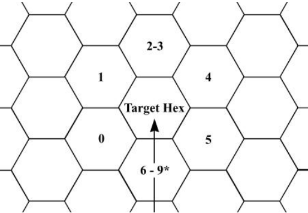

**Diagram A** _**Direction of Throw**_

*If throw originates in this hex, grenade lands in target hex.

# **11. Assault Combat**

During Action Rounds, a standing soldier can perform an
Assault or Move/Charge Assault Action to attack an enemy
soldier in the same hex. Assault is hand-to-hand combat and
thus does not expend ammo. Assaults are resolved one at a
time. A soldier can assault only one enemy soldier, even if
there are more in the hex.

**11/1 Assault Combat Procedure**

To make an assault, the attacking soldier must be standing
and must occupy the same hex as the soldier he is assaulting. If
the attacker is not in the same hex as the soldier he wishes to
assault, he must perform a Move/Charge Assault Action ( **11/3** )
in order to enter the defender’s hex and assault him. A soldier
assaulting a target in a wheeled vehicle must first enter the
vehicle (spending 1 MP). You cannot assault a target in a tank
or a Jadgpanther. The following procedure is used to resolve
an assault combat:

**1. Choose the Target**
If there is more than one enemy soldier in the hex, choose
which one is the target of the assault. A German soldier must
assault the US soldier in the most disadvantageous stance.
There are two stance categories: being prone or wounded is the
more disadvantageous; then crouching/standing. If there is a
tie, determine the target at random.
**2. Choose to Capture or Kill**
A US soldier can attempt to capture or kill a German, at your
option ( **11/2** ). An assaulting German always assaults to kill.

buildings and such. For game purposes, they are treated exactly like large grenades, with the following exceptions:
 They require a Port Box to carry instead of an Ammo Box.
 Satchel charges must be prepared before throwing. Prepared satchel charges (and bazookas and similar weapons but
not machineguns) may be carried around prepared without
losing prepared status.
 Satchel charges are more destructive than grenades.
 A soldier must be standing in order to throw a satchel
charge.
 A satchel charge can be thrown no further than three hexes.
 Satchel charges (but not grenades) may be ‘placed’ instead
of thrown. Placed satchel charges do not roll for scatter. Placing the charge takes one action. Once placed, designate a delay
time (number of turns) from 1 to 4. At the start of that turn,
before anything else happens, the charge explodes.

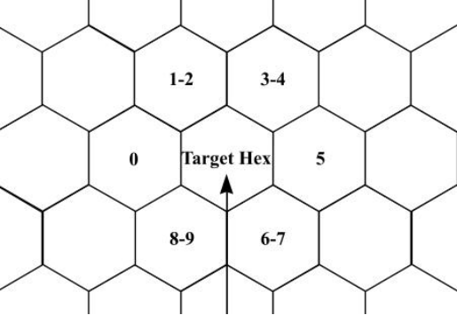

**Diagram B** **Direction of Throw**

**3. Determine the Hit Chance**
The Base Hit Chance is always the same, as listed on the
Weapons Chart. The Hit Chance is modified for any of the
modifiers from the Assault Combat Modifiers Chart that apply
to this attack.

**4. Roll one Die**

If the die result is equal to or less than the final Hit
Chance, the target is hit; proceed to Step 5. If the result is
greater than the Hit Chance, the assault misses; skip Step 5. A
roll of 0 is always a hit; a roll of 9 is always a miss.
**5. Determine the Target Damage**
If the target is hit, roll one die and cross-reference the result
with the Kill or Capture row, as appropriate, on the Assault
Table to determine what type of damage the target takes. Some
results are treated as Capture results if the target is prone or
wounded, as indicated on the Capture row of the table.

**ASSAULT COMBAT EXAMPLE:** _US Soldier D moves one hex to_
_charge assault to kill German X, who is standing, unpanicked and_
_unwounded. The Base Hit Chance for assault is 7, which is modified._
_D’s Weapon Skill is +1; there is a -3 modifier for charge assaulting;_
_and German X has a Weapon Skill of +2, which is subtracted from the_
_Base Hit Chance. The final modifier is -4, which is applied to the_
_Base Hit Chance of 7 to yield a final Hit Chance of 3. One die is_
_rolled; if the result is 4 or more, there is not effect; if 3 or less is_
_rolled, Soldier X is hit. The roll in this example is a 2, which is a hit._
_Consulting the Assault Table, roll one die on the Kill row. The result_
_in this example is a 7, which incapacitates the German._

_**AMBUSH! RULES: PAGE 25**_

**11/2 Capture**

An assaulting US soldier can attempt to capture, instead of
kill, his target. If he does so and hits his target, a capture result
may be obtained from the Assault Table.

A captured German immediately falls prone, if not already
prone, and a Captured marker is placed on him. The German’s
AR marker is immediately moved to the Inactive space of the
AR Track. He loses any turns he has remaining in the Round
and does not receive any turns until he is free. Any equipment
possessed by a captured soldier can be taken from him, using
the Pick Up/Exchange Equipment Action. Since a captured
German is inactive, play may switch from Action Rounds to
Operations if all Germans on the map are captured or otherwise inactive.

A captured German may be moved by a US soldier who
occupies the same hex. The Movement Allowances of the
German and his guard are reduced to 2. The German has a free
stance change unless already wounded. The German is still
inactive, and his Actions are determined by those of his guarding soldier.

During Operations, if a captured German is ever in a hex
without an active US soldier, he is immediately free; remove
his Captured marker and commence Rounds, if Rounds are not
already in progress. He receives turns normally beginning the
next Action Round. The German is activated and all US soldiers are automatically aware of him. If there are no US soldiers in sight at the beginning of the Round, the German soldier is removed from the map permanently (he ran away). Use
the Self-preservation column on his card to determine his Actions (regardless of the Condition or subsequent directions
given in paragraphs) for the rest of the mission. If he begins a
turn not in sight of US soldier, remove him from the map.

You cannot shoot prisoners, force them to walk into minefields, tie them up, or in any way intentionally harm them.
However, you can voluntarily leave them in a hex alone. The
captive is then considered free and Action Rounds are initiated
if not already in progress.

A US soldier guarding a captured enemy soldier can perform all Actions normally during Rounds, with the exception
of firing a crew weapon. A prisoner’s guard can be changed
only when the guarding soldier has a Turn and wishes to relinquish control of that prisoner. This change costs nothing.

# **12. Minefields and Boobytraps**

During both Operations and Rounds, your soldiers may
stumble upon minefield or boobytrap hexes.

**12/1 Boobytrap Procedure**

When a US soldier enters a hex during Operations or
Rounds, a paragraph may state that the hex contains a boobytrap set by the Germans. The first US soldier to enter such a
hex must immediately conduct a PC Check ( **5/7** ). If the check
succeeds, the soldier is unaffected and the boobytrap no longer
exists in the hex (place a Boobytrap marker in the hex). If the
check fails, the boobytrap explodes and the soldier suffers
damage as if hit by an exploding grenade indoors (even if he is
in an outdoor hex). Once the boobytrap explodes, it no longer
exists (place a Boobytrap marker in the hex). If more than one
soldier enters a hex with a boobytrap at the same time, the soldier with the highest PC conducts the PC Check; however, if
the boobytrap explodes, all soldiers in the hex suffer damage
(roll a die separately for each soldier).

Should automatic weapons fire or a grenade or satchel charge
be fired into the hex, both the prisoner and his guard take damage normally.

There is no limit to the number of enemies a soldier may
guard.

**11/3 Charge Assault**
A soldier who does not begin his turn in the same hex with a
target may perform a Move/Charge Assault Action to move
into the hex and then assault. He can expend only half his
Movement Point Allowance, rounded down, in order to enter
the hex. Thus, a soldier with a Movement Point Allowance of
3 could not cross a window to enter the defender’s hex, since
this would cost 2 Movement Points, and his halved MPA is
only 1. A charge assault is conducted with an additional -3
modifier to the Base Hit Chance, as summarized on the Assault
Combat Modifiers Chart.

**11/4 Assault Modifiers**

When assaulting, the attacker’s WS is used to modify the
Base Hit Chance. In addition, if the soldier being assaulted is
not panicked or wounded and has a Weapon Skill of +1 or +2
then his Weapon Skill is subtracted from the Base Hit Chance
(a WS of 0 or less has no effect). A US soldier who is unaware
when assaulted cannot use his WS to modify the German assault. An unaware soldier that is assaulted automatically becomes aware after the assault is resolved.

The Base Hit Chance is modified by -2 if the attacker is
already wounded when the assault is resolved. If the target is
wounded, he cannot modify the assault with his Weapon Skill.
Otherwise, his wound has no effect.

The Base Hit Chance is modified by -3 if the attacker is
making a charge assault.

If the only weapon available to the attacker is a captured
weapon, then the -1 modifier for “captured weapons use” applies to the assault.

All modifiers are totaled to yield one final total that is then
used to modify the Base Hit Chance, yielding the final Hit
Chance.

**12/2 Minefield Procedure**

Minefields are similar to boobytraps except that they are
permanent features. When a US soldier first enters a hex, a
paragraph may state that the hex is a minefield; place a
Minefield marker in the hex. That US soldier, and every US
soldier to enter the hex later, must make a PC Check ( **5/7** ). If
the check succeeds, he is not harmed, but the minefield may
still affect other soldiers. If the check fails, a mine in the field
explodes and the soldier suffers damage as if hit by an
exploding grenade indoors. Other soldiers in the hex are not
affected by the explosion. If more than one soldier enters a
minefield at the same time, each soldier conducts a separate
PC Check, and only those who fail their check suffer the
effects of an exploding mine. Minefields have an unlimited
number of mines and are thus never depleted or destroyed.

_**AMBUSH! RULES: PAGE 26**_

# **13. Damage**

The results of a successful combat (fire, assault, minefield,
etc.) inflict damage on the target of the attack. If the target is a
soldier, he is either wounded, incapacitated, killed, or immediately panicked. If the target is a vehicle or wall, the target may
be penetrated by the fire, and the crew or people behind the
wall may suffer damage as well. The Damage Table section of
the Weapons Chart and the Assault Table determine the damage to soldiers. The Damage Table determines the penetration
result against a vehicle or wall. Soldiers recover from wounds
and incapacitation between missions when playing a campaign.

**13/1 Panic Results**

A common result on the Damage and Assault Tables is
Panic. This result is identical to the Panic that can befall a soldier during the Action Sequence ( **6/4** ), only this Panic occurs
during the Round itself. A panicked soldier is subject to the
following restrictions:
 If Rounds are in progress, he loses any turns he has remaining in the current Round; move his AR marker to the Panic
space. He can perform no actions in the Round, including a
free stance change. Instead, he remains immobile for the duration of the Round. At the end of the Round, he falls prone (if
not already prone). If in Operations, the Panic result has no
effect.

 A panicked commander has no command radius and cannot
give turns to other soldiers or make other soldiers aware ( **6/3** ).
 A panicked soldier cannot use his Weapon Skill when defending against an assault attack.
 A panicked soldier falls prone at the end of the Round, if
not already prone.

**13/2 Wound Results**

A wounded soldier is subject to the following restrictions:
 When the wound occurs, the soldier immediately falls
prone if not already prone. Place a Wounded marker on him.
The Wounded marker remains on the soldier for the rest of the
mission (unless he is incapacitated or killed).
 A wounded soldier loses any turns he has remaining in the
current Round; move his AR marker to the Complete space on
the AR Track.

 A wounded soldier can receive only one turn per Round. If
a roll in the Action Sequence indicates that the soldier receives
two turns, place his AR marker in the 1-Turn space instead.
 A wounded soldier cannot use his Weapon Skill to modify
an assaulting attacker’s Hit Chance. In addition, when a
wounded soldier makes an assault, there is a -2 modifier
against him.
 A wounded soldier’s Port Box total is reduced to one; put
an **X** through one box. If he is carrying two Port Boxes of
equipment, he must immediately drop the contents of one Port
Box. If the item he is carrying is a two-box item, he must drop
it immediately.
 A wounded soldier cannot be given a turn or be made
aware by a commander ( **6/3** ).

 There is a -2 modifier to the Base Hit Chance for a wounded soldier throwing a grenade or satchel charge.

 There is a -1 modifier to the Base Hit Chance for a wounded soldier firing a weapon.

 A wounded soldier has his Movement Point Allowance
reduced to 2 for the rest of the mission. Record his reduced
MPA on the Squad Record.

 A wounded soldier never receives a free stance change. The
only way he can change stance is by paying a Movement Point
to do so.

 A wounded soldier who suffers an incapacitation or second
wound result is incapacitated.

**13/3 Incapacitation Results**

An incapacitated soldier is subject to the following restrictions:

 When the incapacitation occurs, the soldier immediately
falls prone if not already prone. He remains prone for the rest
of the mission. Place an Incapacitated marker on the soldier
(where it remains for the rest of the mission, unless he is
killed).
 An incapacitated soldier cannot perform actions of any kind
for the duration of the mission. Move his AR marker to the
Inactive space on the AR Track.
 An incapacitated soldier, either US or German, cannot be
intentionally attacked in any way. Unintentional attack, such as
a grenade scattering into the incapacitated soldier’s hex is allowed. A soldier can fire into a hex containing an incapacitated
soldier, but the incapacitated soldier is not a target and thus
cannot be hit.

 An incapacitated soldier can be moved from one hex to an
adjacent hex by an active standing soldier, or put into or taken
from a vehicle by an active standing soldier. However, each
time such an action is performed, you must roll one die; on a
result of 0, the soldier dies (any other result is no effect). This
die roll is not made when an incapacitated soldier is being
moved from hex to hex in a vehicle.

 An incapacitated soldier who suffers a wound or second
incapacitation result is killed.

**13/4 Kill Results**

When a soldier suffers a kill result, he is dead. Move his
AR marker to the Inactive space and place a Killed marker on
him. He can be moved by other soldiers like an incapacitated
soldier.

**13/5 Penetration Results**

Some weapons have the ability to penetrate their target,
noted by a range of numbers under the Penetration results on
the Damage Table portion of the Weapons Chart. Penetration
applies only to fire against a wall or vehicle. The effects of
penetration depend on whether or not the weapon fires an explosive shell. Bazookas and tank main guns fire explosive
shells; all other weapons fire non-explosive bullets. There are
three levels of penetration:
**Light Penetration.** If the shell is explosive, the penetrated surface is destroyed. If non-explosive, the fire passes through a
wooden wall or non-armored vehicle surfaces.

**Medium Penetration.** If the shell is explosive, the penetrated
surface is destroyed. If non-explosive, the fire passes through
any type of wall or vehicle surface except a heavy armored
vehicle surface.

**Heavy Penetration.** Regardless of fire type, explosive or nonexplosive, the fire passes through and destroys any type of wall
or vehicle surface.

A wall may be the target of an attack and 4 is added to the
Base Hit Chance when doing so. A soldier occupying a hex
when one of its wall hexsides is penetrated (but not destroyed)
can be hit by the fire. Roll one die. A prone soldier is hit on a
result of 0; a crouching soldier is hit on a result of 0 or 1; a
standing soldier is hit on a result of 0, 1, or 2. If the soldier is
hit, roll for damage normally. If more than one soldier is in the

_**AMBUSH! RULES: PAGE 27**_

hex, the fire hits the soldier in the most exposed stance first. If
there are two or more soldiers in the most exposed stance, determine the target of the attack at random. If a hex with more
than one active soldier is attacked by aimed automatic weapons fire, roll one die for each and every soldier to see if he is
hit.

If a wall is destroyed, all soldiers in the building hex that
the wall bordered are automatically hit. Check damage to each
such soldier as if he were hit by semi-automatic rifle fire. A
destroyed wall is treated as a clear hexside from then on. If a
building hex has two of its wall hexsides destroyed, the building collapses and becomes a rubble hex. Any soldiers occupying the hex when this occurs are killed.

**13/6 Aimed Automatic Weapon Damage**

If an Aimed Fire with Personal/Crew Weapon Action is
made with an automatic weapon, there is a chance of hitting

# **14. Captured Equipment**

During the course of the game, it is very likely that you
will capture various kinds of German equipment. You may
take it from incapacitated, killed, or captured Germans using
the Pick Up/Exchange Equipment Action. This equipment can
be used with the following restrictions:

**Personal Weapons and Crew Weapons.** Each captured
weapon is considered to have only one clip or round of ammo
when captured. A German weapon that runs out of ammo during a Round has no ammo if captured by the US. When using a
captured weapon, the US soldier’s Weapon Skill is considered

# **15. Victory**

In _**Ambush!**_ you play to beat the game system itself. Victory is determined by the accumulation of Victory Points
(VPs). The number of VPs you have acquired at the end of a
mission determines whether you win or lose.

On the Squad Record are two boxes to record the VPs you
gain and lose during the mission. Keep the two totals separate.
You gain VPs for performing the tasks listed in the Mission
Briefing and as revealed in paragraphs during the mission. You
lose two VPs for each US soldier killed or incapacitated during
the mission.

more than one target in the hex. If the primary target in a multiple target hex ( **9/2** ) is hit by the aimed fire, roll for damage
and apply the result to the primary target normally. If the damage die roll was greater than 0, roll for damage again. If the
result of the second roll is less than the result of the first roll,
apply the indicated damage to a second target in the hex. If
there is a third target in the hex and the second roll was a hit,
roll for damage again; if the result of the third roll is less than
the result of the second roll, apply the indicated damage to the
third target. As long as each damage roll result is less than the
one before it, keep rolling for each possible target in the hex.
Once a damage die roll result is equal to or greater than the
previous roll in this process, stop immediately. If there is more
than one target (other than the primary target) in the hex, attack
the most exposed first (standing, crouching, prone); settle ties
at random.

reduced by 1 for all purposes. Once captured, use the US ammo depletion procedure, not the German one.

**Grenades.** Captured grenades can be used just like normal US
grenades, with no reduction to the soldier’s WS.

**Radios.** Captured radios cannot be used by the US.

**Vehicles.** Captured vehicles, other than tanks, can be driven by
US soldiers. However, the Driving Skill of the driver is considered reduced by 1. A soldier with an original Driving Skill
of 0 cannot drive a captured German vehicle.

In some missions, VPs are not lost for incapacitated US
soldiers that you get off the map or into certain listed hexes.
Victory points gained or lost by additional forces on the player’s side count towards the player’s VP total if not instructed
otherwise.

gain and lose during the mission. Keep the two totals separate. At the end of the mission, subtract your VP losses from
You gain VPs for performing the tasks listed in the Mission your VP gains to determine your VP total. Compare this total
Briefing and as revealed in paragraphs during the mission. You to the schedule in the Victory section of the Mission Briefing.
lose two VPs for each US soldier killed or incapacitated during If the result is greater than or equal to the mission’s requirethe mission. ment, you have won; if less, you have lost.

**You Are Now Ready to Play Mission 1**

_**At this point, you know all the rules you need in order to play Mis-**_
_**sion 1: Bloody St. Mick. If you wish to play the game as a campaign**_
_**using the same squad from mission to mission, read 16 before be-**_
_**ginning Mission 1. If you do not wish to play this as a campaign, or**_
_**you will begin your campaign beginning with Mission 2, begin Mis-**_
_**sion 1 now.**_

_**AMBUSH! RULES: PAGE 28**_

# **Mission 1: Bloody St. Mick**

Late June, 1944. Your squad’s parent division is advancing cautiously through the bocage country of Normandy. Earlier in the day, another squad was sent ahead to seize a lateral
stretch of St. Michaux road that, under Allied control, could be
used for ground communication between advancing British
forces to the east and US forces to the west. Unfortunately, the
first squad was forced to withdraw under heavy sniper fire
from hidden German positions. This afternoon, your more experienced squad is assigned to attempt the same mission: establish control of the St. Michaux road.

**YOUR SQUAD**

You can use the pre-generated squad in this booklet, or
generate one of your own. If you use the squad provided, copy
the data onto a blank Squad Record for use in this scenario. If
you generate your own, use the equipment listed on the pregenerated squad instead of buying your own for this mission.

**SET UP**

Use Map A. The top of the map is the north edge. Your
soldiers can enter the map in any hexes on the north edge between A1 and J1 (inclusive). No markers begin the mission on
the map. There are no special rules in this scenario, and the
water barrier on the map is considered a stream. The Activation Levels are as follows:

**c1:** 0-1. **c2:** 0-3. **c3:** 0-5. **c4:** 0-8.

# **16. Campaign**

_**Ambush!**_ can be played as separate missions or as a continuous campaign. If playing separate missions, use the pregenerated Squad Record in this booklet or generate a new
squad for each mission. When playing a campaign, use the
same squad on each mission and replace any killed soldiers
between missions. The game is most fun when played as a
campaign, because the individual soldiers acquire a history and
take on lives of their own.

The missions are not presented in chronological order. If
you wish to play them in chronological order, by all means do
so, but you will have to learn certain scenario-specific rules
earlier this way.

**16/1 Campaign Procedure**

For the first mission, use the squad provided in this booklet or one you generate yourself. This squad will then be used
to play the remaining seven missions. As you play, note any
great deeds a soldier performs, in abbreviated form, on his
Combat Point section of the Squad Record as a reminder. At
the end of each mission, use the following procedure to award
Combat Points, improve soldier characteristics, and replace
killed soldiers.

**1. Award Combat Points**
At the end of the mission, award each of your surviving soldiers Combat Points using the procedure and guidelines of
**16/2** . Incapacitated soldiers receive CPs if you manage to
avoid VP loss for these soldiers by exiting them from the map
or by another method (as described each mission).

**2. Spend Combat Points**
A soldier who has 6 Combat Points can spend them to increase
his various ratings using the procedure and costs in **16/3** . If he
has fewer than 6 CPs, he cannot spend them at this time. However, CPs can be carried over from mission to mission.

**3. Generate Replacement Soldiers**
For each US soldier killed during a mission, you must generate
a replacement soldier, using the procedure outlined in **16/4** .

**VICTORY**

You need 13 Victory Points to win this mission. The mission ends in one of two ways.

1. At least one active US soldier is in the building hex T8, at
least one US soldier is in the building hexes K13 and L13, and
at least one active US soldier is in any hex of the heights in the
southeast corner of the map (defined by the elevation change
running from Q19 to Y13 ) from which he can see all the road
hexes on the map. No active Germans can be on the map. If the
mission ends in this manner, you have accomplished your mission and earn 4 additional Victory Points.

2. All active US soldiers have exited the map from hex A1
through hex J1 (inclusive).

At the end of the mission, total your Victory Points to determine whether or not you have won. VP loss for an incapacitated US soldier can be avoided by moving him off the map
from hex A1 through J1 or, if mission ending 1 is accomplished, by moving him into either building hex.

Other Victory Point awards will be revealed during the
mission.

**16/2 Combat Point Awards**

Combat Points are used to represent gains in ability due to
each soldier’s experiences and actions during missions. When
a soldier has accumulated 6 CPs, he can spend them to increase one of his ratings – either his IN, PC, WS, or DS.

To determine the number of Combat Points your squad receives at the end of a mission, multiply the number of soldiers
who survived the mission by 4 if you won the mission, or by 2
if you lost. The result is the number of Combat Points the
squad receives. Soldiers who were incapacitated during the
mission are considered to survive the mission if you avoid VP
loss for their incapacitation, as described in the Victory section
of each mission briefing. An incapacitated soldier who causes
you to lose two Victory Points is considered killed and must be
replaced when the mission ends. A surviving incapacitated
soldier recovers from his wounds between missions and begins
the next mission unwounded.

For example, you win Mission 1, and at the end you have
two soldiers killed, two soldiers incapacitated, and four who
got out intact. If you managed to exit the two incapacitated
soldiers from hexes A1 through J 1, they survive the mission. If
only one were exited successfully, your squad would be
awarded 20 Combat Points (5 soldiers multiplied by 4 for winning).

Each surviving soldier automatically receives one CP. The
remaining CPs are divided among the squad members as you
see fit. Soldiers should be rewarded according to how well you
thought they fought and how important they were to the mission. A single soldier cannot be awarded more than 6 CPs at
the end of a single mission. As you play a mission, record the
possible reasons for CP awards in each soldier’s CP box in
abbreviated form. The following guidelines serve as a basis for
these awards, although they do not cover all eventualities. Special events, such as blowing bridges and saving wounded comrades, should also be rewarded, as should commanders giving
important turns to other soldiers. Be creative, and award the
discretionary points as you feel they are deserved.

_**AMBUSH! RULES: PAGE 29**_

For example, wounding a German is usually worth only 1
CP, but if the German was a machine gunner pinning the entire
squad, the soldier who wounds him should probably be awarded 2 CPs instead of 1.

RECOMMENDED

SUCCESSFUL ACTION ABBREVIATION CP AWARD

**Kill German by Fire** **KF (German #)** **2**
**Incapacitate German by** **IF (German #)** **2**

SUCCESSFUL ACTION ABBREVIATION

**IF (German #)** **2**

**Fire**

**Wound** **German by Fire** **WF (German #)** **1**
**Kill German by Assault** **KA (German #)** **3**
**Incapacitate German by** **IA (German #)** **3**

**Assault**

**Capture German by**

**Assault**

**Wound German by**

**Assault**

**CA (German #)** **3**

**WA (German #)** **2**

**Knock Out Tank** **KOT** **4**
**Immobilize Tank** **IMT** **3**

**Knock Out** **Car** **KOC** **3**

At the end of the mission, divide your squad’s CPs among
the surviving soldiers by filling in their CP boxes. Use pencil,
because they will probably be erased later. It is likely that you
will have more CP boxes filled in with abbreviations than you
have CPs to distribute. This is intentional. After distributing
CPs, erase the abbreviations in those boxes that were not actually awarded a CP.

For example, a squad completing Mission 1 was awarded
20 CPs: 1 per soldier and 15 discretionary. The soldier’s CP
boxes were filled in with the following abbreviations over the
course of the mission:

|A|KF 7|WF 2|Turn|Col5|Col6|Col7|
|---|---|---|---|---|---|---|
|~~B ~~ |~~KA 48~~ |~~KF 90~~ | | | | |
|~~C ~~ |~~KF 2~~ | | | | | |
|~~D ~~ |~~Bridge~~ |~~IF 76~~ |~~KF 39~~ |~~WA 48~~ | | |
|~~E ~~|||||||

You decide to give soldier E no additional CPs, since he
was incapacitated before he could do much. You give soldier
D five additional CPs, for a total of 6, because he was the most
decisive individual in the game by blowing the bridge and successfully attacking three Germans. He actually deserves more
than 6 CPs, but you are limited to 6 per mission. Soldier C
killed German 2, which would normally entitle him to 2 CPs,
but the German was already wounded. Thus, you award C only
1 additional CP, for a total of 2. Soldier B killed German 48 by
assault, but the German was already wounded. He also killed
German 90 by fire. You decide he deserves only 4 additional
(SP’s because, while important, the actions were not decisive,
and soldier B panicked at a critical moment, causing one US
soldier to be killed.

You give soldier A, your commander, the remaining 5 CPs
for killing one German, wounding another, and giving the turn
to soldier D that allowed him to blow the bridge. In the final
tally, you fill in the following number of CP boxes for each
soldier on the Squad Record:

A: 6 B: 5 C: 2 D: 6 E: 1

You are now ready to spend soldier A’s and soldier D’s
CPs to improve their characteristics ( **16/3** ).

# **17. Vehicles**

_**Ambush!**_ includes both German and US vehicles. In some
missions, you will be assigned a vehicle; otherwise, you will
encounter the vehicles during play. There are two basic types
of vehicles: cars and tanks. Cars include jeeps, Kubelwagens,
and staff cars, while tanks include German Panzer IV’s and

**16/3 Improving Soldier Characteristics**

If a soldier has accumulated 6 CPs, you can spend them to
improve the soldier’s ratings. If a soldier has fewer than 6 CPs,
they cannot be spent. Instead, they are accumulated from mission to mission until the soldier has 6 to spend. If a soldier has
more than 6 CPs accumulated, he can spend them in groups of
6. Any unspent CPs are not lost. When a soldier has CPs he
has not spent, simply transfer them to his CP boxes when you
fill out the Squad Record for the next mission.

You can spend 6 CPs to raise a soldier’s Initiative, Perception, Weapon Skill, or Driving Skill. Each rating has a maximum, above which it cannot be raised:

IN: 5 PC: 9 WS: +2 DS: 8

When CPs are spent to raise Perception or Weapon Skill,
the rating is raised by one. Driving skill is raised by two. Initiative is a more basic human ability and is raised using the
following procedure. Spend the 6 CPs and roll one die. Locate
the result on the following table. If the result is an IN, the soldier’s Initiative is raised by 1; if the result is a PC, the soldier’s
Perception is raised instead. You may have to change the soldier’s MPA if his Initiative increases from 1 to 2 or from 4 to
5. If you try to improve the IN rating when a soldier’s PC is
already 9 but fail, the CP are lost.

**Initiative Increase Table**

**CURRENT INITIATIVE RATING**
**DIE** **0** **1** **2** **3** **4**

0-2 PC PC PC PC PC

3-4 IN IN PC PC PC

5-6 IN IN IN PC PC

7-8 IN IN IN IN PC

9 IN IN IN IN IN

**16/4 Replacements**

After you have determined and spent your CPs, you are
ready to replace your killed soldiers and those incapacitated
soldiers you were unable to save. On your Squad Record, you
recorded each soldier’s cost in Squad Points next to his name
in the box provided. When the soldier needs replacing, you can
spend those Squad Points again. Furthermore, you can combine all such soldiers into one Squad Point total to spend. In
this way you need not buy exact replacements (although you
often will). In a campaign, the squad points of your squad do
not change.

**EXAMPLE:** _You lost three soldiers costing 8, 5, and 1 Squad Points,_
_respectively. Thus, you have a total of 14 Squad Points to buy three_
_replacements. You decide to buy soldiers costing 8, 3, and 3 Squad_
_Points and record their costs on the new Squad Record._

After buying replacements, generate their new ratings using the Perception, Weapon Skill, and Driving Skill tables, and
the Movement Point Allowance Chart. Record them on the
Squad Record and you are ready to begin a new mission. Rearm your entire squad at the beginning of the next mission,
using your squad’s Weapon Point total. You may keep the
weapons points constant for all missions, or you may reroll
them for each mission, but not a mixture of both.

Jadgpanthers and US Shermans. Each vehicle has a different
set of attributes and is summarized in its own rules section. All
German vehicles have cards which determine the vehicle’s
actions during play. US vehicles have no cards (with one exception), and you can perform actions with them as you wish.

_**AMBUSH! RULES: PAGE 30**_

**17/1 Vehicle Attributes**
**Size.** Each vehicle is classified as large or small. A large vehicle presents an easier target to hit than a small vehicle.

**Armor.** A vehicle can be armored or non-armored. An armored
vehicle has an armor rating (light, medium, or heavy) assigned
to each of its parts. An armored vehicle hit by fire is not affected unless the fire achieves a penetration result ( **13/5** ) that
equals or exceeds the armor rating of the part of the vehicle hit.

**Open/Closed.** In an open vehicle, all occupants are always
exposed to enemy fire. In a closed vehicle, the occupants may
not be hit by fire. Non-armored vehicles can only be open.
Place a closed marker on a closed vehicle to indicate its status
(no marker is used to indicate open status). An armored vehicle
can change from open to closed at any time during Operations.
During Rounds, the vehicle crew must spend an action to open
or close.

**Occupants.** Every car has a maximum number of soldiers
(active or inactive) it can carry, including the driver and all
passengers. During Rounds, the occupants of the vehicle spend
actions independently. Only the occupant identified as the
driver can spend actions to drive the car. Tanks cannot carry
passengers and have a crew that cannot leave the tank.

**Speed.** Each vehicle has a fast and slow speed used for
movement during Rounds. When driving fast, there is a chance
a vehicle accident may occur, based on the Driving Skill of the
driver. During Rounds, a closed tank cannot travel fast, nor
may a car which has had its tires shot out.

**Hit Chart.** Each vehicle has a Hit Chart in its description that is
used to determine the location and effects of each successful
fire combat against the vehicle. Grenades and satchel charge
attacks against vehicles are not resolved using the Hit Charts.

**17/2 Vehicle Facing**

Each vehicle counter has an arrow that points toward the
hexside that the front of the vehicle faces. A vehicle can move
by entering the hex in front of it or by backing up into the hex
directly behind it. There is no additional cost to turn a vehicle
during Operations or Rounds.

Each vehicle has a front, side, and rear that can be hit by
enemy fire. Depending on which side is hit, the armor protection and chance of hitting various parts of the vehicle vary, as
shown in the Vehicle Summary. To determine the side hit,
locate the firing enemy’s position relative to the target vehicle’s facing on the diagram following. If both attacker and target occupy the same hex, the attacker has his choice of which
side to attack (determine the side at random for German attacks).

When a vehicle enters a hex, it faces the hexside opposite
the one it crossed to enter the hex. When it enters another hex,
change its facing to enter the new hex.

**17/3 Vehicle Movement During Operations**

During Operations, vehicles with an active driver or crew
can move hex by hex across the map. Just like soldiers moving
on foot, you must make a Paragraph Check for each hex the
vehicle enters. A vehicle can enter any type of hex except a
building, rubble, or river hex. A large vehicle cannot enter a
woods hex. Accident Checks are not usually conducted during
Operations. A maximum of two vehicles can occupy the same
hex at the same instant. A disabled vehicle does count against
this limit.

**17/4 Vehicle Movement During Rounds**

A soldier in the driver’s seat of a car can spend one turn to
perform the Drive Vehicle action. The crew of a tank can per

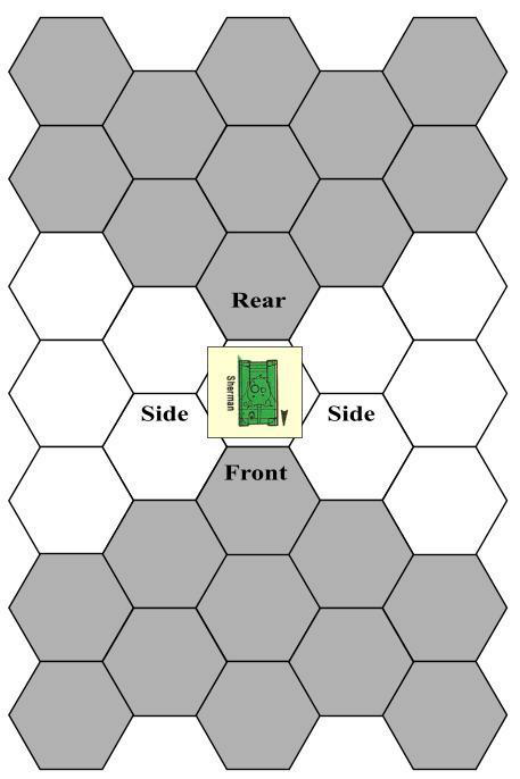

**VEHICLE FACING**

form the Drive Vehicle action alone, or in combination with
other actions, during a turn.

Each vehicle has two MPAs, slow and fast. Refer to the
Vehicle Summary to find the MPAs of the vehicle being driven. A vehicle can be driven slowly at no risk of accident, or
fast using the driver’s or crew’s Driving Skill to avoid accidents. When a German vehicle moves, the action paragraph
will indicate whether it moves slowly or fast. When a US vehicle moves, you decide whether to move slowly or fast. A
closed tank can never move fast.

When a vehicle moves, it spends Movement Points to enter hexes, just as soldiers do. A vehicle pays the Movement
Point cost for each terrain type as listed on the Movement
Point Cost Chart. Vehicles are prohibited entering certain terrain types listed on the chart. A vehicle cannot expend more
MPs than the Movement Point Allowance, slow or fast, then in
use. When moving a German vehicle, expend as many MPs of
its applicable MPA as possible. A vehicle cannot enter a hex if
it does not have sufficient MPs to pay the terrain cost, even if
this would be the only hex of its move. There is no additional
Movement Point cost to change facing.

When a vehicle is moving and exceeds its slow MPA, it is
moving fast and an Accident Check must be made. The check
is made the moment the vehicle exceeds its slow MPA. Use
the DS of the crew (for a tank) or driver (see Accident Checks,
**17/9** ).

Only two vehicles, disabled or otherwise, can end a turn in
the same hex. However, an unlimited number of vehicles can
move through the same hex during a turn.

_**AMBUSH! RULES: PAGE 31**_

A vehicle can run over enemy soldiers, using the procedure in **17/12** .

You may not intentionally drive a vehicle into a crater
hex; however, a movement reference might force a vehicle to
enter one. If so, the vehicle enters the hex at a cost of 3 MPs,
and makes an immediate Accident Check. Craters have no
effect on fire combat against vehicles.

**17/5 Drivers, Passengers, and Crew**
**Cars.** A soldier in the same hex as a jeep, Kubelwagen, or staff
car can be the driver, a passenger, or can be outside the vehicle. The counters for all soldiers inside a vehicle should be
stacked under the vehicle counter. The driver is noted by having his counter on the top of the stack. The next counter is Passenger 1, then Passenger 2, and so on. If the driver changes,
put the new driver on top. Soldiers can change places in a vehicle, or get in or out of the vehicle, at any time during Operations or by spending a Movement Point during Rounds. A soldier outside a car should be placed on top of the vehicle.

**Tanks.** A tank is operated by a crew that is an integral part of
the vehicle, as shown on its card. The number of active crew in
a tank determines its IN, PC, WS, and DS ratings. Soldiers
cannot enter, drive, or ride upon tanks. Thus, a soldier in the
same hex as a tank is outside the vehicle.

**Soldier Stances.** A soldier’s stance is irrelevant when occupying a vehicle. Ignore any references to a soldier’s stance when
he occupies a vehicle, which may occur in some German paragraphs.

**Command and Panic.** The crew of a tank is never subject to
the rules of command and can never be given an extra turn by
a commander. Tanks panic only if their IN ratings are reduced
to 0 or 1. and a die roll on the Action Round Track is 0, 1, or 2.
They never panic due to combat or lack of command. The
driver and passengers of a car are subject to command and can
be given turns by a commander. If the driver of a car panics
due to a combat result, make an immediate Accident Check
( **17/9** ). If panic occurs, for a tank or car, due to a roll on the
Action Round Track, the vehicle does not move; no Accident
Check is made.

**17/6 Fire Combat Against Vehicles**

A vehicle and all its occupants are considered one target
when fired upon. A soldier in a vehicle cannot be singled out
as a target.

Although a closed tank is considered an active target for a
German soldier, a soldier will not fire at a closed tank if only
armed with a weapon (such as a pistol or bolt rifle) that has no
chance of achieving the penetration necessary to do damage to
the vehicle. The German will ignore those parts of a paragraph
instructing him to do so.

When firing at a vehicle, the Base Hit Chance is modified
using the vehicle’s size (large or small) on the Fire Combat
Modifiers Chart. Resolve the fire normally using the procedure
in **9/1** to determine whether or not you hit the vehicle.

If the vehicle is hit, you must determine which part of the
vehicle, or which occupant, is hit. Roll one die and locate the
result on that vehicle’s Hit Chart in the Vehicle Summary to
find the part hit. After determining the part hit, determine the
effects of the damage using the following guidelines:

**Car Passengers.** If a passenger is hit, roll for damage using
the firing weapon’s Hit Table on the Weapon Chart. Only one
passenger is hit unless using aimed automatic weapon fire
( **13/6** ). If the firing weapon is a bazooka, the passenger it hits
uses the Personnel result, and all other soldiers roll for damage

on the Grenade Inside row as if they were prone. After resolving these effects, the car is disabled in the hex it occupies.

**Car Drivers.** If the driver of a car is hit, roll for damage using
the firing weapon’s Hit Table. If the result is panicked or
wounded, immediately conduct an Accident Check ( **17/9** ). If
the result is incapacitated or killed, an accident automatically
occurs. If using aimed automatic weapon fire, more than one
target may be hit ( **13/6** ). If the firing weapon is a bazooka, then
the driver uses the Personnel result and all other soldiers roll
for damage on the Grenade Inside row as if they were prone.
After resolving these effects, the car is disabled in the hex it
occupies.

**Tank Crew.** When open, each tank has three crew members
exposed to fire, if there are three or more crew members in the
tank. If a crew member in an open tank is hit, reduce the size
of the crew by one. Note this reduction on the Notes section of
the Squad Record. Do not roll for damage, because the hit automatically reduces the crew. If using aimed automatic weapon
fire, you may hit more than one soldier in a single fire ( **13/6** ).
If using a bazooka, the crew member hit is killed; furthermore,
roll on the Bazooka Inside row of the Damage Table for each
other exposed crew member (treat them as prone for this damage roll). If any crew member suffers a wound, incapacitate, or
kill result, reduce the crew by one (ignore panic results). The
number of exposed crew members remains the same, even if
some are hit and the crew size is reduced, as long as there are
enough crew members active to fill the gaps.

**Vehicle.** If a part of the vehicle is hit, refer to the Vehicle
Summary for that vehicle to determine the effects of damage.

**EXAMPLE:** _You attack a German Kubelwagen containing three_
_Germans, with an automatic rifle. Your final Hit Chance is 8, and_
_you roll a 6, scoring a hit. Turning to the Jeep/Kubelwagen vehicle_
_summary, you roll one die; the result is a 2, which is located under_
_the three-occupant column to yield a hit on the body of the vehicle._
_You then roll a 7 on the automatic rifle Damage Table, yielding a_
_result of Light. The penetration result causes the vehicle to be disa-_
_bled in the hex it currently occupies. The occupants of the vehicle_
_are unharmed, however._
If a vehicle is hit by an explosive ammo weapon (bazooka,
tank main gun etc.) soldiers in the same hex, but outside the
vehicle do not take damage.

**Firing at a Soldier in a Hex Occupied by a Vehicle**

A hex with a vehicle in it is considered a cover hex for
purposes of protecting a soldier who is in the hex but not in the
vehicle. _**Exception**_ : When in a terrain type that provides more
protection than cover, use the better terrain.

**EXAMPLE:** _If a soldier occupies a clear hex with a vehicle in it, he_
_would be considered in a cover hex. However, if the hex contains_
_woods, use the woods instead of the vehicle, since the woods pro-_
_vides better protection._

**Disabled Vehicles**

A vehicle can become disabled as a result of combat or as

a result of an accident. A disabled vehicle is referred to as being “knocked out” in some places, and “inactive” in others.
The terms are synonymous. A disabled vehicle is flipped to its
destroyed side for the remainder of the mission. A tank can
become immobilized (losing its treads) without being disabled.

When a car/truck/halftrack is disabled, the driver and passengers are immediately placed prone in the vehicle hex, outside the vehicle, and lose all rounds for that turn.

**17/7 Vehicle Fire Combat**
**Tanks.** The crew of a tank can fire the various weapons built
into the particular tank ( **17/13** ). Each crew member is called a
Crew Point, and performing combat actions cost a number of
Crew Points each, as described in greater detail in Tanks
( **17/13** ). A tank can fire one or more of its weapons during the

_**AMBUSH! RULES: PAGE 32**_

same turn, depending on the number of crew members active,
the Crew Point cost of each fire, and the restrictions for each
weapon type. Individual crew members have no personal
weapons and cannot fire independently. When a tank fires, the
-2 modifier that applies to firing from a car does not apply.

**Cars.** A passenger in a car can conduct aimed or snap fire with
his personal weapon according to the fire combat rules ( **9** ).
However, there is an additional -2 modifier when firing from
inside the vehicle. A driver in a car can conduct one snap fire
with his personal weapon. The -2 modifier for firing from a car
applies, in addition to any other modifiers that apply. Soldiers
in cars cannot engage in bazooka, satchel charge, grenade, or
crew weapon (except mounted machinegun) combat unless
specifically noted.

**17/8 German Vehicle Paragraphs**

The actions of German cars and tanks depend on the action paragraphs used by the vehicle. The actions of a tank are
determined by rolling a die and cross-referencing the result on
the German card for that vehicle with the number of active
crew members. Look up the paragraph and perform the actions
it calls for in order. Complete as many actions as you can, depending on the number of Crew Points available and the tank’s

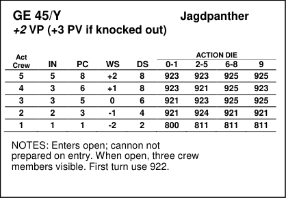

situation. Thus, if a paragraph calls for an immobilized tank to
move, ignore the movement part of the paragraph.

The actions of a German car depend on the action paragraph of the driver. Each German who can drive a car has a
column of paragraph numbers on his card that are used when
he drives the vehicle, as instructed by other paragraphs during
the mission.

A German tank will fire its main gun at the building wall
when instructed to fire at a soldier in the building (getting the
+4 modifier). It will fire only its MGs at a soldier visible behind a stone wall, and its main gun at the wall when the soldier
there is “known” to it but invisible (prone).

If a vehicle is instructed to Move Fast but in fact only
spends the Slow MP because it ends its movement (due to obstacles, because it arrived at the destination, whatever), it also
spends only the Crew Points for Move Slow.

**17/9 Accident Checks**

Certain events may cause the driver or crew of a vehicle to
make an Accident Check to determine whether or not an accident occurs. The game is not a simultaneous movement game;
therefore, the accident procedure generates accidents that “interrupt” the normal course of play. For example, a vehicle
moves continuously in reality, but not so in this game. Thus,
when a vehicle has an accident, it is assumed to be moving and
moves out of sequence in the game. An Accident Check is
made for the following reasons:

1. The instant a vehicle exceeds its slow MPA.

2. When a car’s driver, wheels, or body is hit in fire combat.
3. When the driver of a car becomes panicked or wounded as a
result of combat.

**PROCEDURE**
To conduct an Accident Check, roll one die:

 If the result is equal to or less than the Driving Skill of the
driver or crew, no accident occurs.

 If the result exceeds the Driving Skill of the driver or crew,
an accident may occur. Roll the die again, and refer to the Accident Table to find out what happens.

**17/10 Vehicles, Minefields, and Boobytraps**
**Tanks.** A tank that enters a hex with a minefield or boobytrap
is unaffected and its crew unharmed. The boobytrap is eliminated and the minefield remains. _**Exception**_ : In Mission 7, the
US is provided with anti-tank mines. These mines are detonated only when the hex they occupy is entered by a tank. If a
tank enters such a hex, it is automatically immobilized, while a
car is disabled.

**Cars.** When a car enters a hex with a minefield or boobytrap,
no PC Check is conducted; detonation is automatic. The vehicle is immediately disabled in the mine hex, and each soldier
suffers a panic result. If a booby-trapped hex is entered, the
driver makes a PC Check; if successful, there is no effect, but
the boobytrap remains. If the check fails, the car is disabled
and the soldiers in the car panic.

**17/11 Grenades and Satchel Charges**
**Tanks.** When a tank is open, a grenade can be tossed into the
vehicle as if through a building aperture. The penalty for
throwing through a non-adjacent aperture applies unless the
throwing soldier is in the same hex as the vehicle. If a grenade
explodes inside a tank, all occupants are killed and the vehicle
is disabled. A grenade has no effect on a closed tank.

A satchel charge can be thrown into an open tank in the
same way as a grenade. Furthermore, a satchel charge thrown
into a tank’s hex, not into the tank itself, can disable the vehicle. If the satchel charge lands in the hex, roll on the Satchel
Charge Outside row of the Damage Table. If the result is an
incapacitated or kill, the tank is disabled; any other result is no
effect.

**Cars.** A grenade can be thrown into a car as if thrown into a
building. The penalty for throwing through a non-adjacent aperture applies unless the throwing soldier is in the same hex as
the vehicle. If a grenade explodes inside a car, the vehicle is
disabled and the occupants roll on the Grenade Inside row of
the Damage Table to determine their wounds (they are considered prone). A grenade thrown into a car’s hex can disable it. If
the grenade lands in the hex, roll on the Grenade Outside row
of the Damage Table. If the result is incapacitated or killed, the
vehicle is disabled; any other result is no effect. If the vehicle
is successfully disabled, roll again on the Grenade Outside row
once for each soldier in the vehicle.

A satchel charge can be thrown into a car, like a grenade,
disabling the car and causing the occupants to roll on the

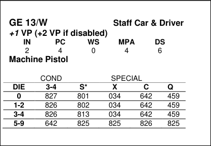

_**AMBUSH! RULES: PAGE 33**_

Satchel Charge Inside row of the Damage Table (they are considered prone). If the satchel charge is successfully thrown into
the car’s hex, instead of into the car, the car is automatically
disabled. Roll once for each soldier on the Satchel Charge Outside row of the Damage Table, treating the soldiers as prone.

**Scattering.** When an attempt to throw a grenade or satchel
charge into a tank or car fails, the scatter procedure is modified
as follows:

 If the throwing soldier is in the same hex as the vehicle, use
Diagram A in section **10/3**, except on a roll of 6-9 the grenade/satchel will scatter into the target hex outside the vehicle,
where the usual grenade/SC procedure is used (PC check etc.).
It can damage all soldiers in that hex, including the thrower.
However, the thrower himself need not conduct a PC check to
react to the grenade (he is already aware of it); if he has an
action left, he may immediately remove the grenade, or if not,
he may fall prone immediately. The thrower is assumed to be
directly behind the vehicle when determining direction of the
throw.

 If the throwing soldier is in a hex adjacent to the vehicle,
use Diagram A. However, a roll of 6-9 will scatter the grenade
into the vehicle’s hex, not into the vehicle itself, where the
usual grenade/SC procedure is used (PC check etc.). It can
damage all soldiers in that hex.
 If the throwing soldier is in neither the same nor an adjacent hex, use Diagram A or B, as usual. Should the above procedure scatter a grenade or satchel charge into a building
through a wall with no aperture, follow the guideline provided
in **10/3** (i.e., the grenade or satchel charge will bounce off the
wall into a different hex). Note that a grenade can never scatter
back into the inside of a vehicle or into the thrower’s hex.

**17/12 Running Over Soldiers**

A tank or car may run over enemy and friendly soldiers.
When a vehicle enters a hex containing one or more friendly
soldiers, make an Accident Check. If the check is successful,
you miss the soldiers. If the check fails, each active soldier
about to be run over makes a PC Check; those that succeed get
out of the way and are unharmed. They remain in the same
hex, but are considered out of harm’s way. Those that fail or
are inactive are hit. If hit by a tank, they are immediately
killed. If hit by a car, each soldier hit rolls as if hit by bolt rifle
fire, and the car must roll on the Accident Table once more for
itself.

When a vehicle enters a hex containing enemy soldiers, a
similar procedure is used. The only difference is that you make
your Accident Check to hit the enemy, not to miss them. Thus,
if you succeed in rolling against your Driving Skill, you may
hit the enemy. The enemy first gets to make PC Checks, as
above; those that fail are hit. An incapacitated enemy soldier is
automatically hit and killed.

If a US vehicle attempts (and fails) to run over a German
soldier and wants to try again in the same turn, the vehicle
must exit the hex, turn around sharply (1 MP), and conduct an
Accident Check in the hex where it performed the sharp turn.
If successful, the vehicle can return to the hex containing the
German soldier and once more attempt to run him over.

**17/13 Tanks**

There are three different tanks depicted in this game: the
German Panzer IV tank, the German Jadgpanther tank destroy

er, and the US Sherman medium tank. Every tank has its own
card, identified in the mission briefing or in a paragraph. Each
tank card lists its ratings depending on the size of the crew.

The Panzer IV and Sherman tanks have three weapons: the
cannon and coaxial medium machinegun are in the turret and
can fire in any direction. However, only one of these can be
fired in one turn. The bow medium machinegun is in the body
of the tank and can be fired in the same turn as the cannon or
coaxial weapon, but can be fired only at a target in front of the
tank (as defined in the facing diagram).

The Jagdpanther has two weapons: the cannon and bow
medium machinegun. The cannon is mounted in the body, not
on a turret, and thus can fire only at a target in front of the
tank. The bow machinegun can fire only at a target in front of
the tank as well, although it can be fired in the same turn as the
cannon. If the Jagdpanther is ever immobilized, it can fire its
cannon only down the single hex row that the front of the tank
faces. This reflects the limited traverse of the gun. The machinegun can still fire in the forward arc, however.

A Panzer or Sherman can fire its cannon and coaxial machinegun at a target into the same hex as the vehicle. They
cannot fire their bow machineguns, however. A Jagdpanther
cannot fire either of its weapons (cannon or bow machinegun)
at a target into the same hex. (Per **17/12**, Vehicle Facing, if
both attacker and target occupy the same hex, the attacker has
his choice of which side to attack.)

**TANK ACTIONS**

A tank receives turns in a Round just as a soldier does.
When a tank receives a turn, it can spend a number of Crew
Points up to the number of men currently in its crew to perform any of the following actions. A single task from this list
cannot be conducted more than once in a single turn.

**Aimed Fire with Cannon (2 Crew Points).** The cannon and
coaxial machinegun cannot be fired in the same turn. The cannon must already be loaded. When a cannon is fired, it becomes unloaded. A tank never runs out of cannon ammo or
jams its cannon.

**Load Cannon (1 Crew Point).** The cannon cannot be reloaded
in the same turn in which it fires, or in which the coaxial machinegun is fired.

**Aimed Fire with Bow Machinegun (2 Crew Points).** Target
must be in front of the tank. Bow machineguns never run out
of ammo, but they can jam.

**Snap Fire with Bow Machinegun (1 Crew Point).** Target
must be in front of the tank.

**Aimed Fire with Coaxial Machinegun (2 Crew Points).** Cannot load or fire the cannon in the same turn in which the coaxial machinegun is fired. Coaxial machineguns never run out of
ammo, but they can jam.

**Snap Fire with Coaxial Machinegun (1 Crew Point).** Cannot
load or fire cannon in same turn in which the coaxial machinegun is fired.
**Move Slowly (2 Crew Points).**
**Move Fast (3 Crew Points).** Vehicle must be open.
**Open or Close Tank (all Crew Points).** Cannot be combined
with any other task in the turn. Place a Closed marker on the
tank.

_**AMBUSH! RULES: PAGE 34**_

# **Mission 2: Advance on** **Chasoul**

August, 1944. Your squad’s parent division is racing
across France toward the German frontier in the face of crumbling German resistance. While your regiment awaits more
fuel, your men are sent ahead to scout out the small town of
Chasoul. With the Germans retreating faster than you can advance, no opposition is expected, and your men should be able
to occupy the village until relieved.

**YOUR SQUAD**

You can use the pre-generated squad, your squad from
Mission 1, or a new squad. Regardless of which you use, buy
new equipment from the Equipment Costs Chart using your
squad’s Equipment Points.

**SET UP**
Use Map B. The top of the map is the north edge. Your soldiers can enter the map in any hexes on the west edge between
A6 and A15 (inclusive). No markers begin the mission on the
map. There are no special rules in this mission, and the water
barrier on the map is considered a stream. The Activation Lev

# **Mission 3: A Cold Morning in** **Belgium**

Your squad, on garrison duty in a quiet sector of the front,
is bivouacked in a small village just east of a running river. On
this misty, snowy morning, your men have been ordered to
patrol nearby bombed out buildings to check for German
scouts.

**YOUR SQUAD**

You can use the pre-generated squad, your own continuing
squad, or you can generate a new squad. Buy all new equipment using your squad’s Weapon Points, and receive a free
radio.

**SET UP**

Use Map B. The top of the map is the east edge. Place
your soldiers in three different buildings of your choice. Your
squad has a jeep that you can place in any clear hex adjacent to
a road. Building hex L10 contains a fuel dump with dozens of
full gas cans. Unlike other missions, this mission has no Activation Levels, because the Germans all enter by random event.

# **Mission 4: D-Day Night Drop** **to Destiny**

D-Day, 6 June 1944. In the early morning, your squad’s
parent unit is paratrooping on to the Cotentin Peninsula in support of the US landings at Utah Beach. Your squad has been
assigned to capture, intact, two bridges in a small hamlet near
the town of Carentan. Opposition is expected, although reconnaissance has shown no presence of tanks or heavy weapons in
the immediate vicinity of the drop zone.

**YOUR SQUAD**

You can use your continuing squad, the pre-generated
squad, or a new one. Regardless of which squad you use, buy
all new equipment within the following restrictions. Since your
mission is a night paradrop, you are restricted in the equipment
you can use. You can buy only six types of weapons:

Carbines
Sub machineguns
Automatic Rifles

els are as follows:

**c1:** 0-1. **c2:** 0-3. **c3:** 0-5. **c4:** 0-6. **c5:** 0-7. **c6:** 0-6.

**VICTORY**

You need 25 Victory Points to win. You receive one Victory Point for each building hex that any of your soldiers enter.
Other ways of gaining VPs may be revealed during the mission. The mission ends in one of two ways:

1. All the building hexes have been entered by US soldiers,
and all your active soldiers are in the railroad station ( 06, P5,
and Q5 ).

2. All your active soldiers have exited the map from any valid
entry hex ( A6 through A15, inclusive).

VP loss for an incapacitated soldier can be avoided by
moving him off the map from hex A6 through A15 or, if all
building hexes have been entered, by moving him into the railroad station.

**SPECIAL RULES**
**Weather.** A light mist over the area reduces visibility to six
hexes for the duration of the mission, unless stated otherwise
in a paragraph.

**Paragraph Checks.** When in Action Rounds, do not conduct
Paragraph Checks when your soldiers enter hexes. Paragraph
Checks for hex entry are conducted normally during Operations.

**River.** The water barrier from hex A6 to hex Y17 is a river. A
river cannot be entered except by crossing on an intact bridge.

**VICTORY**

You need 25 Victory Points to win. You receive one Victory Point for each of the following hexes that any of your soldiers enter: A3, A4, B3, C3, T3, U4, and V3 . Other methods of
Victory Point gain will be revealed during the mission. VP loss
for an incapacitated soldier can be avoided by moving him off
the map from hex A13 through A19 (inclusive). The method by
which this mission ends will be revealed during play.

Pistols
Grenades

Bazookas

You cannot buy machineguns or semi-automatic rifles (M1 Garands). A soldier can carry only one Port Box of weapons
and cannot carry bazooka ammo.

In this mission, you are given a weapons cache that lands
by parachute with you. This cache can carry 4 Port Boxes of
weapons and 8 Ammo Boxes of ammo. You can put equipment and ammo of your choice into the cache, subject to the
five weapon type limit of this mission. Bazookas, automatic
rifles, and bazooka rounds must be put in the cache. The cache
enters play like a soldier, drifting onto the map and landing. It
has two sides to its counter: closed and open. When the cache
counter lands, it remains closed-side up until opened. To open
it, a soldier must occupy the same hex, crouching and spending

_**AMBUSH! RULES: PAGE 35**_

one Action to open it. Thereafter, soldiers can use the Pick
Up/Exchange Equipment action in Operations or Rounds to
remove its contents. The cache can be lost if it lands in the
river; otherwise, it will be unharmed by the landing.

**SET UP**

Use Map B. The top of the map is the north edge. Your
soldiers set up on the map according to the paradrop rules (see
below). No markers begin the mission on the map. The Activation Levels are as follow:

**c2:** 0-2. **c3:** 0-5. **c4:** 0-8. **c5:** 0-8. **c6:** 0-8.

Activation is not possible during Condition 1.

**PARADROPPING PROCEDURE**

This mission begins with your squad drifting in from the
east edge of the map. To begin, place your soldiers and the
weapons cache on the hexes Y6 through Y15 (inclusive), _**one**_
_**counter per hex**_ . Then conduct the following procedure. Complete the landing of one counter before beginning the movement of another.

**1. Drift Movement**
The counter drifts one hex at a time, using the drift procedure
below.

**2. Landing**
When the message, Land, indicates that the soldier has landed,
use the landing procedure below to see if he is injured. The
weapons cache is never affected by its landing, except if it
lands in the river (in which case it is lost permanently).

**3. Repeat Steps 1 and 2**
Repeat the first two steps until all counters have landed, then
continue to Step 4.

**4. Put new Condition into Effect**
Unless a paragraph indicated otherwise, go to Condition 2.

**5. Paragraph Checks**
Make a Paragraph Check for each hex occupied by a US soldier, active or inactive, but not one for the weapons cache. Use
the procedure in Activation below.

**6. Commence Rounds or Operations**
If an Activation occurred in Step 5, then commence Rounds.
Otherwise, commence Operations as usual.

**DRIFT**

After you have set up your counters, one per hex, in hexes
Y6 through Y15, choose one to move first. The drift and landing of this counter must be finished before beginning another.
Roll one die to determine which hex the counter enters when it
drifts. If the result is even, the counter drifts one hex northwest
of its current location. If the result is odd, it drifts one hex
southwest of its current location.

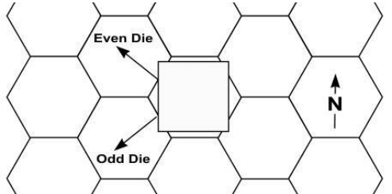

Make a paragraph Check for the new hex occupied by the
counter. If the message. Land, appears, the counter lands; otherwise follow the instructions in the paragraph listed. If the
counter does not land, roll again for drift and enter the indicated hex, making a new Paragraph Check. Continue this procedure until the counter lands.

**LANDING**

When a counter receives a Land message from a Paragraph Check, it lands in that hex. After all soldiers and the
cache have landed, the Condition changes. Put Condition 3
into effect if one or more US soldiers were fired upon in Condition 1; otherwise, go to Condition 2.

The type of terrain in the landing hex may affect the quality of each landing. The cache lands intact unless it lands in the
river. It if lands in the river, roll a die to determine if it is lost;
otherwise, no die roll is made for other terrain types. With soldiers, roll one die for each counter and locate the result under
the terrain in which he landed to determine if he is injured.
When a soldier lands, place a Prone marker on him to indicate
his stance. In addition, place a Parachute marker on him, 2-side
up, indicating that his chute is on and it requires two actions to

remove.

When a counter lands, roll one die and consult the terrain
type of the hex in which it landed:

**River**
**0-1:** Just misses the river! The soldier or cache lands on hex
north of the river hex. **2-5:** Cache lands in the river and is lost!
Soldier lands in the river, but is able to struggle out of his harness and get to shore. Place the soldier on an adjacent all-land
hex, determined at random, crouching. The soldier has lost all
his equipment and ammo; erase his Port and Ammo Boxes. **6-**
**9:** Soldier or cache lands in river and is swept away! The soldier drowns and all his equipment is lost. The cache is lost.

**Clear or Road**
**0-8:** Good landing! **9:** Bad landing! The soldier is wounded.

**Cover or Brush**
**0-8:** Good landing! **9:** Bad landing! Roll one die again; on a
roll of **0-4**, soldier is wounded; on a roll of **5-9**, soldier is incapacitated.

**Rough or Woods**
**0-4:** Good landing! **5-8:** Bad landing! Roll one die again; on a
roll of **0-5**, there is no effect; on a roll of **6-9**, soldier is wounded. **9:** Roll one die again; on a roll of **0-4**, soldier is wounded
(place him in a clear hex of your choice adjacent to landing
hex); on a roll of **5-9**, soldier is incapacitated (place him a clear
hex, determined at random, adjacent to landing hex).

**Building**
**0-3:** Just missed it! Roll for drift again. **4-7:** Roll one die; on a
roll of **0-4**, good landing (place soldier in clear hex of your
choice adjacent to building); on a roll of **5-9**, soldier is wounded (place him in clear hex of your choice adjacent to building).
**8:** Roll one die; on a roll of **0-4**, soldier is wounded (place him
in a clear hex of your choice adjacent to building); on a roll of
**5-9**, soldier is incapacitated (place him in a clear hex, determined at random, adjacent to building hex). **9:** Roll one die; on
a roll of **0-4**, soldier is incapacitated (place him in a clear hex,
determined at random, adjacent to building hex); on a roll of **5-**
**9**, soldier is killed (place him in a clear hex, determined at random, adjacent to building hex).

**ACTIVATION ON LANDING**

After all US counters have landed, make a Paragraph
Check for each hex occupied by a US soldier (do not make a
check for a hex occupied solely by the cache). If a German
activation occurs, place the new German on the map, but _**do**_
_**not commence Rounds**_ . Note which side was to receive the
advantage and two turns, and continue making Paragraph
Checks. Complete all Paragraph and Activation Checks before
beginning Rounds.

When Rounds are begun, all Germans activated are used,
but only one Activation result is used to determine who has the
advantage and who receives two turns. Ignore US awareness
references; all US soldiers are automatically aware when they

_**AMBUSH! RULES: PAGE 36**_

land. If more than one Activation occurs and if in Condition 2
when the Activations occur, use the result most advantageous
to the US. If in Condition 3, use the Activation result most
advantageous to the Germans.

**EXAMPLE:** _The US lands and Condition 2 is put into effect. Three_
_Germans were activated during the landing. One Activation para-_
_graph said “Commence Rounds. US advantage.” The second said,_
_“Commence Rounds. US advantage. All US soldiers that can see_
_hex H-14 are automatically aware. All aware US soldiers, that do_
_not panic, receive 2 turns this Round.” The third said, “Commence_
_Rounds. German advantage.” In this case, the second result is_
_used, because the Activation occurs in Condition 2 and it is the_
_most advantageous to the US. However, you would ignore the US_
_automatic awareness reference. Had it been Condition 3, the last_
_result would have been used, since it is the most advantageous to_
_the Germans. If in Condition 3 and only the first and second results_
_had occurred, the first would have been used, because it is better_
_for the Germans than the second one._

Each soldier must remove his chute before he can move or
perform any other action.

**PARACHUTE REMOVAL**

If Rounds begin when the landing occurs, all US soldiers
are considered prone, unless otherwise specified by the terrain
result in Landing (above). The soldier must remove his parachute before he can perform any other action. To remove the
chute, he must be crouching or standing. It takes two actions to
remove. The actions need not be consecutive. When the first
action is used, turn the Parachute marker over to its 1-side.
When the second action occurs, remove the Parachute marker.
Once removed, the soldier can perform actions normally. It is
not possible to remove another soldier’s parachute, and a panicked soldier cannot remove his own.

If Rounds do not begin when the landing occurs, commence Operations. The parachutes are automatically removed
in Operations.

# **Mission 5: Operation Pick-** **pocket**

4 July 1944. Your squad has volunteered for a dangerous
commando raid deep behind German lines. Your mission is to
slip into Holland, with the aid of the Dutch underground, and
raid a hidden German rocket base near The Hague. Allied high
command is very interested in seeing documents for the rumored V-2 rocket and in having the base destroyed.

**YOUR SQUAD**

Buy new equipment for your squad. Since you are travelling light, you cannot buy the following:

Automatic Rifles
Bazookas
Medium Machineguns

Within these limitations, you can buy any of the equipment on the Equipment Costs Chart. In addition, you receive
two satchel charges free.

**SET UP**

Use Map B. The top of the map is the north edge. Your
soldiers can enter the map on the south or west edges, between
hexes A12 and L19 (inclusive). No markers begin the mission
on the map. The Activation Levels are as follows:

c1: 0-1. c2: 0-3. c3: 0-5. c4: 0-7.

**SPECIAL RULES**

**Night Visibility.** The mission occurs in the very early morning,
and visibility is reduced to five hexes for the duration of the
mission. A soldier can trace an LOS only five hexes.

**River.** The water barrier from hex A6 to Y17 is a small river. It
cannot be entered except by crossing on an intact bridge. If a
soldier parachutes into the water, there is a good chance he will
drown.

**VICTORY**

You need 10 Victory Points to win. You receive 4 Victory
Points if you capture a bridge intact by unwiring the German
explosives under it. It takes four turns to unwire a bridge. The
same soldier need not expend all four turns; they can be split
between two or more soldiers. In addition, the turns need not
be made consecutively. Keep track of turns on the Notes section of the Squad Record. Once unwired, a bridge is captured
and cannot be blown up by the Germans.

If you capture both bridges, you receive 10 Victory Points,
not 8. You also receive VPs for the Activation of Germans and
their capture, as revealed in the mission. VP loss for incapacitated soldiers cannot be avoided in this mission. The mission
ends in one of three ways:

1. If in Condition 4, 5, or 6, the game ends if there are no active Germans on the map and both bridges are captured and/or
blown.

2. All your active soldiers have exited the map, from any map
edge hex.

3. All US soldiers are killed.

**SPECIAL RULES**

**River.** The water barrier from hex A6 to Y17 is a river. A river
hex can be entered only by crossing an intact bridge or by
crossing at a ford. The locations of fords will be revealed by
paragraphs during play. When revealed, place a ford landmark
in the hex. A ford hex can be entered from any adjacent land
hex, regardless of the facing of the ford marker.

**VICTORY**

You need 15 Victory Points to win. You will be awarded
Victory Points for finding documents and destroying installations as revealed during play. The VP award for documents
only counts if your soldier exits the map with the documents.
When documents are found, note the soldier carrying them on
your Squad Record. Should a carrying soldier be killed, another soldier can pick up the documents, using the Pick
Up/Exchange Equipment action. The mission ends only when
all your active soldiers have exited from the map from any
valid entry hex ( A12 through L19, inclusive).

VP loss for an incapacitated soldier can be avoided by
moving him off the map from hex A12 through L19 .

_**AMBUSH! RULES: PAGE 37**_

# **Mission 6: Pleasure Boating** **to the West Wall**

16 January 1945. The US army has reached the German
fortified line called the West Wall. Near the German town of
Trier, a cluster of bunkers are holding up the US advance. Repeated attacks and B-17 bombings have failed to destroy the
bunkers. Your squad has been volunteered for a dangerous
mission – approach the West Wall by canoe at night and take
out the bunkers.

**YOUR SQUAD**

Buy new equipment for your squad, keeping in mind that
you need to destroy concrete bunkers. In addition, you receives
four canoes and four satchel charges free.

**SET UP**

Use Map A. The top of the map is the north edge. Your
soldiers enter the map in hex H1 by canoe, as described in the
canoe rules. The following markers begin the mission on the

map:

**Craters:** G7, K8, L12, L15, K18, M17 .

**Rubble:** K13, L13 .

The Activation Levels are as follow:

**c1:** 0-1. **c2:** 0-3. **c3:** 0-5. **c4:** 0-7.

**SPECIAL RULES**

**River.** The water barrier from hex H1 to O19 is a river and can
be crossed only by an intact bridge or by canoe.

**Night Visibility.** The mission occurs at blackest midnight; thus
visibility is reduced to five hexes for the duration of the mission. A soldier can trace an LOS only 5 hexes, excluding his
own hex.

**Canoes.** The US has four canoes, each of which can carry two
soldiers. Furthermore, each canoe can carry two Port Boxes of
equipment, which is recorded on the Notes section of the
Squad Record. A canoe can carry a third soldier instead of
equipment in its Port Boxes (which is useful in taking out
wounded soldiers). When a soldier is in a canoe, he can carry
his ammo and personal weapon, but any bazookas, medium
machineguns, and satchel charges must be put in the canoe’s
two Port Boxes.

Canoes move one hex at a time in Operations, and Paragraph Checks are made as usual. During Rounds, each canoe
has a Movement Point Allowance of 4 and moves using the
actions in **6/7**, such as Move/Snap Fire or Move. A canoe
spends one Movement Point per river hex entered and can
move in both directions on the river. A canoe must be manned
by two active US soldiers in order to move. It can move only
once per turn, even if both soldiers receive actions in the same
turn. The canoe moves when one of its soldiers receives a turn.
For example, If soldier A receives two turns and soldier B receives one, the canoe can move twice: once in turn 2 for soldier A’s action and again in turn 1 for one of the two soldier’s
actions. The front of the canoe faces the river hexside the canoe will enter next. Canoes can turn in any direction in a hex at
no additional cost.

A canoe can beach in any hex adjacent to the river at a
cost of one Movement Point in Rounds, and at no additional
cost in Operations. When it beaches, turn a canoe counter over
to its beached side. The soldiers are still in the beached canoe
until they exit the canoe. To enter or exit a canoe, the canoe
must be beached and the soldier must occupy, the canoe’s hex.
He must then spend one Movement Point, if in Rounds, or one
action, if in Operations, to enter the canoe. Equipment stored

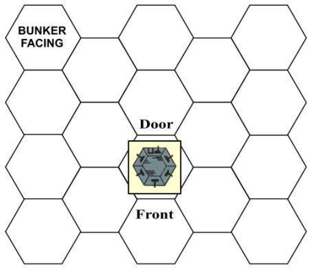

in the canoe’s Port Boxes may be removed using the Pick
Up/Exchange Equipment action.

Soldiers can engage in all forms of combat from their canoes. When fired on, they are considered crouching in clear
terrain. When a German fires at a canoe, the targets are the
soldiers in the canoe; however, if the fire misses, there is a
chance the canoe may be hit. If a German fire misses, roll one
die; on an even result, the fire hits the canoe. When a canoe is
hit, it is punctured and must beach to avoid sinking. Beaching
must occur during the next turn that canoe receives; otherwise
it sinks. If it sinks, all equipment in the canoe’s Port Boxes is
lost. Any soldiers in the canoe survive and are placed in a land
hex adjacent to that river hex, with all their personal equipment
intact.

**Bunkers.** The Germans have an unknown number of hidden
bunkers that you must find and knock out. Each bunker faces
all six of its hexsides and has a door on one side. The German
activation paragraph will indicate which side the door faces.
All six faces of the bunker are considered window apertures
for combat purposes, even the door side. Treat the bunker as a
building with all windows for LOS purposes.

When firing at a bunker, you can aim at a soldier visible
through an aperture, if visible, or you can choose to fire at the
bunker itself. To fire at a soldier, the soldier must be crouching
or standing. However, a crouching soldier cannot be fired at if
your soldier is adjacent to the bunker and is also crouching
(see LOS, Building Hexes). A prone soldier in a bunker cannot
be seen through a doorway (even if the door has been
breached) unless the sighting soldier is in a hex adjacent to the
door (per LOS rules, Building Hexes). When firing at the bunker, there is a +2 modifier. Thus, the chances of hitting the
bunker are much greater than the chance of hitting an individual soldier through an aperture.

When attacking the bunker itself with fire combat, use the
following procedure. First, resolve the fire to determine
whether or not you hit the bunker. If you miss, there is no effect. If you hit, then determine the side of the bunker that has
been hit. There are only two possible sides: the front and the
door.

When the facing has been determined, roll one die and locate the result on the following chart to determine the part of
the building hit, much as you would do in attacking a tank.
Then resolve the combat using the Damage Table section of
the weapon being fired.

_**AMBUSH! RULES: PAGE 38**_

**Bunker Hit Tables**

FRONT FACING DOOR FACING

DIE PART HIT ARMOR DIE PART HIT ARMOR
**0-7** Wall H **0-4** Wall H
**8** Aperture M **5-7** Door L
**9** Crew  - **8-9** Crew  
_***If bazooka fire, treat as an aperture hit if front facing is fired up-**_
_**on, as a door hit if door facing is fired upon.**_

**DAMAGE EFFECTS**

**Wall.** If the wall is hit and the penetration result is an H, the
bunker is destroyed and all Germans inside are killed. Turn the
bunker counter over to its destroyed side. If the penetration
result is less than H, no effect.

**Aperture.** Like a wall, except an H or M penetration result
causes the destruction.

**Door.** Any H or M penetration result causes the bunker to be
destroyed. An L penetration result causes the door to be
breached. If breached, treat that hexside like a doorway instead
of a window (the door has been blasted open). If can be
crossed by US soldiers to enter the bunker.

**Crew.** If the crew is prone, the fire misses ( _**Exception**_ : If firing
through the door which was previously breached). If the crew
is not prone, then determine the target hit at random. Resolve
damage against that soldier alone, unless using aimed fire with

# **Mission 7: Bait for the Trap**

8 August 1944. The German Seventh Army is counterattacking toward the French town of Mortain. The purpose –
close the Allied breakout from the Normandy beachhead. Allied high command has determined to draw the Germans into
pushing so far that the planned Allied counterattack will encircle the entire German army. Your squad stands directly in the
path of the oncoming 2 [nd] Panzer Division. Your mission is to
delay the Germans and make them pay for the ground they
gain, then retreat safely to the rear toward the main US line.

**YOUR SQUAD**

Buy equipment for your squad, keeping in mind that a
tank attack is expected. In addition, you receive a jeep and two
anti-tank mines, at no cost.

**SET UP**

Use Map A. The top of the map is the south. You can set
up your squad anywhere you wish on the west side of the river
or within three hexes of the river on the east side. The Germans will enter from the east edge of the map. When setting up
on the east side, the three-hex range is counted from the river
to the setup hex, excluding the river hex itself. The jeep and
mines must also be set up within these limitations. Do not set
up your anti-tank mines in woods hexes, since tanks are large
vehicles that cannot enter woods. Your soldiers with bazookas
and medium machineguns can begin the mission with them
already prepared.

**SPECIAL RULES**

**Stream.** The water barrier from hex H1 to O19 is a stream and
can be crossed at any point by spending Movement Points as
summarized on the Movement Point Cost Chart.

**Anti-Tank Mines.** Use two minefield markers as your antitank
mines and set them up within the restrictions of the setup. An

an automatic weapon, in which case more than one soldier may
be hit.

A bunker can also be attacked by grenade or satchel
charge as if it were a normal building hex.

A bunker is considered knocked out for Victory Point purposes when all its original occupants have been killed or incapacitated and one of the following has occurred:

1. The bunker has been reduced to rubble.

2. A satchel charge has been set off inside the bunker. A satchel charge set off inside a bunker destroys the bunker for victory
point purposes but does not reduce it to rubble.

**VICTORY**

You need 12 Victory Points to win. You receive 6 Victory
Points for each bunker you knock out. You also receive Victory Points for the appearance of Germans. You lose Victory
Points for the incapacitation and killing of US soldiers. VP loss
for an incapacitated soldier can be avoided by moving him off
the north map edge. You can exit him by canoe if you choose.
When moving an incapacitated soldier by canoe, do not roll for
his death for each hex entered as you would on foot.

The mission ends the instant there are no active US soldiers on the map.

ti-tank mines explode only when a vehicle enters their hex;
soldiers can enter such a hex with no effect. A car that enters
an anti-tank mine hex is immediately disabled and all soldiers
in the vehicle roll for damage as if hit by a bazooka outside. A
tank that enters an anti-tank mine hex is immobilized and cannot move for the duration of the mission. It can. however, continue to fire.

**German Entry.** Since you are on the defense, the Germans
enter by Random Event. There are no Activation Checks in
this mission. Once you have set up your soldiers, roll for Random Events until a German is activated and Rounds commence. If you ever re-enter Operations (unlikely), and do not
wish to move any of your soldiers, roll for Random Events
again until another German enters and Rounds commence
again.

**VICTORY**

You need 5 Victory Points to win. You receive Victory
Points for the activation of Germans and their destruction (if
vehicles). You lose VPs for the incapacitation and killing of
US soldiers. VP loss for an incapacitated soldier can be avoided by moving him off the west map edge, from hex Y1 to Y19
(inclusive). Furthermore, you lose VPs for each German soldier or vehicle that exits the west map edge. The number of
VPs lost equals twice the VP value of the German. Thus, if a
German is worth 1 VP for activation and 1 additional if captured, you would lose 4 VPs if he exits the map.

The mission can end only during Condition 4. It ends the
instant there are no active US soldiers on the map. Important:
Germans still on the map when the mission ends do not cause
you to lose VPs. You lose VPs only for those Germans that
exit before the mission ends.

_**AMBUSH! RULES: PAGE 39**_

# **Mission 8: Dash for the** **Sambre**

Early September, 1944. As your parent division enters the
low countries, your regiment is assigned a company of Shermans for special infantry support. Yesterday, in the face of
heavy German mortar fire, you received orders to hold up west
of the Sambre River. But now, one of these precious tanks has
been dispatched to move ahead with your squad. Unfortunately, the final approach to the only bridge over the river in your
sector is a vulnerable raised road. Your men are to set out
ahead of the tank to clear the area leading to the bridge and to
secure the bridge itself. Once the tank has crossed the bridge,
you are to advance with discretion.

**YOUR SQUAD**

Buy new equipment for your squad.

**SET UP**

Use Map A. The top of the map is the north edge. Your
soldiers can enter the map in any hexes on the west edge between A1 and A6 (inclusive). No markers begin the mission on
the map. The Activation Levels for this mission are as follows:

**c1:** 0-1. **c2:** 0-4. **c3:** 0-5. **c4:** 0-6. **c5:** 0-7.

**SPECIAL RULES**

**The Tank.** The tank is not available to you at the start of the
mission, but is expected shortly. During the mission, a paragraph will state the availability of the tank and its card number.
The tank can enter play in hex A6 only. Remember, since a
tank is a large vehicle, it cannot enter a woods hex. See the
tank vehicle summary for the tank’s Hit Chart.

**The Sambre River.** The water barrier running from hex H1 to
O19 is a river, and may not be entered except were crossed by
an intact bridge.

**Design Credits**

**Design and Development:**
Eric Lee Smith and John H. Butterfield

**Design Assistance:**
Bob Ryer, Mark Herman, and Gerry Klug

**Graphics:** Ted Koller

**Rules Editing:** Bob Ryer

**Playtesting:**
Dave Cogger, Mark Herman, Erica Johnson, Nick Karp,
Michael Moore, Cosmo Prete, Bob Ryer, Kevin Wilkins

**Production:**
Ted Roller, Bob Ryer, Eric Lee Smith, Jim Talbot, Bob
Haynes, Colonial Composition, Monarch Services, Inc.

**Front Cover Art:** John H. Butterfield

**Back Cover Art:** Jim Talbot

**Project Oversight:** W. Bill

**Embankments.** In this mission, embankment hexsides present
no special hazard to foot soldiers, but are too steep for wheeled
and tracked vehicles. Vehicles are prohibited from crossing
embankment hexsides.

**Roadblocks.** During the past few days, your squad has repeatedly come upon roadblocks hastily constructed by the retreating Germans. Composed of logs and any available junk, these
barriers can be moved aside with some effort. A roadblock
encountered during this mission can be removed during Operations only. At least three active US soldiers must be in the
roadblock hex and you must conduct an Event Check. The
roadblock marker can then be removed from that one hex.

**Prohibited Hexes.** Certain hexes are keyed on the Mission
Cards with the message **“XXX”** to remind you that these hexes
cannot be entered.

**VICTORY**

You need 18 Victory Points to win. You earn one Victory
Point for each active soldier that exits the map from hex Y8 .
Other ways of gaining VPs may be revealed during the mission. The mission ends in one of two ways:

1. All active US soldiers have exited the map from hex Y8 . The
tank can remain on the map.

2. All active US soldiers have exited the map from hex A1
through A6 (inclusive). The tank can remain on the map.

VP loss for an incapacitated soldier can be avoided by
moving him off the map from hex A1 through A6 (if the second
mission ending is chosen) or from hex Y8 (if the first mission
ending is chosen).

**Errata and Clarifications:**
Lutz Pietschker

**Reformatting:**
Andrew Korson

Rev 1.0, May 2011

# **VEHICLE SUMMARY**

_**AMBUSH! RULES: PAGE 40**_

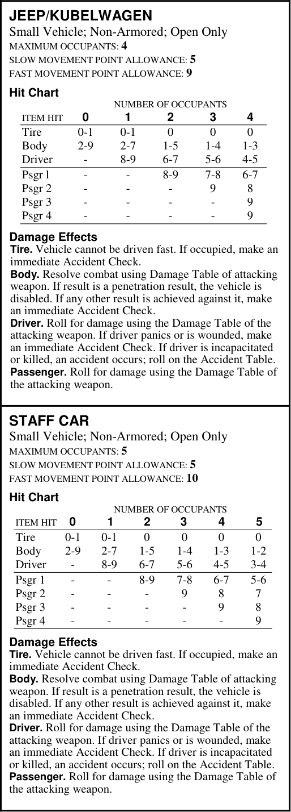

**(M):** Medium armor rating. **(H):** Heavy armor rating

.

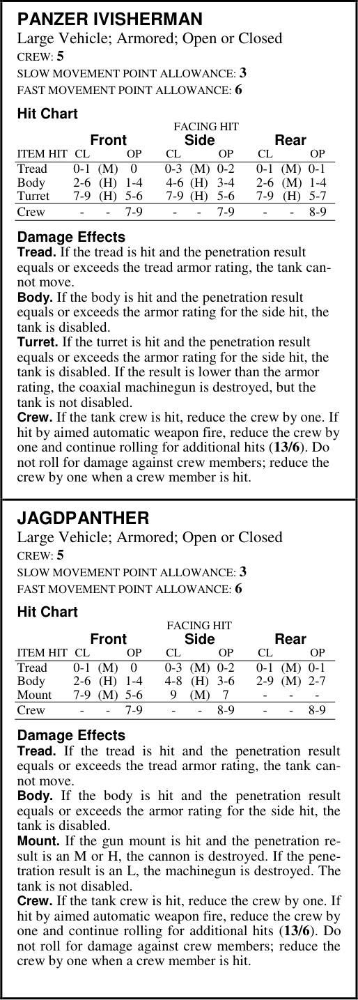

**CL:** Closed. **OP:** Open.
